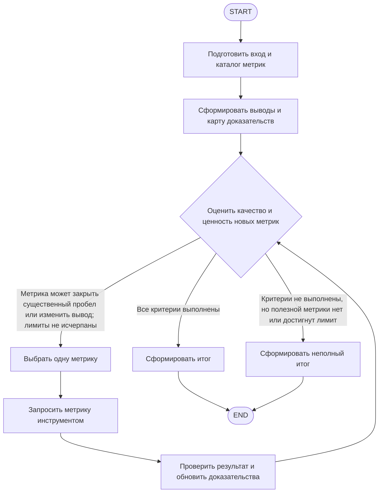

# S02-main-treatment

- Сценарий: `S2`
- Вариант: `treatment`
- Модель: `gpt-6-luna` (high)

## Ход 1 — запрос пользователя

Агент анализирует сводные данные, по необходимости запрашивает уточняющие метрики через инструменты и объясняет вывод. Продолжать итерации только ради достижения критериев качества анализа.

## Ход 1 — ответ агента

Понял задачу: агент анализирует сводные данные, запрашивает дополнительные метрики, когда они нужны для вывода, и повторяет цикл только пока это помогает выполнить критерии качества анализа.

Какой режим выбираете?

- **Проектирование с нуля** — разработать новую архитектуру. Рекомендую этот вариант: вы описали поведение агента, но не существующий граф для аудита или изменения.
- **Аудит архитектуры** — проверить уже существующий граф или описание.
- **Модификация архитектуры** — изменить действующую архитектуру.

Инструмент Superpowers, предписанный правилами обсуждения, в этом сеансе недоступен. До выбора режима архитектуру не детализирую.

## Ход 2 — запрос пользователя

Выбираю режим «Проектирование с нуля».

## Ход 2 — ответ агента

Нашёл официальные материалы LangChain по выбору фреймворка и основам LangGraph. Поиск в `specs/` репозитория не выявил подходящих спецификаций. Предлагаю вести проектирование в новом файле `specs/agent-analiza-metrik-2026-11-03.md`. Здесь я не буду его создавать: режим только для чтения.

Согласуем этот путь для обсуждения? После этого уточню критерии качества анализа — от них зависит, когда агенту следует запрашивать метрики и завершать итерации.

## Ход 3 — запрос пользователя

Согласен с рекомендуемым вариантом. Подготовь архитектурный ответ здесь в чате; не пиши код, не меняй файлы и не выполняй внешние действия.

## Ход 3 — ответ агента

Путь `specs/agent-analiza-metrik-2026-11-03.md` согласован. Соблюдаю режим только для чтения: архитектурный ответ будет здесь, без изменений файлов и внешних действий.

**Варианты архитектуры:**

- **LangChain `create_agent`** — проще для агента с постоянным набором инструментов. Но условие «продолжать только если следующая метрика поможет достичь критериев качества» будет в основном зависеть от поведения модели.
- **LangGraph `StateGraph`** — позволяет явно разделить анализ, проверку качества, выбор метрики, вызов инструмента и формирование ответа. Проверка качества может управлять циклом и остановкой. Это лучше соответствует требованию, хотя добавляет структуру и сложность.

Рекомендую **LangGraph `StateGraph`**: критерий качества анализа здесь управляет маршрутом выполнения, поэтому его полезно оформить как явную проверку. Deep Agents не предлагаю: в описанной задаче пока нет потребности в долгосрочном планировании, управлении файлами или делегировании. Такой выбор согласуется с [официальным обзором LangChain](https://github.com/langchain-ai/langchain-skills/blob/126c384d8552dcb476b226c244172186cc3f4328/config/skills/ecosystem-primer/SKILL.md) и [руководством по LangGraph](https://github.com/langchain-ai/langchain-skills/blob/126c384d8552dcb476b226c244172186cc3f4328/config/skills/langgraph-fundamentals/SKILL.md).

Согласовать `StateGraph` как основу архитектуры? Ограничение пока одно: критерии качества анализа не определены, поэтому без них нельзя надёжно задать условие остановки цикла.

## Ход 4 — запрос пользователя

Согласен выбрать `StateGraph`. Считай анализ достаточным, когда каждый существенный вывод подкреплён релевантными метриками, оставшиеся неизвестные перечислены, а дополнительные метрики вряд ли изменят вывод. Подготовь архитектуру здесь в чате, без кода, изменений файлов и внешних действий.

## Ход 4 — ответ агента

# Архитектура агента анализа метрик

## Цель и границы

Агент получает сводные данные, формирует существенные выводы, при необходимости запрашивает недостающие метрики через доступные инструменты и объясняет результат.

Считаем анализ достаточным, когда:

1. Каждый существенный вывод подкреплён релевантными метриками.
2. Оставшиеся неизвестные перечислены.
3. Среди доступных метрик не осталось такой, которая с заметной вероятностью изменила бы вывод.

Предполагаю, что инструменты предоставляют **чтение метрик без побочных эффектов**, а один запуск относится к одному вопросу и одному набору данных. Каталог инструментов и метрик ограничен явно доступным агенту списком. Если эти предположения неверны, потребуется скорректировать границы доступа и обработку длительных запусков.

## Architecture

Выбран `LangGraph StateGraph`: цикл запросов и остановку можно связать с явной проверкой критериев качества. Агент не запрашивает дополнительные метрики просто ради продолжения цикла.

Deep Agents не нужны для описанной задачи: пока нет потребности в долгосрочном планировании, управлении файлами или делегировании работы. `LangChain create_agent` был бы проще, но оставлял бы условие остановки в большей степени на усмотрение модели. Это соответствует рассмотренным [официальному обзору LangChain](https://github.com/langchain-ai/langchain-skills/blob/126c384d8552dcb476b226c244172186cc3f4328/config/skills/ecosystem-primer/SKILL.md) и [руководству по LangGraph](https://github.com/langchain-ai/langchain-skills/blob/126c384d8552dcb476b226c244172186cc3f4328/config/skills/langgraph-fundamentals/SKILL.md).

Маршрут цикла один: оценка → выбор метрики → вызов инструмента → проверка результата → оценка. Метрики запрашиваются последовательно: следующий запрос зависит от того, что показали предыдущие данные. Параллельные вызовы и `Send` не нужны.

## State

| Поле | Роль и тип | Читает / пишет | Объединение |
|---|---|---|---|
| `request` | Вопрос пользователя, включая требуемые период и разрезы, если они заданы | Все узлы / начальный узел | Перезапись только при инициализации |
| `summary` | Полученная сводка с доступными сведениями о периоде, разрезах и источнике | Анализ, оценка / инициализация | Перезапись при инициализации |
| `metric_catalog` | Список доступных метрик, инструментов, ограничений и стоимости запроса, если она известна | Выбор и оценка / инициализация | Неизменяемое поле на запуск |
| `claims` | Существенные выводы и ссылки на подтверждающие их метрики | Оценка и итог / анализ и интеграция | Перезапись актуального набора |
| `observations` | Полученные метрики с периодом, разрезом, источником и статусом проверки | Анализ и оценка / узел интеграции | Добавление через reducer |
| `unknowns` | Непроверенные факты и пробелы, способные ограничить вывод | Выбор и итог / оценка | Перезапись актуального списка |
| `metric_candidates` | Доступные метрики-кандидаты, их релевантность, ожидаемое влияние на вывод и стоимость | Выбор / оценка | Перезапись при каждой оценке |
| `query_history` | История запрошенных метрик, результатов и ошибок | Оценка и итог / узел интеграции | Добавление через reducer |
| `iteration_count` | Число циклов получения метрик | Оценка и выбор / узел интеграции | Перезапись с увеличением |
| `budget` | Максимум циклов, вызовов и времени на запуск | Оценка и выбор / конфигурация | Неизменяемое поле на запуск |
| `gate_decision` | `complete`, `need_metric` или `incomplete` | Маршрутизация / оценка | Перезапись |
| `report` | Итог с выводами, доказательствами, неизвестными и статусом полноты | Пользователь / формирование итога | Финальная перезапись |

Данные истории накапливаются. Актуальное состояние выводов, неизвестных и кандидатов перезаписывается одной оценкой за раз; параллельных записей в эти поля нет.

## Nodes

| Узел | Ответственность и зависимости | Результаты и ошибки |
|---|---|---|
| `prepare` | Проверить наличие вопроса и сводки, зафиксировать доступный каталог метрик и лимиты. Внешних вызовов нет. | При непригодном входе передаёт управление формированию неполного ответа с описанием того, чего не хватает. |
| `analyze` | Выделить существенные выводы из вопроса и сводки. Для каждого указать подтверждающие метрики и пробелы. Использует LLM. | Заполняет `claims`; не подтверждённые данными утверждения маркирует как гипотезы или неизвестные. |
| `assess` | Проверить критерии качества и оценить, может ли доступная метрика устранить существенный пробел или изменить вывод. Использует проверку структуры и LLM-оценку релевантности. | Устанавливает `gate_decision` и обновляет кандидатов. Не должен считать, что любое дополнительное уточнение полезно. |
| `select_metric` | Выбрать одну наиболее полезную и доступную метрику с учётом влияния на вывод, стоимости и оставшихся лимитов. | Передаёт запрос узлу инструмента. Если кандидата выбрать нельзя, направляет к неполному итогу. |
| `fetch_metric` | Вызвать подходящий разрешённый инструмент чтения метрик. | Сохраняет результат или ошибку в историю; не интерпретирует ошибку как нулевое значение метрики. |
| `integrate` | Проверить, что результат относится к нужному периоду и разрезу, добавить его как наблюдение и обновить счётчик. | Новые данные возвращаются на оценку. Неоднозначный или отсутствующий результат остаётся неизвестным. |
| `report` | Сформировать пользовательский ответ из подтверждённых выводов, оставшихся неизвестных и причин ограничений. | Отмечает результат как достаточный или неполный в соответствии с решением узла оценки. |

Единый узел оценки не должен просто «одобрять» предыдущий анализ. Проверка требует явного соответствия: каждый существенный вывод связан с релевантным наблюдением, а неизвестные не скрыты в формулировках. Для причинных выводов одних корреляционных или агрегированных метрик недостаточно.

## Edges и маршрутизация

Используются условные переходы. Для узла с условной маршрутизацией не добавляются параллельные статические edges, способные запустить альтернативный путь.

- `START → prepare → analyze → assess`.
- `assess → select_metric`, если критерии ещё не выполнены и есть кандидат, который способен устранить существенный пробел или изменить вывод, а лимиты не исчерпаны.
- `select_metric → fetch_metric → integrate → assess`.
- `assess → report`, если критерии выполнены.
- `assess → report`, если критерии не выполнены, но полезной доступной метрики нет или достигнут предел ресурсов; отчёт получает статус неполного.

## Execution и termination

На входе агент фиксирует вопрос, сводку, доступные инструменты и пределы одного запуска. Затем он строит карту существенных выводов и проверяет её по заданным критериям. Если данные указывают на конкретный полезный запрос, агент получает одну метрику и пересматривает карту доказательств. После каждого результата он оценивает кандидатов заново, поскольку новая метрика может сделать последующие запросы ненужными.

«Метрика вряд ли изменит вывод» — это оценка ожидаемой ценности информации: есть ли у метрики правдоподобный путь изменить существенный вывод, закрыть важный пробел или существенно изменить его квалификацию. Порог вероятности и допустимая стоимость пока не заданы; их нужно настраивать для конкретного домена. Без каталогизации доступных метрик агент может оценить только известные ему варианты, а не гарантировать, что полезных метрик нигде больше нет.

Остановка имеет три разных результата:

- **Достаточный анализ:** выводы подтверждены, неизвестные перечислены, значимых кандидатов на дополнительные метрики не осталось.
- **Неполный анализ:** лимит исчерпан, полезной метрики не удалось получить или существенный пробел не закрыт. Итог объясняет ограничения и не выдаёт его за достаточный.
- **Аварийный отказ:** вход или необходимый инструмент недоступен настолько, что содержательный вывод невозможен. Причина явно сообщается пользователю.

Бюджет циклов и вызовов обязателен, чтобы сбои оценки или инструментов не создавали бесконечный цикл. Конкретные числовые значения зависят от стоимости инструментов и требований к задержке; они пока не заданы.

## Error Handling и persistence

Для временных сетевых ошибок допустим ограниченный повтор вызова инструмента. Ошибка прав доступа, неподдерживаемый разрез, отсутствие данных или несовпадение периода не должны вызывать бесконечные повторы: они фиксируются как неизвестные и передаются на повторную оценку. Ошибка формата ответа инструмента также не трактуется как реальное значение метрики.

Для описанного одношагового анализа checkpoint и долговременная память не обязательны. Если позднее понадобится возобновлять длительные запуски, потребуется добавить checkpoint и идентификатор потока. Сам checkpoint не предотвращает повторный вызов инструмента после восстановления; для чтения это в первую очередь риск дополнительных затрат, поэтому полезно кэшировать результаты по инструменту, метрике, периоду и разрезу.

## Проверка архитектуры и заключение

Маршруты из `assess` определены для успеха, отсутствия полезных метрик, исчерпания бюджета и ошибок. Единственный цикл проходит через именованные узлы и возвращается к проверке качества; `START` не используется как точка возврата. Параллельных узлов и конфликтующих обновлений состояния нет. Ошибки и пределы ресурсов ведут к явному неполному результату, а не к ложному успешному завершению.

**Проблема:** пока не заданы доменная политика существенности выводов, каталог инструментов, числовые лимиты и порог, при котором ожидаемое влияние метрики оправдывает её запрос.

**Критичность:** существенная для условий остановки и полноты охвата доступных метрик.

**Последствия:** агент может запросить лишние метрики либо преждевременно решить, что новые данные вывод не изменят.

**Рекомендуемое исправление:** перед реализацией определить эти настройки и уточнить формат метаданных инструментов. До этого архитектура **требует доработки** по порогам и границам каталога, хотя основной граф и критерии завершения согласованы. Это архитектурная проверка целостности описания, не результат тестирования кода.
