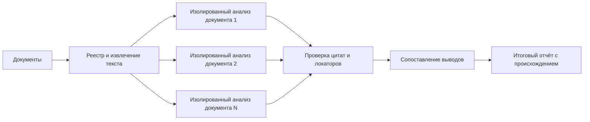

# S03-main-control

- Сценарий: `S3`
- Вариант: `control`
- Модель: `gpt-6-luna` (high)

## Ход 1 — запрос пользователя

Нужно независимо проанализировать множество документов, затем объединить результаты, сохраняя происхождение каждого вывода.

## Ход 1 — ответ агента

Рекомендую конвейер из двух этапов:

1. **Независимый анализ.** Каждый документ получает устойчивый ID и анализируется отдельно. Результаты сохраняются как отдельные выводы с цитатой или точным фрагментом, страницей/разделом и уверенностью.
2. **Сведение.** Сопоставляются сами выводы: совпадения, противоречия и уникальные наблюдения. Итог не стирает разногласия, а каждый вывод ссылается на исходные документы и записи анализа.

Так сохраняются и независимость первичного чтения, и проверяемая цепочка от итогового вывода до источника. Для прослеживаемости также стоит фиксировать версию документа и точное место фрагмента.

В репозитории не нашёл подходящей спецификации. Предлагаю новую: `specs/анализ-документов-с-происхождением-2026-11-03.md`. Superpowers, предписанный правилами взаимодействия, в доступных инструментах не обнаружен; в этой сессии я могу дать рекомендации только в чате. **Подходит ли вам предложенное имя спецификации?**

## Ход 2 — запрос пользователя

Выбираю режим «Проектирование с нуля».

## Ход 2 — ответ агента

Принято: проектируем с нуля; за основу обсуждения беру новую спецификацию `specs/анализ-документов-с-происхождением-2026-11-03.md`. В этой read-only сессии останемся в чате.

**Первое решение — как обеспечить независимость анализа.** Предлагаю анализировать каждый документ в отдельном изолированном контексте: анализатор видит только назначенный ему документ и возвращает выводы с цитатами и точными локаторами. Это снижает влияние соседних документов на первичный разбор; цена — повторный анализ общих тем появится только на этапе сведения.

Согласны с таким способом разделения?

## Ход 3 — запрос пользователя

Согласен с рекомендуемым вариантом. Подготовь архитектурный ответ здесь в чате; не пиши код, не меняй файлы и не выполняй внешние действия.

## Ход 3 — ответ агента

# Архитектура анализа множества документов с происхождением выводов

Система проходит четыре этапа: фиксирует исходные документы, анализирует каждый отдельно, сопоставляет результаты и формирует выводы с обратными ссылками на первичные источники.

## 1. Реестр документов

Для каждого документа создаётся запись с устойчивым ID, названием, версией и контрольной суммой. Зафиксированная версия нужна, чтобы выводы можно было проверить даже после появления обновлённого файла.

При извлечении текста сохраняются точные локаторы: страница и абзац, раздел, ячейка таблицы или иной подходящий адрес. Если файл отсканирован или структура документа не распознана надёжно, это отмечается в метаданных: качество извлечения влияет на проверяемость анализа.

## 2. Независимый анализ

Каждый документ передаётся анализатору в отдельном контексте. Он не видит другие документы и их анализы. Это сохраняет независимость первичных прочтений и уменьшает влияние формулировок из соседних источников.

Результат анализа состоит из отдельных записей, а не только из свободного резюме. Для каждого утверждения указываются:

- ID вывода;
- содержание своими словами;
- точная цитата или фрагмент, на котором он основан;
- ID документа и локатор фрагмента;
- тип: прямо сказано, выводится из текста, предположение или неизвестно;
- оговорки и уверенность анализатора.

Один вывод связывается с одним или несколькими фрагментами того же документа. Анализатор не должен представлять собственную интерпретацию как дословное утверждение источника.

## 3. Проверка происхождения

Перед сведением отдельный этап проверяет, что цитата существует в указанной версии документа, а локатор ведёт к нужному месту. Непроверенную цитату нельзя молча включать в итог: она помечается как требующая проверки или исключается из подтверждённых свидетельств.

Так ловятся ошибки извлечения текста, неверные ссылки и случаи, когда вывод точнее или категоричнее, чем исходный фрагмент.

## 4. Сведение результатов

Этап сведения получает проверенные записи анализов и сопоставляет их по темам и смыслу. Он группирует:

- выводы, согласующиеся между документами;
- расхождения и прямые противоречия;
- уникальные сведения, которые есть только в отдельных источниках;
- вопросы, по которым источники не дают достаточных данных.

Для каждого итогового вывода создаётся отдельная запись со ссылками на поддерживающие и, если есть, противоречащие ему исходные выводы. Учитываются дата, контекст и статус документов, если эти данные есть в реестре. Несколько документов сами по себе не означают независимого подтверждения: их выводы могут восходить к одному и тому же источнику.

## 5. Модель происхождения

Логически происхождение удобно хранить как граф:

`документ → фрагмент → вывод по документу → итоговый вывод`

Каждая связь указывает, какую роль играет источник: подтверждает, опровергает или задаёт ограничение. Поэтому читатель может пройти от любого итогового утверждения обратно к конкретному фрагменту документа.

## 6. Формат итогового отчёта

Для каждого итогового утверждения отчёт показывает формулировку, статус согласованности источников, список ссылок на фрагменты, противоречия и ограничения. Если источники расходятся, отчёт представляет обе позиции с их основаниями, а не скрывает расхождение в усреднённой формулировке. Уверенность анализатора сохраняется как вспомогательная оценка и не заменяет оценку качества и независимости свидетельств.

**Ключевой инвариант:** каждый вывод в итоговом отчёте должен иметь прослеживаемую цепочку до проверяемого фрагмента источника либо быть явно помечен как синтез, гипотеза или неподтверждённое обобщение.
