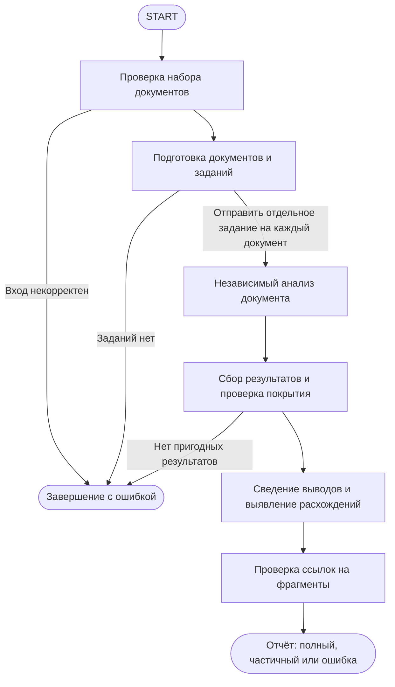

# S03-main-treatment

- Сценарий: `S3`
- Вариант: `treatment`
- Модель: `gpt-6-luna` (high)

## Ход 1 — запрос пользователя

Нужно независимо проанализировать множество документов, затем объединить результаты, сохраняя происхождение каждого вывода.

## Ход 1 — ответ агента

Для этой задачи возможны три режима:

- **Проектирование с нуля** — спроектировать поток, который параллельно анализирует документы и объединяет выводы с указанием источников.
- **Аудит** — проверить уже существующую архитектуру такого потока.
- **Модификация** — изменить действующую архитектуру.

Рекомендую **проектирование с нуля**: вы описали целевое поведение, но не упомянули существующую архитектуру. Какой режим выбираете?

## Ход 2 — запрос пользователя

Выбираю режим «Проектирование с нуля».

## Ход 2 — ответ агента

Принято: проектируем систему с нуля. Цель пока вижу так: документы анализируются независимо, затем выводы сводятся в общий результат, и у каждого вывода остаётся проверяемая связь с источником.

Для начала уточню, каким должен быть итог: **сводка по теме с выводами и ссылками на подтверждающие фрагменты** или другой формат? Я бы начал со сводки с указанием документа и фрагмента для каждого вывода: так можно проверить происхождение и быстро заметить противоречия.

## Ход 3 — запрос пользователя

Согласен с рекомендуемым вариантом. Подготовь архитектурный ответ здесь в чате; не пиши код, не меняй файлы и не выполняй внешние действия.

## Ход 3 — ответ агента

Для архитектуры вижу три варианта:

1. **Параллельный поток «анализ → объединение».** Один узел распределяет документы между независимыми анализаторами, затем узел синтеза сводит их структурированные результаты. Происхождение сохраняется в каждом результате: ID документа, страница или раздел и подтверждающий фрагмент. Это мой предпочтительный вариант: анализ документов остаётся независимым, а покрытие и сбор результата проще контролировать. Ограничение — параллелизм нужно ограничивать для больших наборов.
2. **Отдельный подграф на документ.** Каждый документ проходит несколько шагов, например извлечение текста, анализ и проверку ссылок на фрагменты. Подходит, если обработка документа сложная, но добавляет узлы и состояние.
3. **Агент-координатор с делегированием.** Координатор сам решает, кому и что поручить. Это гибко, но сложнее гарантировать, что каждый документ обработан и выводы снабжены источниками.

Предлагаю вариант 1: он напрямую соответствует независимому анализу с последующим объединением, без лишней свободы делегирования. Какой вариант выбрать?

## Ход 4 — запрос пользователя

Выбираю вариант 1 — параллельный поток «анализ → объединение». Подготовь архитектурный ответ здесь в чате, без кода, изменений файлов и внешних действий.

## Ход 4 — ответ агента

# Архитектура: независимый анализ документов и сведение выводов

## Цель и принятые требования

Система получает набор документов, анализирует каждый документ независимо, затем строит общую сводку. Каждый итоговый вывод должен быть проверяем: у него указаны подтверждающие документы и точные фрагменты. Несогласующиеся сведения сохраняются как противоречие, а не сводятся к одной версии без основания.

**Предлагаемый формат результата:** сводка выводов с источниками, локаторами фрагментов и статусом подтверждения — например, «подтверждается несколькими документами», «есть расхождение» или «найдено в одном документе».

## Архитектурный выбор

Для этого потока подходит ограниченный граф **LangGraph `StateGraph`**: его этапы и порядок заранее известны, а изменяется только число параллельных задач — по одной на документ. Свободная агентная оркестрация не требуется.

- `StateGraph` с параллельной обработкой и последующим сведением — выбранный вариант. Он даёт явные границы этапов и контроль полноты обработки.
- `create_agent` с инструментами добавил бы автономный цикл принятия решений, который здесь не нужен.
- Координатор с динамическими агентами или Deep Agents дал бы больше гибкости, но усложнил бы контроль покрытия документов и происхождения выводов.

Предполагается, что для всего набора задана общая цель анализа. Без неё система может подготовить обзор содержания, но не сможет надёжно определить, какие выводы относятся к задаче.

## Поток выполнения

Узел сведения запускается после завершения всех параллельных задач. Он получает их результаты через состояние графа; порядок завершения анализаторов не влияет на итоговый порядок обработки: перед синтезом результаты сортируются по устойчивому ID документа.

## Состояние графа

| Поле | Роль и тип | Кто читает и пишет | Объединение и сохранение |
|---|---|---|---|
| `batch_id` | Идентификатор запуска, строка | Проверка записывает; все узлы читают | Неизменяемое поле на время запуска |
| `documents` | Список ссылок на документы и их версии | Проверка и подготовка читают; проверка записывает | Неизменяемый вход |
| `analysis_request` | Цель и формат анализа | Анализаторы и узел сведения читают | Один общий вход для всех документов |
| `document_results` | Список структурированных результатов анализа | Параллельные анализаторы пишут; сбор и синтез читают | Параллельные записи объединяются редьюсером; сбор сортирует и дедуплицирует по ключу задания |
| `document_failures` | Список ошибок по документам | Анализаторы записывают; сбор читает | Редьюсер объединяет параллельные записи |
| `final_report` | Итоговая сводка, источники и статус полноты | Синтез записывает; проверка читает | Одно итоговое значение |
| `citation_check` | Результат проверки цитат и локаторов | Проверка ссылок записывает; завершение читает | Одно итоговое значение |

Ключ задания должен однозначно учитывать ID документа, версию его содержимого и профиль анализа. Параллельные узлы не должны полагаться на порядок выполнения. Если несколько задач пишут в общее поле, семантика редьюсера должна сохранять все записи; конфликтующие повторные результаты нужно обнаруживать, а не молча перезаписывать.

## Узлы

| Узел | Ответственность | Входы и выходы | Ошибки и переходы |
|---|---|---|---|
| **Проверка набора** | Проверить наличие документов, уникальность идентификаторов и доступность исходных данных | Читает документы и цель анализа; записывает проверенный вход | Некорректный набор завершает запуск ошибкой |
| **Подготовка заданий** | Получить текст и устойчивые локаторы фрагментов; при необходимости разбить длинные документы на части внутри задания этого документа | Читает документы и настройки; готовит задание на каждый документ | Неподдерживаемый формат фиксируется как ошибка конкретного документа |
| **Анализ документа** | Извлечь кандидаты выводов только из одного документа и вернуть подтверждающие фрагменты | Читает одно задание; пишет один результат или ошибку документа | Ограниченный повтор для временной ошибки; постоянная ошибка записывается в `document_failures` |
| **Сбор результатов** | Дождаться всех заданий, упорядочить результаты, проверить покрытие и свести повторы по ключу | Читает результаты и ошибки; записывает нормализованный набор для синтеза | При конфликтующих повторах помечает результат неоднозначным |
| **Сведение выводов** | Объединить одинаковые или совместимые выводы, сохранить различия и противоречия | Читает только результаты анализаторов; записывает черновик отчёта | Ограниченное число повторов при временном сбое; после исчерпания лимита запуск завершается с ошибкой |
| **Проверка ссылок** | Проверить, что каждый локатор существует, цитируемый фрагмент совпадает с источником, а вывод опирается на приведённые фрагменты | Читает отчёт и исходные тексты либо сохранённые фрагменты; записывает результат проверки | Вывод без проверяемого основания удаляется или явно помечается как неподтверждённый |

Анализатор документа не получает результаты других анализаторов: так сохраняется независимость. Анализаторы не должны иметь инструменты, позволяющие выполнять инструкции, найденные внутри документов; содержимое документов рассматривается как данные.

## Контракты результатов и происхождения

Каждый результат анализа документа должен содержать:

- устойчивый ID документа, версию или хеш содержимого;
- один или несколько кратких выводов;
- для каждого вывода — точный фрагмент и локатор: страница, раздел или диапазон текста;
- связь «вывод → подтверждающие фрагменты»;
- при необходимости — фрагменты, которые этому выводу противоречат;
- статус обработки документа: успешно или с ошибкой.

Финальный отчёт хранит эту связь и после синтеза. При объединении двух похожих выводов их источники объединяются вместе с ними. Если документы расходятся, отчёт показывает обе позиции и соответствующие фрагменты. Числовую уверенность модели не следует считать доказательством; практичнее показывать число и перечень источников и отдельно отмечать расхождения.

Проверка цитат должна опираться на исходный текст или неизменяемый снимок документа. Система проверяет не только наличие цитаты, но и то, что она привязана к нужной версии документа.

## Границы и завершение

- **Полный успех:** все принятые документы обработаны, итоговые выводы снабжены проверяемыми источниками.
- **Частичный результат:** часть документов не обработана, но доступные результаты пригодны для сводки. Отчёт явно перечисляет необработанные документы и не выдаёт его за полный.
- **Ошибка:** вход некорректен, не удалось получить пригодные результаты или проверка отчёта не прошла.

Порог, при котором частичный отчёт допустим, пока не задан. Рекомендую разрешать его только с явной пометкой о покрытии и списком ошибок. Если не осталось ни одного пригодного результата, синтез не выполняется.

## Ошибки и сохранение выполнения

Временные ошибки модели или извлечения можно повторить с ограниченным числом попыток. Ошибки формата, недоступные файлы и документы неподдерживаемого типа следует фиксировать отдельно и продолжать обработку остальных документов. Ошибка синтеза ограничивает весь отчёт; ошибка одного анализатора — только полноту набора.

Сохранение состояния и возобновление нужны, если пакет большой или обработка должна переживать сбои. Для коротких запусков они могут быть избыточны. Checkpoint сам по себе не гарантирует однократное выполнение узла, поэтому задания следует идентифицировать по документу, версии содержимого и профилю анализа, а результаты повторного выполнения проверять перед сведением.

## Валидация архитектуры

По схеме все узлы достижимы; некорректный вход и отсутствие пригодных результатов имеют определённый путь завершения. Параллельные анализаторы пишут в поля с явной семантикой объединения, а синтез выполняется после сбора результатов. В графе нет неограниченных циклов. Частичный отчёт не скрывает сбои, а происхождение вывода проверяется после синтеза.

Остаются неизвестными объём и размер документов, их форматы и языки, требования к задержке и приватности, допустимость частичных результатов и точность извлечения фрагментов. Эти параметры могут изменить стратегию извлечения, разбиение на части, лимиты параллельной обработки и хранение состояния.

**Техническое ограничение:** актуальные инструкции официальных LangGraph Skills и совместимость конкретных API не проверялись, поскольку вы запретили внешние действия. Поэтому схема концептуальная; названия узлов и потоков описывают архитектуру, а не проверенный код.

## Архитектурное заключение

Ключевой риск — синтез может потерять или неверно привязать источники, особенно при повторах, ошибках извлечения и противоречиях. Последствие — убедительно звучащая сводка, которую нельзя проверить. Рекомендуемое исправление заложено в архитектуру: сохранять происхождение на каждом шаге и проверять цитаты по версии исходного документа после синтеза.

**Вердикт: требует доработки** — базовый поток соответствует цели, но для готовности к реализации нужно определить форматы и масштабы документов, требования к приватности и политике частичных результатов, а также проверить конкретные API и версии LangGraph по официальной документации.
