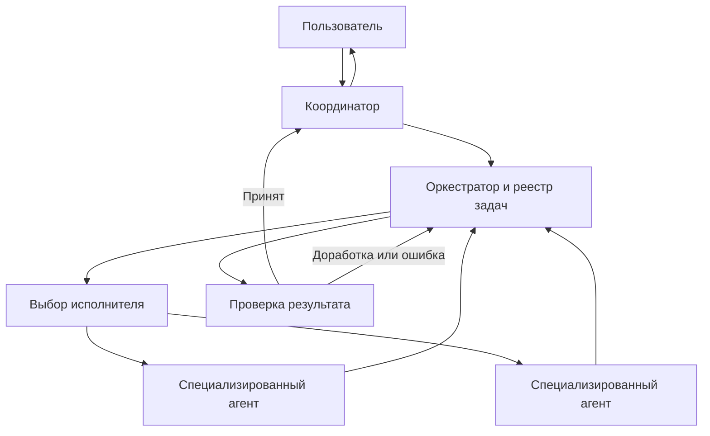

# S04-main-control

- Сценарий: `S4`
- Вариант: `control`
- Модель: `gpt-6-luna` (high)

## Ход 1 — запрос пользователя

Нужна система, где координатор распределяет специализированные задачи между агентами, проверяет результаты и не допускает бесконечной делегации.

## Ход 1 — ответ агента

Предлагаю начать с простого правила: **координатор — единственный, кто может создавать задачи**. Он назначает их специализированным агентам, а те возвращают результат координатору и не делегируют дальше. Это сразу исключает бесконечную цепочку делегаций.

Для каждой задачи координатор задаёт ожидаемый результат и критерии приёмки. Получив ответ, он проверяет критерии, при необходимости один раз отправляет задачу на доработку, а затем принимает результат или сообщает о проблеме.

**Подходит ли вам запрет на делегацию со стороны агентов?** Я рекомендую его как начальный вариант: он упрощает контроль и позволяет координатору видеть всю структуру работы. Навык Superpowers, указанный в правилах этого контекста, среди доступных мне инструментов не найден; GitHub недоступен в режиме read-only, поэтому обсуждаю решение здесь.

## Ход 2 — запрос пользователя

Выбираю режим «Проектирование с нуля».

## Ход 2 — ответ агента

Принял: проектируем с нуля. Будем обсуждать по одному решению за раз. В этом read-only режиме я могу давать рекомендации в чате, но не могу искать или сохранять спецификацию в GitHub. Навык Superpowers, предписанный правилами обсуждения, среди доступных инструментов не найден.

Первое решение — кто вправе создавать подзадачи. Рекомендую оставить это право только координатору: агент возвращает результат ему, а если задача требует дальнейшего разбиения, координатор решает, как её перераспределить. Так проще контролировать делегирование и исключить циклы.

Утверждаем такую модель?

## Ход 3 — запрос пользователя

Согласен с рекомендуемым вариантом. Подготовь архитектурный ответ здесь в чате; не пиши код, не меняй файлы и не выполняй внешние действия.

## Ход 3 — ответ агента

# Архитектура системы координации агентов

**Цель:** координатор распределяет специализированную работу, собирает результаты и проверяет их по заранее заданным критериям. Принятое решение: подзадачи создаёт только координатор; исполнительные агенты не делегируют работу дальше.

## Варианты организации делегирования

- **Плоская схема — выбрана.** Координатор создаёт задачи для агентов, агенты возвращают результаты ему. Легко ограничить глубину, видеть ход работ и проверять итог.
- **Ограниченная вложенность.** Агентам разрешено делегировать на заданную глубину. Может помочь в сложных проектах, но усложняет аудит и распределение бюджета.
- **Свободная вложенность.** Любой агент может создавать новые задачи. Гибко, но трудно гарантировать остановку и предсказуемые затраты.

Для исходной версии подходит плоская схема.

## Компоненты

- **Координатор** понимает запрос, при необходимости разбивает его на задачи, назначает исполнителей и объединяет результаты.
- **Оркестратор** хранит состояние задач и применяет ограничения: права, бюджеты, сроки, лимиты попыток и параллельности. Он должен обеспечивать эти правила независимо от инструкций языковой модели.
- **Каталог агентов** описывает специализации, доступные инструменты и ограничения исполнителей. По нему координатор выбирает подходящего агента.
- **Исполнитель** получает только свою задачу, необходимый контекст, критерии приёмки и выделенный бюджет.
- **Проверка результата** сопоставляет ответ с критериями приёмки и проверяет наличие требуемых подтверждений. Координатор принимает или отклоняет результат с указанием причины.
- **Журнал событий** хранит назначения, переходы состояний, попытки, затраты и решения о приёмке.

## Жизненный цикл задачи

Задача проходит состояния: **создана → назначена → выполняется → проверяется → принята**. Если результат не прошёл проверку, координатор может вернуть его на ограниченную доработку. Если лимит попыток исчерпан или агент сообщил о блокере, задача получает статус **не выполнена** и возвращается координатору для решения или эскалации пользователю.

При создании задачи координатор фиксирует:

- ожидаемый результат;
- критерии приёмки;
- входной контекст и зависимости;
- выбранного исполнителя;
- срок и доступный бюджет.

Агент возвращает результат, подтверждения выполнения критериев, допущения и известные ограничения. Так проверка опирается на требования задачи, а не только на уверенность агента в собственном ответе.

## Ограничители делегирования и повторов

1. Только координатор имеет право создавать задачи. У агентов нет операции или полномочий для запуска подзадач.
2. Система отклоняет задачи, которые не создал координатор, а также циклические зависимости.
3. Повторные попытки ограничены. Рекомендуемый начальный предел — **одна доработка на задачу**; после неё координатор принимает результат, отмечает задачу не выполненной или передаёт вопрос пользователю.
4. У каждого запроса есть общий бюджет, срок, максимум задач и предел параллельно работающих агентов. При достижении любого предела система прекращает запуск новых работ и фиксирует незавершённые задачи.
5. Если агент считает работу слишком широкой, он возвращает координатору предложение о разбиении. Это предложение само по себе не запускает новых исполнителей.

## Проверка и итоговый ответ

Оркестратор проверяет формат ответа и соблюдение технических ограничений. Координатор проверяет смысловые критерии, согласует результаты разных агентов и отмечает противоречия. Результат принимается, если выполнены все обязательные критерии; иначе причина отказа записывается в задачу.

В итоговом ответе координатор сообщает, что сделано, какие критерии выполнены, и какие части остались незавершёнными. Если данных для надёжной проверки недостаточно, он явно это указывает и не объявляет задачу принятой.

**Граница между предложением и согласованным решением:** плоская модель делегирования согласована. Компоненты, статусы, предел одной доработки и другие параметры выше — архитектурное предложение для дальнейшей настройки.
