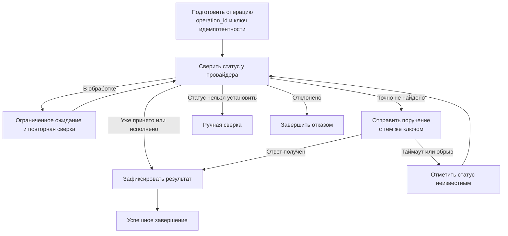

# S06-main-treatment

- Сценарий: `S6`
- Вариант: `treatment`
- Модель: `gpt-6-luna` (high)

## Ход 1 — запрос пользователя

После сетевого сбоя агент должен возобновить работу с прежним состоянием; последний узел успел отправить платёжное поручение до падения.

## Ход 1 — ответ агента

Вы описываете восстановление LangGraph-агента после сбоя: он должен продолжить с сохранённого состояния, хотя платёжное поручение могло уйти до падения. Здесь важно не отправить платёж повторно при возобновлении.

Какой режим выбрать?

- **Проектирование с нуля** — если архитектуры ещё нет.
- **Аудит архитектуры** — если хотите проверить уже существующий граф.
- **Модификация архитектуры** — если граф уже есть и его нужно изменить.

Я бы рекомендовал **модификацию**, если агент уже работает; если его архитектура пока не задана — проектирование с нуля. Какой режим выбираете?

## Ход 2 — запрос пользователя

Выбираю режим «Проектирование с нуля».

## Ход 2 — ответ агента

Понял: после сбоя граф должен продолжить с сохранённого состояния, а уже отправленное поручение нельзя без проверки отправлять повторно. Поиск спецификаций по этой теме в указанном репозитории не нашёл совпадений; когда дойдём до фиксации архитектуры, предложу путь для нового файла.

Ключевое для проектирования: умеет ли платёжная система принимать постоянный ключ идемпотентности или проверять статус поручения по вашему идентификатору? Я рекомендую опираться на такую проверку перед повторной отправкой — иначе после сбоя может возникнуть двойной платёж.

## Ход 3 — запрос пользователя

Согласен с рекомендуемым вариантом. Подготовь архитектурный ответ здесь в чате; не пиши код, не меняй файлы и не выполняй внешние действия.

## Ход 3 — ответ агента

# Архитектурное предложение: восстановление платёжного агента после сбоя

## Цель и выбор подхода

Агент должен продолжать с checkpoint того же рабочего процесса. Если сбой случился после отправки поручения, возобновление не должно вслепую отправлять его ещё раз.

Рассмотрены три подхода:

1. **Только checkpoint.** Просто возобновить граф. Это сохраняет состояние, но не защищает от повтора внешнего действия, если сбой произошёл до фиксации результата в checkpoint.
2. **Checkpoint и защита операции у провайдера.** Для поручения заранее создаётся постоянный идентификатор; при каждом вызове используется один и тот же ключ идемпотентности, а перед повтором агент сверяет статус. Это рекомендованный вариант, и вы согласились с ним.
3. **Собственный платёжный реестр и очередь/outbox.** Даёт больше контроля, но добавляет хранилище и согласование между ним, графом и провайдером. Его стоит рассмотреть, если провайдер не поддерживает надёжную идемпотентность и проверку статуса.

Рекомендую **`StateGraph` с durable checkpoint и детерминированной сверкой платёжной операции**. Критический платёжный путь не должен зависеть от решения LLM: граф обрабатывает статусы и ошибки по явным правилам.

## Поток графа

При возобновлении используется тот же `thread_id` и checkpoint. Узел отправки может выполниться повторно, поэтому он сначала проверяет реестр операции и статус у провайдера; повторная отправка допустима только с прежним идентификатором и тем же ключом идемпотентности.

## Контракты компонентов

| Компонент | Ответственность и данные |
|---|---|
| **State** | `operation_id` — стабильный ID бизнес-операции; `payment_payload` или защищённая ссылка на него — неизменяемые реквизиты; `payload_hash` — защита от незаметного изменения суммы или получателя; `idempotency_key` — постоянный ключ для всех попыток; `payment_status` — статус операции; `provider_reference` — ссылка провайдера; `attempt_count` — число попыток; `last_error` — категория последней ошибки. Для этих полей достаточно overwrite-семантики при одном писателе. |
| **Prepare** | Валидирует поручение и закрепляет `operation_id`, ключ и отпечаток payload до обращения к провайдеру. Повторная подготовка не должна создавать новую операцию для того же бизнес-намерения. |
| **Reconcile** | Читает внутренний статус и запрашивает статус у провайдера по ID/ключу. Не изменяет реквизиты поручения. |
| **Submit** | Вызывает платёжный API с неизменным payload и тем же ключом идемпотентности. Не трактует сетевой таймаут как отказ платежа. |
| **Record outcome** | Сохраняет подтверждённый ответ провайдера и ссылку на операцию. После успешной записи checkpoint графа может безопасно продолжить к завершению. |
| **Manual reconciliation** | Останавливает автоматическую отправку, если результат нельзя надёжно установить. Передаёт операцию на проверку человеку. |

`thread_id` должен быть стабильным идентификатором данного процесса и связан с `operation_id`; он не заменяет платёжный ключ. Checkpointer хранит восстановимое состояние графа, а провайдер или платёжный реестр — авторитетный статус внешней операции.

## Ошибки и завершение

- **Таймаут/обрыв при отправке:** статус становится `unknown`; граф идёт на сверку, а не делает вывод «не отправлено».
- **Провайдер подтвердил операцию:** сохранить статус и завершить граф без новой отправки.
- **Операция ещё обрабатывается:** ограниченно повторять только чтение статуса; после лимита — ручная сверка.
- **Провайдер подтвердил, что операции нет:** разрешить повтор с прежним ключом. Число повторов ограничить.
- **Отклонение:** завершить отказом; повтор разрешать только как новую явно санкционированную операцию.
- **Провайдер недоступен или статус неоднозначен:** приостановить автоматическую отправку и передать человеку.

Успех графа следует определить явно: например, «провайдер принял поручение». Если бизнес-смысл успеха — фактическое исполнение платежа, это отдельный критерий и потребует ожидания статуса исполнения.

## Архитектурная проверка и заключение

Маршруты из checkpoint, сверки, отправки и ручной проверки достижимы; цикл ожидания ограничен; параллельные записи в платёжный статус не предусмотрены. Главный риск — провайдер может не поддерживать стабильный ключ идемпотентности или надёжный поиск статуса. Тогда возможен двойной платёж либо потребуется ручная сверка; один LangGraph checkpoint этого не устраняет.

**Вердикт: требует доработки.** Концептуальная схема предотвращает слепой повтор, но готовность к реализации зависит от контракта платёжного провайдера: поддержки идемпотентности, поиска статуса, срока действия ключа и значений статусов. Актуальную техническую проверку LangGraph здесь не выполнял: официальные материалы недоступны локально, а внешние действия вы запретили. Это архитектурное заключение, не результат проверки кода. Файлы и внешние сервисы не изменялись.
