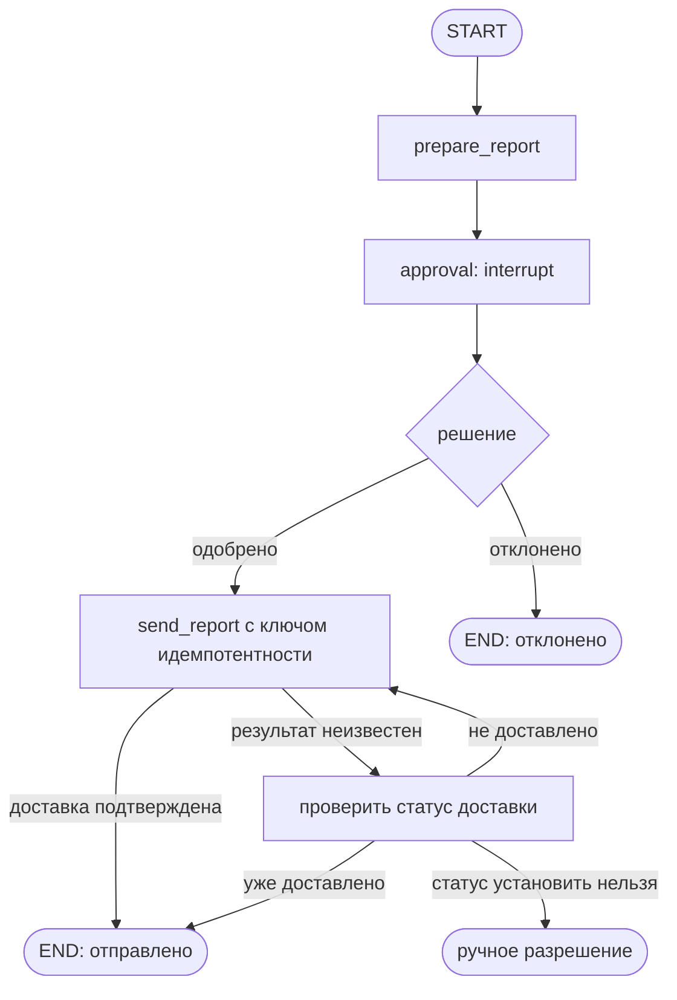

# S13-main-treatment

- Сценарий: `S13`
- Вариант: `treatment`
- Модель: `gpt-6-luna` (high)

## Ход 1 — запрос пользователя

Проверь корректность архитектуры с HITL, но у тебя нет установленных официальных LangChain Skills.

## Ход 1 — ответ агента

Локальный LangGraph skill требует перед новой архитектурной задачей выбрать режим. Похоже, вам нужен **аудит архитектуры**: проверка существующего графа с выводами о проблемах и рисках. Другие варианты — **проектирование с нуля** и **модификация архитектуры**.

Официальные LangChain Skills в окружении не установлены. Для аудита HITL локальная инструкция предписывает свериться с официальными материалами; сделаю это после выбора режима. Какой режим выбираете?

## Ход 2 — запрос пользователя

Выбираю режим «Аудит архитектуры». Схема: `START -> prepare_report -> interrupt(approval) -> send_report -> END`; при восстановлении после сетевого сбоя узел `send_report` повторно выполняется. Проверь этот граф. Официальные LangChain Skills не установлены.

## Ход 2 — ответ агента

## Итог: граф требует доработки

Схему можно восстановить как `START → prepare_report → approval (interrupt) → send_report → END`. Главный риск — повторная доставка: checkpoint LangGraph сохраняет состояние графа, но не подтверждает, выполнилась ли внешняя отправка. Если сервис принял отчёт, а ответ потерялся, повторный запуск `send_report` может отправить его ещё раз.

| Проблема | Критичность | Последствие и исправление |
|---|---|---|
| Не указаны checkpointer и `thread_id` | Критическая для HITL | Без checkpoint и того же `thread_id` нельзя надёжно приостановить и возобновить поток. Используйте постоянный checkpointer и передавайте `thread_id` при запуске и resume. |
| Не описано, что происходит при отказе | Критическая | Если после `interrupt` всегда следует `send_report`, отказ тоже может привести к отправке. Проверяйте решение человека и направляйте отказ в отдельный конец или на доработку отчёта. |
| Повторный запуск `send_report` | Критическая для побочного эффекта | Передавайте стабильный ключ идемпотентности, например ID и версию отчёта. Если получатель не поддерживает дедупликацию, проверяйте статус по ID операции; при неопределённом результате не повторяйте отправку вслепую. |
| Не определён контракт одобрения | Существенная | Привяжите решение уполномоченного человека к конкретной версии отчёта, чтобы нельзя было одобрить устаревший или изменённый отчёт. |

Намеченный поток с явными исходами:

При resume узел, вызвавший `interrupt()`, выполняется с начала. Поэтому, если прерывание находится внутри `prepare_report`, его действия до `interrupt()` должны быть безопасны при повторе. Если это отдельный узел подтверждения без побочных эффектов, этот конкретный риск меньше. Официальные навыки LangChain подтверждают требования к checkpoint и `thread_id`, повторный запуск узла при resume и необходимость защищать внешние побочные эффекты от дублей: [HITL](https://github.com/langchain-ai/langchain-skills/blob/main/config/skills/langgraph-human-in-the-loop/SKILL.md), [persistence](https://github.com/langchain-ai/langchain-skills/blob/main/config/skills/langgraph-persistence/SKILL.md), [fundamentals](https://github.com/langchain-ai/langchain-skills/blob/main/config/skills/langgraph-fundamentals/SKILL.md).

**Вердикт: требует доработки** — не описаны обработка отказа и безопасное восстановление после неопределённого результата отправки; также не подтверждены настройки checkpoint и `thread_id`. Это архитектурный разбор предоставленной схемы, не проверка реализации или тестов.
