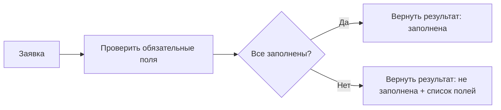

# S01-main-treatment

- Сценарий: `S1`
- Вариант: `treatment`
- Модель: `gpt-6-luna` (high)

## Ход 1 — запрос пользователя

Нужен процесс: получить заявку, проверить заполненность, вернуть результат. Одна проверка, без LLM и памяти.

## Ход 1 — ответ агента

Какой режим выбрать?

- **Проектирование с нуля** — спроектировать новый процесс. **Рекомендую его:** вы описали новую задачу и основные ограничения.
- **Аудит** — проверить уже существующий граф или архитектуру.
- **Модификация** — изменить действующий граф.

Напишите выбранный режим — и продолжу.

## Ход 2 — запрос пользователя

Выбираю режим «Проектирование с нуля».

## Ход 2 — ответ агента

Зафиксировал цель: принять заявку, выполнить одну детерминированную проверку заполненности и вернуть результат; без LLM и памяти.

Есть два подходящих варианта:

- **Обычная функция**: принять данные, проверить поля, вернуть результат. Рекомендую её — для одного шага она проще и не требует оркестрации.
- **LangGraph `StateGraph`**: оформить приём, проверку и возврат как узлы графа. Это добавит структуру графа, но пока не решает описанную задачу лучше. LangGraph полезен, когда нужны собственные маршруты или более сложное управление потоком; Deep Agents и агент с LLM здесь избыточны. [Официальное руководство по выбору](https://github.com/langchain-ai/langchain-skills/blob/main/config/skills/ecosystem-primer/SKILL.md)

Какой вариант проектировать: **обычную функцию** или **LangGraph**?

## Ход 3 — запрос пользователя

Согласен с рекомендуемым вариантом. Подготовь архитектурный ответ здесь в чате; не пиши код, не меняй файлы и не выполняй внешние действия.

## Ход 3 — ответ агента

## Архитектура

Для этого процесса достаточно **одной детерминированной функции**. Она получает заявку и проверяет её по списку обязательных полей. LangGraph, LLM, память, хранилище и циклы здесь не нужны: нет ветвящегося процесса или длительного состояния. Это соответствует официальной рекомендации выбирать LangGraph для пользовательского управления потоком, когда оно действительно требуется. [Руководство по выбору инструментов LangChain](https://github.com/langchain-ai/langchain-skills/blob/main/config/skills/ecosystem-primer/SKILL.md)

**Вход:** заявка и заданный перечень обязательных полей. Перечень должен быть определён правилами предметной области, а не выводиться моделью.

**Проверка:** один проход по перечню. Предлагаемое правило: отсутствующее поле, `null`, пустая строка или строка из пробелов считаются незаполненными. `0` и `false` считаются значениями, если тип поля это допускает.

**Результат:** статус «заполнена» либо «не заполнена»; во втором случае — перечень незаполненных полей. Для заявки с некорректной структурой нужен отдельный результат ошибки входных данных.

Состояние существует только на время вызова функции. Между заявками ничего не сохраняется; повторных проверок, внешних действий и побочных эффектов нет.

## Архитектурное заключение

Схема проста и соответствует цели. Критически не хватает конкретного перечня обязательных полей и согласованного формата результата. Без них нельзя однозначно определить, что считать заполненной заявкой и что именно возвращать вызывающей стороне.

**Вердикт: требует доработки** — нужно утвердить эти два контракта. После этого архитектура будет готова к реализации.
