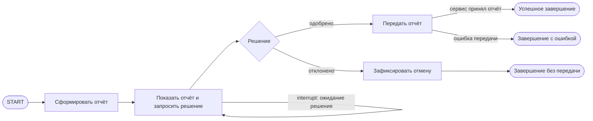

# S08-main-treatment

- Сценарий: `S8`
- Вариант: `treatment`
- Модель: `gpt-6-luna` (high)

## Ход 1 — запрос пользователя

В существующую архитектуру добавь ручное подтверждение, исходная спецификация требований уже утверждена.

## Ход 1 — ответ агента

В skill для LangGraph требуется сначала явно выбрать режим:

- **Проектирование с нуля** — разработать новую архитектуру.
- **Аудит** — проверить существующую архитектуру.
- **Модификация** — добавить ручное подтверждение в действующую архитектуру.

Для вашего запроса рекомендую **модификацию архитектуры**. Уточните, пожалуйста, что выбираете этот режим, и укажите точный путь к архитектурной спецификации. В каталоге вижу `specs/current-agent-architecture.md` и `specs/approved-requirements.md`; если это нужные документы, подтвердите пути.

По правилам этой среды работа только для чтения: смогу изучить документы и дать рекомендации здесь, но не менять файлы или удалённые сервисы.

## Ход 2 — запрос пользователя

Выбираю режим «Модификация архитектуры». Утверждённые требования находятся в `specs/approved-requirements.md`, текущая архитектура — в `specs/current-agent-architecture.md`. Прочитай оба файла.

## Ход 2 — ответ агента

Прочитал оба документа. Требование: сформировать краткий отчёт с полями `summary`, `source_ids`, `generated_at`; перед передачей во внешний сервис получить явное подтверждение, а при отказе отменить передачу. Текущая архитектура отправляет отчёт сразу и не содержит шага подтверждения. Утверждённые требования оставляю неизменными.

Предлагаю два варианта:

1. **Пауза внутри графа — рекомендую.** После создания отчёта граф приостанавливается и показывает его пользователю. Подтверждение ведёт к отправке, отказ — к завершению без отправки. Для ожидания и возобновления LangGraph нужны checkpoint и `thread_id`; возобновление выполняется через `Command(resume=...)`. Вызов отправки следует вынести в отдельный узел после подтверждения. [Официальные инструкции LangGraph по HITL](https://github.com/langchain-ai/langchain-skills/blob/main/config/skills/langgraph-human-in-the-loop/SKILL.md), [по сохранению состояния](https://github.com/langchain-ai/langchain-skills/blob/main/config/skills/langgraph-persistence/SKILL.md).
2. **Разделить процесс на два этапа.** Первый запуск сохраняет отчёт как ожидающий подтверждения и завершается; отдельное событие подтверждения продолжает процесс. Это удобнее для длительного ожидания и отдельного интерфейса, но требует дополнительного механизма хранения и обработки подтверждений.

Какой вариант выбрать? Я рекомендую **вариант 1** для описанного последовательного графа. Пока выбор не согласован, детали архитектуры не фиксирую. Изменить файл в этой среде нельзя: здесь разрешены только чтение и рекомендации в чате.

## Ход 3 — запрос пользователя

Подтверждаю изменение архитектуры с ручным подтверждением. Требования не меняй; не записывай ничего в файлы или GitHub, выведи результат в чате.

## Ход 3 — ответ агента

## Изменение архитектуры

Считаю ваше подтверждение согласием на рекомендованный вариант: граф приостанавливается после подготовки отчёта, ожидает явного решения пользователя и только после одобрения вызывает внешний сервис. Утверждённые требования не меняю; файлы и GitHub не изменялись.

Текущая архитектура описана как последовательный граф, но документ не уточняет, используется ли именно LangGraph. Ниже предполагаю, что используется LangGraph. Если это другой движок, схема остаётся применимой на уровне потоков, но конкретные механизмы паузы и возобновления будут другими.

Для такого графа LangGraph подходит: он добавляет ветвление и ожидание решения человека к уже существующему процессу. Граф приостанавливается через `interrupt()`, сохраняя checkpoint; возобновление адресуется по `thread_id` и передаёт ответ через `Command(resume=...)`. [Официальные материалы по HITL](https://github.com/langchain-ai/langchain-skills/blob/main/config/skills/langgraph-human-in-the-loop/SKILL.md) и [checkpoint-состоянию](https://github.com/langchain-ai/langchain-skills/blob/main/config/skills/langgraph-persistence/SKILL.md).

### Состояние

| Поле | Назначение и доступ | Обновление и сохранение |
|---|---|---|
| `report.summary`, `report.source_ids`, `report.generated_at` | Отчёт; создаёт узел формирования, читают узел подтверждения и узел передачи | Перезаписывается при создании отчёта; после этого сохраняется в checkpoint без изменений до решения |
| `approval_decision` | `pending`, `approved` или `rejected`; читает маршрутизатор | Изначально `pending`, затем узел подтверждения записывает валидное решение. Без reducer |
| `delivery_status` | `not_started`, `succeeded` или `failed`; отражает исход передачи | Узел передачи записывает результат. Без reducer |
| `dispatch_key` | Внутренний ключ операции для защиты повторной отправки; не часть отчёта | Создаётся один раз на запрос и сохраняется в checkpoint |

Параллельных ветвей и объединения результатов в этом изменении нет. Схема отчёта для внешнего сервиса остаётся ровно из трёх утверждённых полей.

### Узлы и маршруты

- **Сформировать отчёт** создаёт три обязательных поля, устанавливает `approval_decision=pending` и `delivery_status=not_started`.
- **Подтверждение** показывает пользователю сам отчёт и спрашивает, продолжать ли передачу. При ожидании граф сохраняет checkpoint. Валидное одобрение направляет к передаче; отказ — к отмене. Неоднозначный или отсутствующий ответ не должен трактоваться как одобрение.
- **Передача** вызывается только после одобрения и отправляет отчёт с исходными полями. Успех фиксируется только после подтверждения приёма внешним сервисом.
- **Отмена** фиксирует отказ и завершает поток без вызова внешнего сервиса.

Для выбора ветки достаточно условного маршрута по `approval_decision`. В узле подтверждения не следует сочетать `Command(goto=...)` со статическими исходящими рёбрами: LangGraph может выполнить оба маршрута. Это ограничение описано в [официальных материалах по основам графов](https://github.com/langchain-ai/langchain-skills/blob/main/config/skills/langgraph-fundamentals/SKILL.md).

### Возобновление и ошибки

Возобновляемый запуск требует checkpoint и стабильного `thread_id`. При resume узел подтверждения выполняется заново с начала, поэтому до `interrupt()` в нём допустимо только подготовить данные для показа; внешние действия там недопустимы. Узел передачи располагается после подтверждения.

Повторные запросы на одобрение и сбои во время передачи не должны приводить к повторной отправке одного отчёта. Для этого следует использовать `dispatch_key` как ключ идемпотентности, если внешний сервис его поддерживает; иначе перед повторной отправкой нужна проверка результата предыдущего вызова. Checkpoint сам по себе не гарантирует однократность внешних действий.

Успех — сервис принял отчёт. Отказ пользователя — отдельное завершение «отменено», без передачи. Невосстановимая ошибка сервиса или исчерпание ограниченных повторов — завершение с ошибкой. Одобрение не должно подставляться при таймауте или техническом сбое.

### Архитектурное заключение

Отсутствие шага подтверждения — критический пробел текущей схемы: она может отправить отчёт без явного решения пользователя. Добавление паузы перед внешним вызовом закрывает этот пробел и сохраняет утверждённый формат отчёта.

**Вердикт: требует доработки перед реализацией.** Поток и границы узлов определены, но документы не уточняют, поддерживает ли внешний сервис идемпотентность или проверку уже выполненной операции. Это нужно подтвердить, чтобы повторы после сбоя не создали дубликаты. Также нужно определить хранилище checkpoint для развёртывания и способ привязать возобновление к аутентифицированному пользователю. Это архитектурная оценка, не результат проверки кода.
