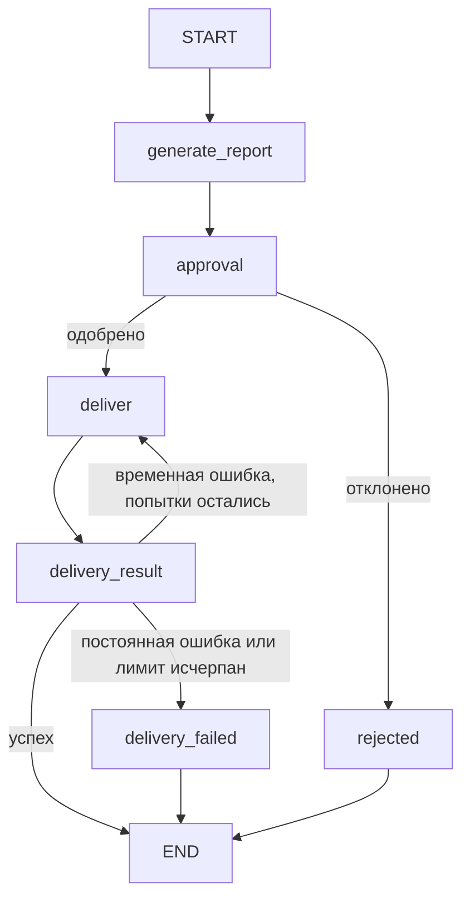

# S08-main-treatment

- Сценарий: `S8`
- Вариант: `treatment`
- Модель: `gpt-6-luna` (high)

## Ход 1 — запрос пользователя

В существующую архитектуру добавь ручное подтверждение, исходная спецификация требований уже утверждена.

## Ход 1 — ответ агента

Понимаю задачу как **модификацию существующей LangGraph-архитектуры**: добавить в неё ручное подтверждение, сохранив утверждённые требования без изменений. В этой среде могу подготовить рекомендации в чате, но не редактировать файлы.

Укажите точный путь или URL утверждённой спецификации требований. По правилам архитектурной работы я должен сначала проверить именно этот источник и до этого не искать его по теме.

## Ход 2 — запрос пользователя

Выбираю режим «Модификация архитектуры». Утверждённые требования находятся в `specs/approved-requirements.md`, текущая архитектура — в `specs/current-agent-architecture.md`. Прочитай оба файла.

## Ход 2 — ответ агента

В требованиях подтверждение должно предшествовать отправке, а отказ — отменять её. Текущая архитектура создаёт отчёт и сразу отправляет его, поэтому нужен явный переход между этими действиями. В описании пока не указаны внутренние поля состояния и устройство узлов.

**Вариант 1 — узел подтверждения в графе.** После создания отчёта граф приостанавливается и показывает пользователю именно тот отчёт, который будет отправлен. После возобновления согласие ведёт к отправке, отказ — к завершению без неё. Для `interrupt()` нужны checkpointer и `thread_id`; при возобновлении узел с прерыванием выполняется заново, поэтому отправку следует держать в отдельном узле после подтверждения. [Официальные инструкции LangGraph по HITL](https://github.com/langchain-ai/langchain-skills/blob/main/config/skills/langgraph-human-in-the-loop/SKILL.md), [по persistence](https://github.com/langchain-ai/langchain-skills/blob/main/config/skills/langgraph-persistence/SKILL.md).

**Вариант 2 — подтверждение через внешний сервис или очередь.** Граф сохраняет ожидающий отчёт, а отдельная система подтверждения позже передаёт решение для продолжения процесса. Это удобнее, если подтверждает несколько ролей или согласование живёт отдельно от приложения, но требует дополнительных связей и хранения статуса.

Рекомендую **вариант 1**: он прямо встраивает обязательное подтверждение в существующий последовательный граф. Какой вариант берём за основу?

## Ход 3 — запрос пользователя

Подтверждаю изменение архитектуры с ручным подтверждением. Требования не меняй; не записывай ничего в файлы или GitHub, выведи результат в чате.

## Ход 3 — ответ агента

## Изменение архитектуры

Беру за основу рекомендованный вариант: явный узел подтверждения внутри последовательного графа. Утверждённые требования не меняются. Отчёт по-прежнему содержит только `summary`, `source_ids` и `generated_at`; подтверждение и статусы доставки — внутреннее состояние графа.

### State

| Поле | Роль и тип | Читатели и писатели | Обновление |
|---|---|---|---|
| `summary: str` | Текст отчёта | Записывает `generate_report`; читает `approval`, `deliver` | Полная замена |
| `source_ids: list[str]` | Источники отчёта | Записывает `generate_report`; читает `approval`, `deliver` | Полная замена, без накопления |
| `generated_at: timestamp` | Время создания отчёта | Записывает `generate_report`; читает `approval`, `deliver` | Полная замена; формат не задан требованиями |
| `approval_decision: pending \| approved \| rejected` | Решение пользователя | Записывает `approval`; читает маршрутизатор | Полная замена |
| `delivery_status: not_started \| sent \| failed` | Результат передачи | Записывают `deliver` и обработка результата | Полная замена |
| `delivery_attempts: int` | Счётчик ограниченных повторов | Читает и обновляет `deliver` | Увеличение на попытку |
| `operation_id: str` | Внутренний ключ одной передачи для защиты от дублей | Создаётся до ожидания подтверждения; читает `deliver` | Не меняется в рамках операции |

Последние четыре поля — архитектурное предложение, они не добавляются в отправляемый отчёт. `operation_id` должен сохраняться при возобновлении и повторной передаче.

### Узлы и маршруты

- **`generate_report`** формирует отчёт и записывает три поля из утверждённых требований. Внешнюю передачу не выполняет.
- **`approval`** показывает пользователю точный отчёт к передаче и приостанавливает граф. После возобновления сохраняет решение. Одобрение ведёт к `deliver`, отказ — к `rejected` и завершению без вызова внешнего сервиса.
- **`deliver`** отправляет те же значения отчёта, которые видел пользователь. Узел доступен только по маршруту одобрения. Временные сбои допускают ограниченные повторы; постоянный сбой или исчерпание лимита ведут в `delivery_failed`.
- **`delivery_result`** выбирает завершение по результату передачи и числу попыток. Успех ведёт к завершению со статусом `sent`.

Для `interrupt()` нужны checkpointer и `thread_id`; решение возобновляет тот же поток через `Command(resume=...)`. Checkpointer хранит состояние ожидания, но сам по себе не гарантирует однократность внешней передачи. Поскольку узел с `interrupt()` при возобновлении запускается заново, до прерывания в нём не должно быть внешних побочных действий. [Официальные инструкции LangGraph по HITL](https://github.com/langchain-ai/langchain-skills/blob/main/config/skills/langgraph-human-in-the-loop/SKILL.md) и [сохранению состояния](https://github.com/langchain-ai/langchain-skills/blob/main/config/skills/langgraph-persistence/SKILL.md).

### Проверка архитектуры

Путь к передаче проходит только через одобрение; отказ завершает граф до обращения к внешнему сервису. Данные, отправленные после одобрения, должны совпадать с показанным отчётом. Все исходы передачи завершаются явно. Повторы безопасны при условии, что внешний сервис поддерживает идемпотентный ключ или позволяет проверить результат предыдущей попытки.

**Заключение**

- **Проблема:** исходная архитектура не описывает состояние ожидания, механизм возобновления и защиту от повторной передачи.
- **Критичность:** высокая для передачи — при неопределённом результате сбоя повтор может создать дубликат; до добавления подтверждения возможна отправка без согласия.
- **Последствие:** отчёт может уйти без подтверждения или быть передан повторно.
- **Рекомендация:** добавить описанный узел подтверждения до передачи, durable checkpointer с идентификацией потока и идемпотентность либо проверку результата у внешнего сервиса.
- **Вердикт:** **требует доработки** перед реализацией: в предоставленной архитектуре не указаны возможности внешнего сервиса по идемпотентности/проверке статуса и конкретный механизм долговременного хранения checkpoint. Спецификацию в файлах и GitHub не менял; это результат для чата.
