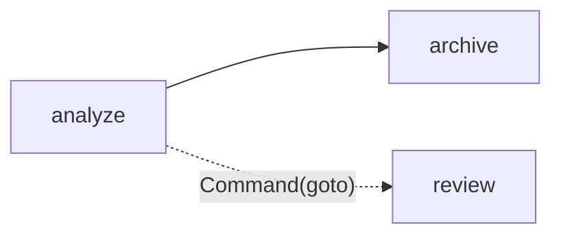

# S07-main-rep04-treatment

- Сценарий: `S7`
- Вариант: `treatment`
- Модель: `gpt-6-luna` (high)

## Ход 1 — запрос пользователя

У меня есть существующий LangGraph-граф, хочу обсудить его маршрутизацию.

## Ход 1 — ответ агента

Для существующего графа подойдут три режима:

- **Аудит архитектуры** — проверю текущую маршрутизацию, циклы и условия завершения; дам выводы и рекомендации.
- **Модификация архитектуры** — разберём, как изменить маршрутизацию, и согласуем обновлённую схему.
- **Проектирование с нуля** — разработаем новую архитектуру графа.

Для вашего запроса рекомендую **аудит архитектуры**. Какой режим выбираете?

## Ход 2 — запрос пользователя

Выбираю режим «Аудит архитектуры».

## Ход 2 — ответ агента

Локально исходников графа нет: в рабочей папке видны только инструкции. В GitHub нашёл спецификацию по LangGraph: [`specs/langgraph-agent-architect-2026-11-02.md`](https://github.com/VetrovDmitry007/Codex/blob/main/specs/langgraph-agent-architect-2026-11-02.md).

Предлагаю использовать её как контекст аудита. Подтвердите этот файл или предпочитаете обсуждать маршрутизацию без него? Файл менять не буду; для аудита самого графа понадобятся его код или схема.

## Ход 3 — запрос пользователя

У узла `analyze` есть статический переход к `archive` и он может вернуть `Command(goto="review")`. Почему после analyze идут обе ветки?

## Ход 3 — ответ агента

Потому что `Command(goto="review")` **добавляет динамический маршрут**, но не отменяет статическое ребро `analyze → archive`. Поэтому после `analyze` LangGraph планирует запуск обоих узлов — `archive` и `review` — в следующем superstep, параллельно. Это описано в [документации LangGraph о `Command` и рёбрах](https://docs.langchain.com/oss/python/langgraph/graph-api#command). 

- **Проблема:** у `analyze` одновременно заданы статическое и динамическое направления.
- **Критичность:** средняя; если запуск обеих веток не задуман, граф выполняет лишнюю работу.
- **Последствие:** `archive` запустится вместе с `review`.
- **Рекомендация:** оставьте один механизм маршрутизации. Если `analyze` должен выбирать следующий узел, уберите ребро к `archive` и направляйте в `archive` или `review` через `Command`. Если архивирование всегда должно происходить, задайте порядок явно через рёбра.
- **Вердикт:** проверенный фрагмент **требует доработки**, если обе ветки не должны выполняться одновременно. Остальной граф не проверен.
