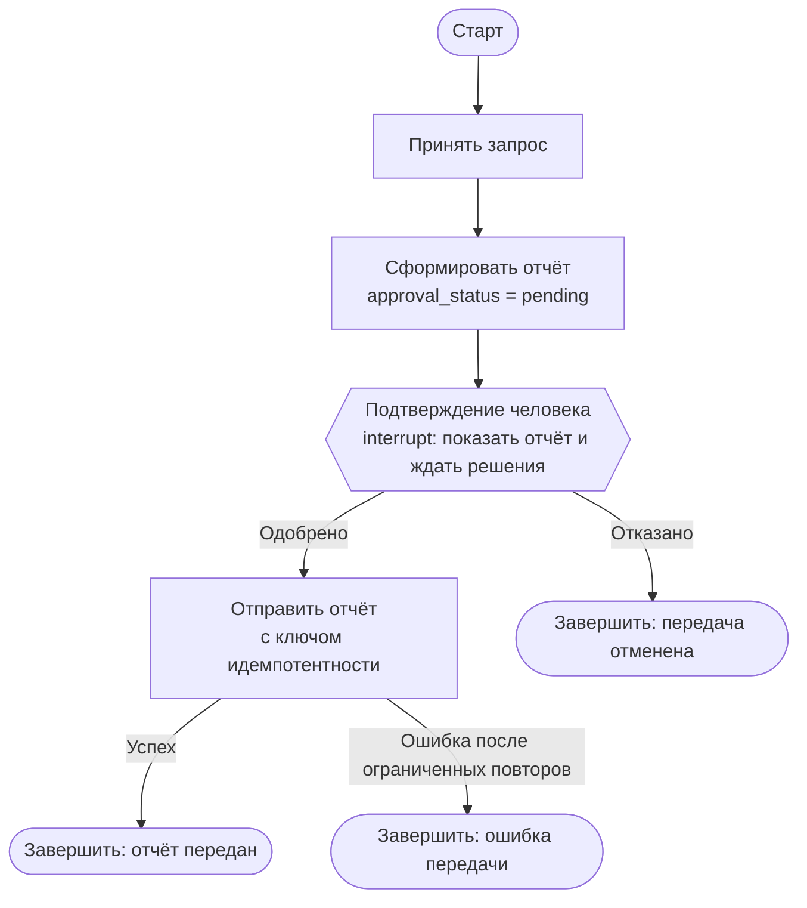

# S08-main-rep01-treatment

- Сценарий: `S8`
- Вариант: `treatment`
- Модель: `gpt-6-luna` (high)

## Ход 1 — запрос пользователя

В существующую архитектуру добавь ручное подтверждение, исходная спецификация требований уже утверждена.

## Ход 1 — ответ агента

Для работы с архитектурой есть три режима:

1. **Проектирование с нуля** — создать новую архитектуру и её спецификацию.
2. **Аудит архитектуры** — проверить существующую и выдать проблемы, рекомендации и вердикт.
3. **Модификация архитектуры** — встроить ручное подтверждение в действующую архитектуру.

Рекомендую **модификацию архитектуры**. Какой режим выбираете? После выбора попрошу точный путь или ссылку на утверждённую спецификацию требований.

## Ход 2 — запрос пользователя

Выбираю режим «Модификация архитектуры». Утверждённые требования находятся в `specs/approved-requirements.md`, текущая архитектура — в `specs/current-agent-architecture.md`. Прочитай оба файла.

## Ход 2 — ответ агента

Прочитал [утверждённые требования](specs/approved-requirements.md) и [текущую архитектуру](specs/current-agent-architecture.md).

Текущий граф сразу передаёт отчёт во внешний сервис, поэтому в нём отсутствует обязательный шаг подтверждения. Предлагаю встроить паузу между созданием отчёта и отправкой:

- **Вариант A — `interrupt()` в отдельном узле подтверждения.** Граф показывает пользователю сформированный отчёт и ждёт решения. После явного одобрения продолжает отправку; после отказа завершает поток без передачи. Для паузы и возобновления нужны checkpointer и `thread_id`; решение передаётся при возобновлении через `Command(resume=...)`. ([Официальная инструкция LangGraph HITL](https://github.com/langchain-ai/langchain-skills/blob/main/config/skills/langgraph-human-in-the-loop/SKILL.md), [Persistence](https://github.com/langchain-ai/langchain-skills/blob/main/config/skills/langgraph-persistence/SKILL.md))
- **Вариант B — сохранить состояние ожидания и возобновлять отдельным вызовом приложения.** Это даст приложению больше контроля над процессом подтверждения, но потребует собственной логики хранения и связывания решения с ожидающим отчётом.

Рекомендую **вариант A**: он напрямую добавляет требуемое подтверждение в граф. Узел отправки должен выполняться только после одобрения; отправку также стоит сделать идемпотентной, чтобы повторы после сбоя не дублировали передачу.

Какой вариант выбираете?

## Ход 3 — запрос пользователя

Подтверждаю изменение архитектуры с ручным подтверждением. Требования не меняй; не записывай ничего в файлы или GitHub, выведи результат в чате.

## Ход 3 — ответ агента

## Предлагаемая модификация

Утверждённые требования остаются без изменений. В [текущей архитектуре](<[LOCAL_PATH_REDACTED]>) сейчас отчёт сразу отправляется во внешний сервис; добавляем обязательное подтверждение между созданием отчёта и отправкой. Поля самого отчёта остаются `summary`, `source_ids`, `generated_at`, как указано в [требованиях](<[LOCAL_PATH_REDACTED]>).

Предлагаемый поток: LangGraph-узел подтверждения вызывает `interrupt()` и показывает пользователю готовый отчёт. Граф ждёт явного решения в том же потоке: одобрение ведёт к отправке, отказ — к завершению без отправки. Для паузы и возобновления LangGraph нужны checkpointer и стабильный `thread_id`; возобновление передаёт решение через `Command(resume=...)`. ([Официальные инструкции LangGraph по HITL](https://github.com/langchain-ai/langchain-skills/blob/main/config/skills/langgraph-human-in-the-loop/SKILL.md) и [сохранению состояния](https://github.com/langchain-ai/langchain-skills/blob/main/config/skills/langgraph-persistence/SKILL.md))

В графе достаточно хранить отчёт, статус подтверждения, статус передачи и внутренний идентификатор операции для защиты от повторной отправки. Это служебное состояние, оно не меняет состав отчёта. Узел подтверждения не должен выполнять побочных действий до `interrupt()`: при возобновлении он запускается заново с начала. Узел отправки должен использовать идентификатор операции как ключ идемпотентности либо уметь проверить результат операции во внешнем сервисе. ([Поведение `interrupt()` и риск повторного выполнения](https://github.com/langchain-ai/langchain-skills/blob/main/config/skills/langgraph-human-in-the-loop/SKILL.md))

**Проблема:** в описанной архитектуре нет ручного подтверждения.  
**Критичность:** высокая, поскольку отправка без одобрения нарушает утверждённое требование.  
**Последствие:** отчёт может попасть во внешний сервис до решения пользователя.  
**Рекомендация:** добавить показанный узел подтверждения и разрешить отправку только по явному одобрению; отказ завершает поток без передачи.  
**Вердикт:** **требует доработки** перед реализацией: краткое описание архитектуры не подтверждает наличие долговечного checkpointer и поддержку идемпотентности или проверки результата внешним сервисом. Также предполагается, что агент действительно работает на LangGraph — исходный файл этого не уточняет.

Результат приведён только в чате; файлы и GitHub не изменялись.
