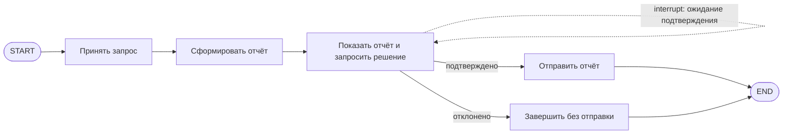

# S08-main-rep02-treatment

- Сценарий: `S8`
- Вариант: `treatment`
- Модель: `gpt-6-luna` (high)

## Ход 1 — запрос пользователя

В существующую архитектуру добавь ручное подтверждение, исходная спецификация требований уже утверждена.

## Ход 1 — ответ агента

Использую **brainstorming** для обсуждения изменения и навык **LangGraph Agent Architect** для архитектурной проработки.

Возможны три режима:

- **Проектирование с нуля** — создать архитектуру и её спецификацию.
- **Аудит архитектуры** — проверить текущую архитектуру и дать рекомендации.
- **Модификация архитектуры** — встроить ручное подтверждение в существующую архитектуру.

Рекомендую **модификацию архитектуры**: это соответствует вашему запросу и позволит сохранить утверждённые требования как источник истины. Какой режим выбираете?

## Ход 2 — запрос пользователя

Выбираю режим «Модификация архитектуры». Утверждённые требования находятся в `specs/approved-requirements.md`, текущая архитектура — в `specs/current-agent-architecture.md`. Прочитай оба файла.

## Ход 2 — ответ агента

Сравнил два варианта для графа, который сейчас создаёт отчёт и сразу отправляет его:

1. **Остановить граф на подтверждении.** После создания отчёта граф вызывает `interrupt()` и сохраняет состояние через checkpointer. Пользователь подтверждает или отклоняет отправку; граф возобновляется с тем же `thread_id`. Это прямой путь для текущего графа. Узел после `interrupt()` запускается заново при возобновлении, поэтому внешнюю отправку нужно выполнять только после подтверждения, а повторы защищать идемпотентностью. [Официальный материал LangGraph о HITL](https://github.com/langchain-ai/langchain-skills/blob/main/config/skills/langgraph-human-in-the-loop/SKILL.md)

2. **Разделить создание отчёта и обработку решения.** Сохранить отчёт со статусом ожидания, а подтверждение или отказ обрабатывать отдельным событием или запуском. Это лучше подходит, если у приложения уже есть очередь согласований, но требует отдельного хранения статуса и связи с запуском графа.

Рекомендую **вариант 1**: он точечно меняет текущую последовательность. После создания отчёт ожидает решения; подтверждение ведёт к узлу отправки, отказ — к завершению без передачи. Какой вариант выбираете?

## Ход 3 — запрос пользователя

Подтверждаю изменение архитектуры с ручным подтверждением. Требования не меняй; не записывай ничего в файлы или GitHub, выведи результат в чате.

## Ход 3 — ответ агента

## Изменение архитектуры: ручное подтверждение перед отправкой

Утверждённые требования не меняются: агент по-прежнему формирует краткий отчёт с полями `summary`, `source_ids`, `generated_at`. Передача во внешний сервис начинается только после явного подтверждения; отказ завершает процесс без отправки. Внешний формат отчёта остаётся прежним.

Основание: [утверждённые требования](<[LOCAL_PATH_REDACTED]>) и [текущая архитектура](<[LOCAL_PATH_REDACTED]>).

### Architecture и поток

Рекомендованный вариант — приостановить граф после подготовки отчёта через LangGraph `interrupt()`. Checkpointer сохраняет состояние ожидания, а `thread_id` связывает подтверждение с нужным запуском. После подтверждения граф возобновляется через `Command(resume=...)`. Это соответствует официальному паттерну LangGraph для human-in-the-loop; возобновляемый узел запускается сначала, поэтому `interrupt()` должен предшествовать побочным эффектам. [Официальный HITL skill](https://github.com/langchain-ai/langchain-skills/blob/main/config/skills/langgraph-human-in-the-loop/SKILL.md), [официальный skill по persistence](https://github.com/langchain-ai/langchain-skills/blob/main/config/skills/langgraph-persistence/SKILL.md)

### State

| Поле | Роль и тип | Читатели / писатели | Обновление и сохранение |
|---|---|---|---|
| `request_context` | Контекст входного запроса; существующая структура не описана | Приём запроса пишет; генерация отчёта читает | Семантика текущего графа сохраняется |
| `report` | Отчёт: `summary`, `source_ids`, `generated_at` | Генерация пишет; подтверждение и отправка читают | Записывается до ожидания; после показа не меняется |
| `approval_decision` | `pending \| approved \| rejected` | Узел подтверждения пишет; маршрутизация читает | По умолчанию `pending`; обычная перезапись |
| `delivery_status` | `not_started \| sent \| failed` | Узел отправки пишет; завершение читает | Изначально `not_started`; обновляется при результате отправки |

`thread_id` передаётся как конфигурация запуска, а не как поле состояния. Checkpointer должен сохранять отчёт и ожидающее решение между вызовами. Конкретный production-backend в исходной архитектуре не указан; LangGraph требует checkpointer и `thread_id` для паузы и возобновления. [Документация persistence](https://github.com/langchain-ai/langchain-skills/blob/main/config/skills/langgraph-persistence/SKILL.md)

### Nodes и Edges

- **Принять запрос** — существующий узел, принимает исходный запрос.
- **Сформировать отчёт** — существующий узел; формирует и сохраняет указанные три поля.
- **Показать отчёт и запросить решение** — новый узел: передаёт пользователю неизменяемый отчёт для просмотра и вызывает `interrupt()`. До прерывания не выполняет внешних действий. При возобновлении принимает только явное решение.
- **Маршрутизация** — при `approved` ведёт к отправке; при `rejected` — к завершению без отправки. Неизвестное или некорректное значение не должно вести к отправке.
- **Отправить отчёт** — существующая внешняя операция, достижимая только из ветки `approved`. Отправляет именно тот отчёт, который был показан на подтверждение.
- **Завершить без отправки** — новый терминальный маршрут для отказа; внешнюю операцию не вызывает.

Узел подтверждения следует соединить условной маршрутизацией. Если используется `Command(goto=...)`, к этому же узлу нельзя добавлять статическое ребро к отправке: статические и динамические маршруты могут выполниться оба. [Официальный skill по основам LangGraph](https://github.com/langchain-ai/langchain-skills/blob/main/config/skills/langgraph-fundamentals/SKILL.md)

### Execution, завершение и ошибки

- При старте граф принимает запрос и формирует отчёт.
- Перед прерыванием сохраняются отчёт и состояние `pending`.
- При возобновлении с тем же `thread_id` передаётся подтверждение или отказ через `Command(resume=...)`.
- Успех — сервис принял отчёт после подтверждения.
- Отказ — граф завершился без передачи.
- Ошибка формирования отчёта или некорректное решение не разрешают отправку.
- Временные ошибки внешнего сервиса можно повторять только с ограничением и защитой от дубликатов. Checkpoint сам по себе не гарантирует однократность внешнего вызова: нужен idempotency key либо проверка результата передачи перед повтором.
- Проверку права пользователя подтверждать следует выполнять до возобновления графа. Требование не задаёт идентификацию подтверждающего или срок действия запроса; эти правила нужно определить отдельно.

### Проверка и заключение

Проверяемый инвариант: **единственный маршрут к внешней отправке проходит через решение `approved`**. Отказ, невалидное решение, ошибка генерации или ожидание подтверждения не отправляют отчёт. Отчёт не меняется после показа пользователю.

**Проблема:** текущая архитектура немедленно отправляет отчёт и не предусматривает паузу.  
**Критичность:** высокая — нарушается утверждённое условие подтверждения.  
**Последствие:** отчёт может уйти во внешний сервис без решения пользователя.  
**Рекомендация:** добавить checkpointed-прерывание после подготовки отчёта и направлять к отправке только подтверждённый неизменённый отчёт; защитить отправку от повторов.  
**Вердикт:** **требует доработки** до реализации: схема подтверждения и отказа определена, но не указаны механизм идентификации подтверждающего, production-backend checkpoint и поддержка идемпотентности внешним сервисом. Сам код и поведение системы не проверялись.
