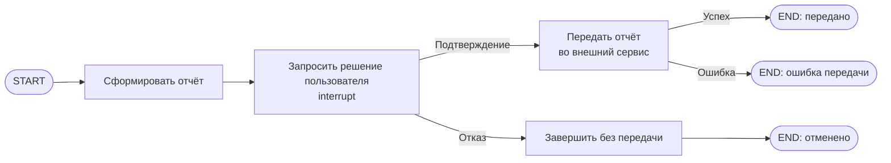

# S08-main-rep03-treatment

- Сценарий: `S8`
- Вариант: `treatment`
- Модель: `gpt-6-luna` (high)

## Ход 1 — запрос пользователя

В существующую архитектуру добавь ручное подтверждение, исходная спецификация требований уже утверждена.

## Ход 1 — ответ агента

Для архитектурной задачи есть три режима:

- **Проектирование с нуля** — подготовить новую архитектуру.
- **Аудит** — проверить существующую архитектуру и дать рекомендации.
- **Модификация** — изменить действующую архитектуру.

Рекомендую **модификацию архитектуры**: добавить ручное подтверждение с учётом уже утверждённых требований. Выберите режим, пожалуйста. После выбора мне понадобится точный путь или URL утверждённой спецификации требований. Пока не изучаю проект: этого требует архитектурный skill для LangGraph.

## Ход 2 — запрос пользователя

Выбираю режим «Модификация архитектуры». Утверждённые требования находятся в `specs/approved-requirements.md`, текущая архитектура — в `specs/current-agent-architecture.md`. Прочитай оба файла.

## Ход 2 — ответ агента

Прочитал [утверждённые требования](<[LOCAL_PATH_REDACTED]>) и [текущую архитектуру](<[LOCAL_PATH_REDACTED]>). Сейчас граф создаёт отчёт и сразу отправляет его; требования требуют получить явное решение пользователя до передачи и отменить передачу при отказе.

Вижу два подхода:

1. **Приостановить граф на подтверждении.** После формирования отчёта граф показывает пользователю `summary`, `source_ids` и `generated_at`, затем ждёт решения. При подтверждении продолжает передачу, при отказе завершает работу без неё. Для этого в LangGraph нужны checkpoint и тот же `thread_id` при возобновлении. Узел возобновляется с начала, поэтому отправку следует выполнять только после подтверждения, а внешний вызов защитить от повторов. [Документация LangGraph HITL](https://github.com/langchain-ai/langchain-skills/blob/main/config/skills/langgraph-human-in-the-loop/SKILL.md)

2. **Вынести ожидание в приложение.** Граф сохраняет отчёт как ожидающий подтверждения, а приложение позже запускает передачу отдельным вызовом. Это подходит, если приложение уже ведёт очередь подтверждений, но требует отдельного хранения и связывания решения с отчётом.

Рекомендую первый подход: он добавляет точку ожидания в существующий последовательный граф, не меняя утверждённые поля отчёта и правило отмены.

Какой подход выбрать?

## Ход 3 — запрос пользователя

Подтверждаю изменение архитектуры с ручным подтверждением. Требования не меняй; не записывай ничего в файлы или GitHub, выведи результат в чате.

## Ход 3 — ответ агента

## Изменение архитектуры

Утверждённые требования остаются без изменений. Отчёт по-прежнему содержит только `summary`, `source_ids` и `generated_at`. Подтверждение и статус передачи хранятся отдельно от него.

**Рекомендация:** добавить в последовательный граф точку ожидания решения через LangGraph `interrupt()`. Она позволяет приостановить граф, сохранить checkpoint и продолжить тот же запуск с решением пользователя через `Command(resume=...)`. Для этого нужны checkpointer и стабильный `thread_id`; узел с прерыванием при возобновлении выполняется заново с начала. [Официальные инструкции LangGraph HITL](https://github.com/langchain-ai/langchain-skills/blob/main/config/skills/langgraph-human-in-the-loop/SKILL.md)

### Контракты графа

**State**

- `report`: объект с тремя утверждёнными полями; формируется один раз и сохраняется checkpoint.
- `approval_decision`: внутреннее решение `approved` или `rejected`, записывается после ответа пользователя.
- `transfer_status`: внутренний статус, например `pending_approval`, `sent`, `cancelled` или `failed`.
- Для безопасных повторов передачи нужен стабильный внутренний `delivery_id` или эквивалентный ключ. Он не добавляется в отчёт.

**Узлы и маршруты**

- `generate_report` формирует отчёт и записывает `report`.
- `request_approval` показывает пользователю отчёт и приостанавливается через `interrupt()`.
- По подтверждению граф направляется в `send_report`; по отказу — в терминальный узел отмены. Неявного подтверждения нет.
- `send_report` вызывается только после подтверждения. Передача выполняется с защитой от дубликатов либо проверкой результата, если внешний сервис не поддерживает ключ идемпотентности.

**Выполнение и ошибки**

До получения решения граф остаётся приостановленным; решение должно возобновлять тот же `thread_id`. До `interrupt()` нельзя выполнять передачу или другие внешние действия с побочным эффектом: узел при возобновлении запускается заново. Ошибки передачи завершаются статусом `failed`; повтор допустим только при защите от дубликатов. Отказ завершает процесс без обращения к внешнему сервису.

### Проверка и заключение

Изменение сохраняет утверждённые поля и добавляет требуемую ветку отмены. Основные риски — неизвестные в текущем описании архитектуры: production checkpointer, способ показа запроса и привязки решения к пользователю, правила повтора передачи и срок ожидания. До их определения нельзя подтвердить корректное возобновление, авторизацию подтверждения и обработку зависших запросов.

**Вердикт: требует доработки** — схема изменения определена, но критические условия долговременного хранения и канала подтверждения в предоставленной архитектуре не описаны. Код, файлы и GitHub не изменялись; это архитектурный разбор, не результат тестирования.
