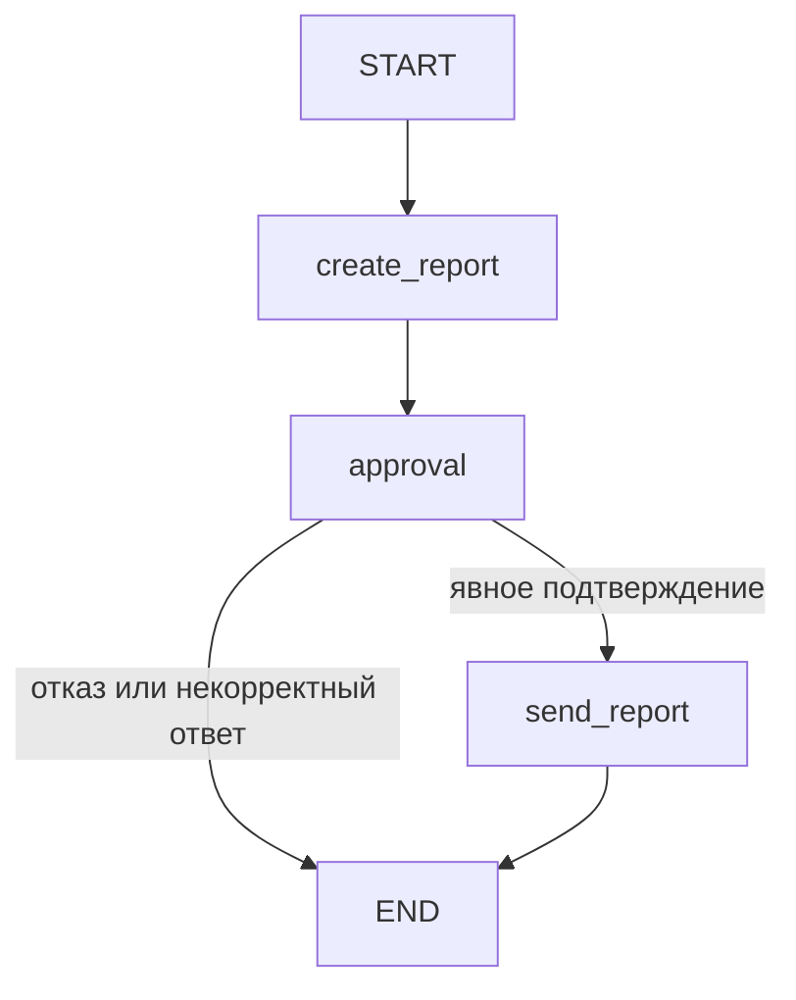

# S08-main-rep04-treatment

- Сценарий: `S8`
- Вариант: `treatment`
- Модель: `gpt-6-luna` (high)

## Ход 1 — запрос пользователя

В существующую архитектуру добавь ручное подтверждение, исходная спецификация требований уже утверждена.

## Ход 1 — ответ агента

Доступны три режима:

- **Проектирование с нуля** — разработать новую архитектуру.
- **Аудит** — проверить существующую архитектуру и дать рекомендации.
- **Модификация** — встроить ручное подтверждение в действующую архитектуру.

Для вашей задачи подходит **модификация**. Какой режим выбираете?

## Ход 2 — запрос пользователя

Выбираю режим «Модификация архитектуры». Утверждённые требования находятся в `specs/approved-requirements.md`, текущая архитектура — в `specs/current-agent-architecture.md`. Прочитай оба файла.

## Ход 2 — ответ агента

Прочитал оба файла. Требования требуют подтверждения **до** передачи отчёта; текущая архитектура описывает только последовательность «запрос → создание отчёта → отправка» и не уточняет поля состояния, обработку ошибок или сохранение выполнения.

Предлагаю добавить отдельный узел `approval` между созданием отчёта и отправкой: он покажет пользователю сформированный отчёт и приостановит граф через `interrupt()`. После возобновления подтверждение направит выполнение к `send`, отказ — к завершению без отправки. Для возобновления нужны checkpointer и `thread_id`; узел отправки не должен выполняться до подтверждения. [Официальная инструкция по HITL](https://github.com/langchain-ai/langchain-skills/blob/main/config/skills/langgraph-human-in-the-loop/SKILL.md), [по persistence](https://github.com/langchain-ai/langchain-skills/blob/main/config/skills/langgraph-persistence/SKILL.md).

Альтернатива — встроить прерывание внутрь узла отправки. Она компактнее, но смешивает подтверждение с внешним действием; при возобновлении узел запускается заново, поэтому такой узел требует особой осторожности с побочными эффектами.

Рекомендую отдельный узел `approval`. Согласовать этот вариант?

## Ход 3 — запрос пользователя

Подтверждаю изменение архитектуры с ручным подтверждением. Требования не меняй; не записывай ничего в файлы или GitHub, выведи результат в чате.

## Ход 3 — ответ агента

## Изменение архитектуры

Требования из [спецификации]([LOCAL_PATH_REDACTED] остаются без изменений. В [текущую схему]([LOCAL_PATH_REDACTED] предлагается добавить отдельный узел подтверждения между созданием отчёта и передачей во внешний сервис.

### Подход

Узел `approval` приостанавливает граф через `interrupt()` и показывает пользователю именно тот отчёт, который будет отправлен. Подтверждение ведёт к `send_report`, отказ — к завершению без отправки. Такой отдельный шаг изолирует проверку человеком от внешнего действия.

Для `interrupt()` нужны checkpointer и стабильный `thread_id`; граф возобновляется через `Command(resume=...)`. При возобновлении узел с прерыванием запускается заново с начала, поэтому до `interrupt()` в нём не должно быть внешних побочных эффектов. [Официальная инструкция LangGraph по HITL](https://github.com/langchain-ai/langchain-skills/blob/main/config/skills/langgraph-human-in-the-loop/SKILL.md), [по сохранению состояния](https://github.com/langchain-ai/langchain-skills/blob/main/config/skills/langgraph-persistence/SKILL.md).

### Граф

Во время ожидания ответа граф находится на паузе. Внешний сервис до подтверждения не вызывается.

### Контракты компонентов

**State**

| Поле | Тип и назначение | Кто читает и пишет |
|---|---|---|
| `report` | Объект с обязательными полями `summary`, `source_ids`, `generated_at` | `create_report` записывает; `approval` показывает; `send_report` отправляет. После подтверждения отчёт неизменяем |
| `approval_decision` | `approved`, `rejected` или пустое значение до ответа | `approval` записывает; условная маршрутизация читает |
| `approval_binding` | Внутренний идентификатор или отпечаток версии отчёта, к которой относится подтверждение | Создаётся до показа отчёта; позволяет связать решение с конкретным содержимым |
| `delivery_status` | `pending`, `sent`, `failed` или `unknown` | `send_report` обновляет после ответа внешнего сервиса |

`thread_id` передаётся в конфигурации LangGraph и связывает возобновление с сохранённым запуском. Состояние нужно сохранять в checkpointer на всё время ожидания ответа.

**Nodes**

- `create_report` формирует отчёт и записывает три поля из требований. Ошибка формирования завершает операцию без запроса подтверждения и без отправки.
- `approval` передаёт пользователю неизменяемый отчёт, ожидает явное решение и сохраняет его. При возобновлении использует тот же отчёт; до `interrupt()` не выполняет внешних действий.
- `send_report` вызывается только при явном положительном решении и передаёт зафиксированную версию отчёта. Отказ или некорректный ответ не должны трактоваться как подтверждение.

**Edges и маршрутизация**

`START → create_report → approval`. После ответа условный маршрут ведёт к `send_report` только для валидного явного подтверждения; в остальных случаях — к `END`. Отправка после успешного ответа также ведёт к `END`. Параллельных ветвей и циклов нет.

### Выполнение и сбои

При отсутствии ответа граф остаётся приостановленным, а отчёт не отправляется. Подтверждение должно возобновлять тот же запуск; решение должно быть связано с пользователем и конкретной версией отчёта.

Повторная попытка отправки после сетевого сбоя может повторить внешнее действие. Checkpoint сам по себе не гарантирует однократность такого действия. Поэтому `send_report` следует защитить ключом идемпотентности или проверкой результата операции у внешнего сервиса. Если результат вызова неизвестен, сначала нужно сверить его, а не безусловно отправлять повторно. [Официальная инструкция по обработке HITL и повторному запуску узла](https://github.com/langchain-ai/langchain-skills/blob/main/config/skills/langgraph-human-in-the-loop/SKILL.md), [по сохранению состояния и повторному выполнению](https://github.com/langchain-ai/langchain-skills/blob/main/config/skills/langgraph-persistence/SKILL.md).

### Проверка архитектуры

Обе ветви подтверждения достижимы, отказ не имеет пути к отправке, а отчёт сохраняется на время паузы. В схеме нет параллельной записи в State или циклов. Существенные детали, которых нет в текущем описании: тип и срок хранения checkpointer, способ аутентификации подтверждающего пользователя, а также поддержка идемпотентности или проверки статуса внешним сервисом. Они влияют на безопасное возобновление и защиту от повторной отправки.

**Проблема:** текущая архитектура отправляет отчёт сразу после создания и не фиксирует решение пользователя.  
**Критичность:** высокая — требование об обязательном подтверждении сейчас не обеспечено.  
**Последствие:** отчёт может уйти во внешний сервис без явного согласия пользователя.  
**Рекомендация:** вставить узел `approval` с checkpoint/resume перед `send_report`, а повторную отправку защитить идемпотентностью или сверкой статуса.  
**Вердикт:** **требует доработки перед реализацией** — схема изменения определена, но перечисленные интеграционные контракты не описаны в исходных материалах.

Файлы и GitHub не изменялись; код и тесты не запускались.
