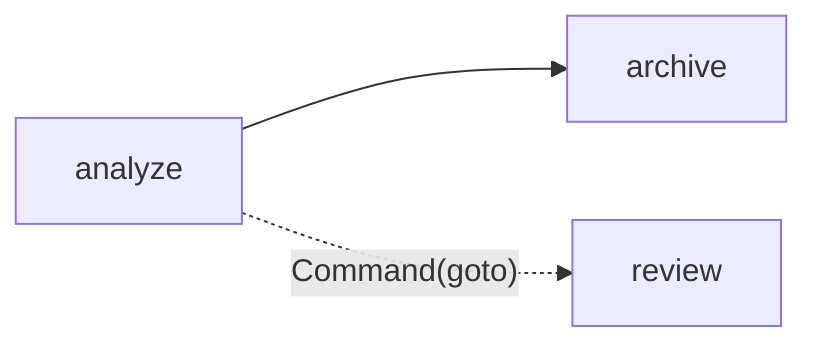

# S07-main-rep01-treatment

- Сценарий: `S7`
- Вариант: `treatment`
- Модель: `gpt-6-luna` (high)

## Ход 1 — запрос пользователя

У меня есть существующий LangGraph-граф, хочу обсудить его маршрутизацию.

## Ход 1 — ответ агента

Для обсуждения есть три режима:

- **Проектирование с нуля** — разработать новую архитектуру.
- **Аудит архитектуры** — проверить существующий граф и его маршрутизацию, выявить проблемы и предложить исправления.
- **Модификация архитектуры** — согласовать изменения действующего графа и обновить его архитектурное описание.

Рекомендую **аудит архитектуры**: он подходит для разбора маршрутизации существующего графа. Какой режим выбираете?

## Ход 2 — запрос пользователя

Выбираю режим «Аудит архитектуры».

## Ход 2 — ответ агента

В рабочей папке нашёл только инструкции — файлов с графом нет. Пришли сюда фрагмент, где объявлены узлы и рёбра, особенно `add_conditional_edges` и функции маршрутизации. Если выбор маршрута зависит от состояния, добавь определения соответствующих ключей `State`.

Этого хватит, чтобы разобрать маршруты и достижимые ветви; остальной граф оценивать не буду без его описания.

## Ход 3 — запрос пользователя

У узла `analyze` есть статический переход к `archive` и он может вернуть `Command(goto="review")`. Почему после analyze идут обе ветки?

## Ход 3 — ответ агента

`analyze` имеет два исходящих маршрута: статическое ребро всегда ведёт в `archive`, а `Command(goto="review")` добавляет переход в `review`. `Command` не заменяет статическое ребро, поэтому LangGraph запускает обе ветки — они могут выполняться параллельно. Это отмечено и в официальном руководстве по LangGraph. [LangGraph Fundamentals](https://github.com/langchain-ai/langchain-skills/blob/main/config/skills/langgraph-fundamentals/SKILL.md)

Если нужна **одна взаимоисключающая ветка**, оставь в `analyze` только один механизм маршрутизации: например, убери статическое ребро и выбирай `archive` или `review` через `Command`. Если обе ветки должны запускаться вместе, текущая схема соответствует этому намерению.

**Проблема:** статический переход и `Command(goto=...)` задают два маршрута из `analyze`.

**Критичность:** зависит от намерения; при ожидании одной ветки — существенная, особенно если узлы выполняют побочные действия.

**Последствие:** запускаются и `archive`, и `review`; возможны нежелательные действия или конфликтующие обновления состояния.

**Рекомендация:** если ветки должны быть взаимоисключающими, оставить один механизм маршрутизации.

**Вердикт:** **требует доработки** для проверенного фрагмента, пока не определено, должны ли ветки быть взаимоисключающими. Остальной граф не проверен. Ты ожидаешь, что после `analyze` сработает только одна из этих веток?
