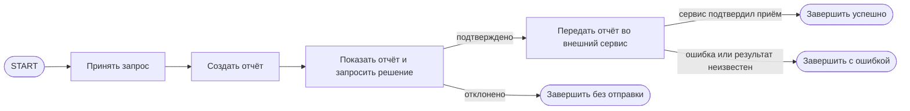

# S08-main-rep01-treatment

- Сценарий: `S8`
- Вариант: `treatment`
- Модель: `gpt-6-luna` (high)

## Ход 1 — запрос пользователя

В существующую архитектуру добавь ручное подтверждение, исходная спецификация требований уже утверждена.

## Ход 1 — ответ агента

Есть три режима:

- **Проектирование с нуля** — создать новую архитектуру.
- **Аудит архитектуры** — проверить существующую и указать проблемы.
- **Модификация архитектуры** — добавить подтверждение в действующую архитектуру и обновить её описание.

Рекомендую **модификацию архитектуры**, поскольку вы хотите добавить ручное подтверждение в существующую. Какой режим выбираете?

## Ход 2 — запрос пользователя

Выбираю режим «Модификация архитектуры». Утверждённые требования находятся в `specs/approved-requirements.md`, текущая архитектура — в `specs/current-agent-architecture.md`. Прочитай оба файла.

## Ход 2 — ответ агента

Прочитал оба файла. Требования задают три поля отчёта и требуют явного подтверждения перед отправкой; отказ должен отменять отправку. Текущая архитектура отправляет отчёт сразу после создания.

Предлагаю два варианта:

1. **Приостанавливать граф перед отправкой.** Узел подтверждения ждёт решения пользователя; подтверждение ведёт к отправке, отказ — к завершению без отправки. Это проще и соответствует описанному последовательному процессу. Для возобновления потребуются checkpoint и идентификатор потока; после resume узел может выполниться заново, поэтому отправку нужно защитить от повторов.
2. **Вынести подтверждение в отдельный асинхронный процесс.** Он лучше подходит, если пользователь может ответить значительно позже или из другого интерфейса, но добавляет отдельное хранение статуса и обработку ожидания.

Рекомендую первый вариант: требования не указывают на асинхронный процесс. Согласуете его?

## Ход 3 — запрос пользователя

Подтверждаю изменение архитектуры с ручным подтверждением. Требования не меняй; не записывай ничего в файлы или GitHub, выведи результат в чате.

## Ход 3 — ответ агента

## Предлагаемая модификация

Утверждённые требования из [specs/approved-requirements.md]([LOCAL_PATH_REDACTED] не меняются. В [текущей архитектуре]([LOCAL_PATH_REDACTED] добавляется обязательный шаг подтверждения между созданием отчёта и его отправкой.

### Architecture и Execution

Сохраняется последовательный граф. Узел подтверждения приостанавливает выполнение, показывает пользователю сформированный отчёт и принимает явный ответ «подтвердить» или «отклонить». После подтверждения граф отправляет тот же отчёт; отклонение завершает выполнение без вызова внешнего сервиса.

Для этого подходит LangGraph `interrupt()` с последующим возобновлением через `Command(resume=...)`. Такое возобновление требует checkpoint и `thread_id`; после resume узел с interrupt запускается заново с начала, поэтому в нём нельзя размещать побочные действия перед прерыванием. Эти требования описаны в [официальном HITL Skill](https://github.com/langchain-ai/langchain-skills/blob/main/config/skills/langgraph-human-in-the-loop/SKILL.md) и [Skill по persistence](https://github.com/langchain-ai/langchain-skills/blob/main/config/skills/langgraph-persistence/SKILL.md).

### State

| Поле | Назначение и доступ | Обновление и сохранение |
|---|---|---|
| `report` | Структура с `summary`, `source_ids`, `generated_at`; её читают узлы подтверждения и отправки | Создаётся узлом формирования отчёта; перезапись целиком, без reducer. Сохраняется в checkpoint до ожидания подтверждения |
| `approval_status` | Состояние решения: `pending`, `approved` или `rejected`; его читает маршрутизация | Узел подтверждения записывает результат resume. Не считать отсутствие ответа подтверждением |
| `delivery_status` | Результат передачи: `not_attempted`, `sent`, `failed` или `unknown` | Узел отправки обновляет поле после ответа внешнего сервиса |
| `thread_id` | Идентификатор исполнения для восстановления ожидающего графа | Передаётся в runtime-конфигурации; должен однозначно сопоставляться с ожидающим подтверждением |

Поля запроса и источников в исходном описании не раскрыты, поэтому их схема и владельцы остаются без изменений и требуют сверки с полной архитектурой.

### Nodes и Edges

- **Принять запрос** и **Создать отчёт** остаются существующими узлами.
- **Подтвердить отчёт** — новый узел: передаёт человеку отчёт для просмотра, приостанавливается, затем записывает решение. До interrupt он не выполняет внешних действий.
- **Маршрутизация по решению** ведёт к отправке только при `approval_status = approved`; при `rejected` — к завершению без отправки. Некорректный или отсутствующий ответ не должен вести к отправке.
- **Передать отчёт** вызывается только по ветке подтверждения и записывает результат операции.

Условный переход должен быть единственной маршрутизацией после решения. В LangGraph статические рёбра из узла продолжают выполняться даже при использовании `Command(goto=...)`; поэтому нельзя одновременно оставлять безусловное ребро к отправке и добавлять условный переход.

### Termination и Error Handling

- **Успех:** внешний сервис подтвердил приём отчёта.
- **Отказ пользователя:** завершение без передачи отчёта.
- **Ошибка:** постоянная ошибка сервиса; состояние доставки отмечается как `failed`.
- **Неизвестный результат:** например, соединение оборвалось после возможной передачи; статус становится `unknown`, автоматический повтор без проверки результата запрещён.

Для возобновления нужен долговременный checkpointer и привязка ответа пользователя к соответствующему `thread_id`. Вызов отправки следует защитить ключом идемпотентности или проверкой результата операции: checkpoint сам по себе не гарантирует однократность внешнего действия.

### Проверка и архитектурное заключение

**Проверено:** для описанного потока все основные маршруты достижимы; отказ не ведёт к отправке; подтверждение предшествует передаче; бесконечного цикла в предложенном графе нет. Архитектура согласуется с указанными требованиями и не меняет состав полей отчёта.

**Проблема:** исходные документы не уточняют технологию графа, способ доставки и авторизации ответа, выбранный checkpointer, а также поддержку идемпотентности или проверки результата внешним сервисом.

**Критичность:** высокая для надёжности передачи и подтверждения.

**Последствие:** нельзя подтвердить корректное возобновление после паузы и исключить повторную передачу при неоднозначном ответе сервиса.

**Рекомендация:** перед реализацией определить производственный checkpointer, механизм, связывающий пользователя с `thread_id`, и способ безопасно повторять или проверять отправку. Подтверждение должно приниматься только от пользователя, которому разрешено подтвердить именно этот отчёт.

**Вердикт: требует доработки** — схема изменения определена, но перечисленные критичные интеграционные контракты в доступных материалах не заданы. Это архитектурная оценка, не результат тестирования кода. Ничего в файлы или GitHub не записывал.
