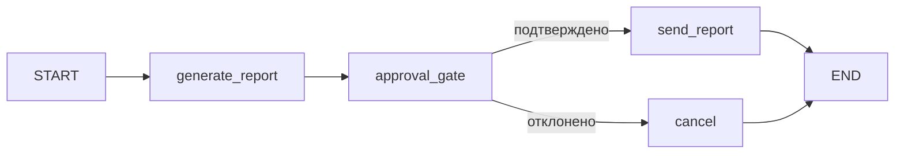

# S08-main-rep02-treatment

- Сценарий: `S8`
- Вариант: `treatment`
- Модель: `gpt-6-luna` (high)

## Ход 1 — запрос пользователя

В существующую архитектуру добавь ручное подтверждение, исходная спецификация требований уже утверждена.

## Ход 1 — ответ агента

Выберите режим:

- **Проектирование с нуля** — создать новую архитектуру.
- **Аудит архитектуры** — проверить существующую и описать проблемы.
- **Модификация архитектуры** — изменить действующую архитектуру и обновить её спецификацию.

Рекомендую **модификацию архитектуры**: вы хотите добавить ручное подтверждение в существующую. Какой режим выбираете? Указание на утверждённую спецификацию требований я учёл; её точное расположение уточню после выбора режима.

## Ход 2 — запрос пользователя

Выбираю режим «Модификация архитектуры». Утверждённые требования находятся в `specs/approved-requirements.md`, текущая архитектура — в `specs/current-agent-architecture.md`. Прочитай оба файла.

## Ход 2 — ответ агента

Прочитал [утверждённые требования](<[LOCAL_PATH_REDACTED]>) и [текущую архитектуру](<[LOCAL_PATH_REDACTED]>). Требование однозначно: отчёт с полями `summary`, `source_ids`, `generated_at` должен быть явно подтверждён до отправки; отказ отменяет передачу. Сейчас граф отправляет отчёт сразу после создания.

Предлагаю два способа добавить подтверждение:

1. **Узел подтверждения в графе — рекомендую.** После создания отчёта граф приостанавливается и показывает его пользователю. Подтверждение возобновляет граф и ведёт к отправке; отказ завершает поток без передачи. Это напрямую выражает требование в графе. Для `interrupt()` нужны checkpoint и стабильный `thread_id`; после возобновления узел запускается заново, поэтому отправку следует держать в отдельном узле после подтверждения. [Официальный материал LangGraph о HITL](https://github.com/langchain-ai/langchain-skills/blob/main/config/skills/langgraph-human-in-the-loop/SKILL.md)
2. **Пауза во внешнем оркестраторе.** Приложение сохраняет отчёт и отдельно управляет ожиданием решения, затем запускает передачу после подтверждения. Подходит, если приложение уже владеет такой логикой, но добавляет границу между графом и оркестратором.

Какой вариант выбираете? Моя рекомендация — узел подтверждения в графе.

## Ход 3 — запрос пользователя

Подтверждаю изменение архитектуры с ручным подтверждением. Требования не меняй; не записывай ничего в файлы или GitHub, выведи результат в чате.

## Ход 3 — ответ агента

## Предлагаемое изменение

Утверждённые требования не меняю. В описанной архитектуре отчёт сейчас отправляется сразу после создания, без обязательной проверки человеком. Предлагаю вставить узел подтверждения между созданием отчёта и его отправкой.

Узел `approval_gate` приостанавливает выполнение и показывает пользователю сформированный отчёт и запрос на решение. Подтверждение продолжает граф к `send_report`; отказ ведёт к `cancel`, минуя внешний сервис. Пока решения нет, поток остаётся приостановленным — истечение времени само по себе не запускает отправку.

## Архитектурные контракты

**Architecture.** Сохраняется существующая последовательная структура графа; добавляется одно ветвление по решению пользователя. Исхожу из того, что описанный граф реализован на LangGraph: текущий документ не называет фреймворк явно. Многоагентность и параллельные ветви для этого изменения не нужны.

**State.** Граф передаёт неизменённый отчёт с полями `summary`, `source_ids`, `generated_at`. Для нового этапа нужны:

| Поле | Роль и тип | Читатели и писатели | Обновление |
|---|---|---|---|
| `report` | Отчёт со структурой из утверждённых требований | Записывает `generate_report`; читают `approval_gate` и `send_report` | Записывается при создании и не меняется после показа на подтверждение |
| `approval_decision` | Решение: `null`, `approved` или `rejected` | Записывает `approval_gate`; читает условный переход | `null` при ожидании; устанавливается после проверки ответа |
| `operation_id` | Стабильный идентификатор операции, вне payload отчёта | Создаёт `generate_report`; читает `send_report` | Не меняется при возобновлении или повторе передачи |
| `delivery_status` | Результат передачи: `not_sent`, `sent` или `failed` | Обновляет `send_report`; читает вызывающая сторона | Меняется после результата внешнего вызова |

Для паузы и продолжения состояние сохраняется через checkpointer; при возобновлении используется тот же `thread_id`. В LangGraph `interrupt()` требует checkpoint и идентификатор потока, а при возобновлении узел с прерыванием запускается заново с начала. Поэтому в `approval_gate` до прерывания не должно быть внешних побочных действий. [Официальный материал о HITL](https://github.com/langchain-ai/langchain-skills/blob/main/config/skills/langgraph-human-in-the-loop/SKILL.md), [о persistence и checkpointers](https://github.com/langchain-ai/langchain-skills/blob/main/config/skills/langgraph-persistence/SKILL.md)

**Nodes.**

- `generate_report` создаёт отчёт и стабильный `operation_id`.
- `approval_gate` показывает именно этот отчёт, ожидает явный ответ `approved` или `rejected` и записывает решение. Неизвестный или некорректный ответ не должен считаться подтверждением.
- `send_report` вызывает внешний сервис только после `approved`, передаёт отчёт с исходными тремя полями и записывает результат.
- `cancel` завершает операцию после отказа без вызова внешнего сервиса.

**Edges.** `START → generate_report → approval_gate`. После возобновления — условный переход из `approval_gate` в `send_report` при `approved` либо в `cancel` при `rejected`. Оба конечных узла ведут к `END`; из `cancel` нет маршрута к отправке.

**Execution и завершение.** После генерации граф сохраняет checkpoint и ждёт решение. Ответ передаётся в тот же поток. Подтверждение завершает передачу успешно; отказ завершает операцию без передачи; отсутствие ответа оставляет операцию ожидающей. Ошибочная отправка фиксируется как `failed` после ограниченного числа повторов.

**Ошибки и повторное выполнение.** Внешняя отправка — побочный эффект, который LangGraph сам по себе не гарантирует выполнить ровно один раз при сбое или replay. `send_report` должен передавать внешний ключ идемпотентности на основе стабильного `operation_id` либо проверять в сервисе результат предыдущей попытки. Checkpoint и `thread_id` обеспечивают восстановление состояния, но сами по себе не исключают дублирование внешнего действия. [Официальный материал о persistence](https://github.com/langchain-ai/langchain-skills/blob/main/config/skills/langgraph-persistence/SKILL.md)

## Архитектурное заключение

- **Проблема:** в описанном графе отсутствует обязательное подтверждение между генерацией отчёта и отправкой.
- **Критичность:** высокая — текущий поток нарушает утверждённое требование.
- **Последствие:** отчёт может быть передан без явного согласия пользователя.
- **Рекомендация:** добавить `approval_gate` с checkpoint и возобновлением того же потока; разрешать переход к отправке только при валидном `approved`, а повторы внешней операции защищать идемпотентностью.
- **Вердикт:** **требует доработки** перед реализацией. Предложенный маршрут соответствует требованиям, но в текущем описании не указаны механизм идентификации пользователя при возобновлении и поддержка ключа идемпотентности внешним сервисом. Эти факты нужно подтвердить; утверждённые требования при этом менять не требуется.

Ничего не записывал в файлы или GitHub; это архитектурное предложение только для чата.
