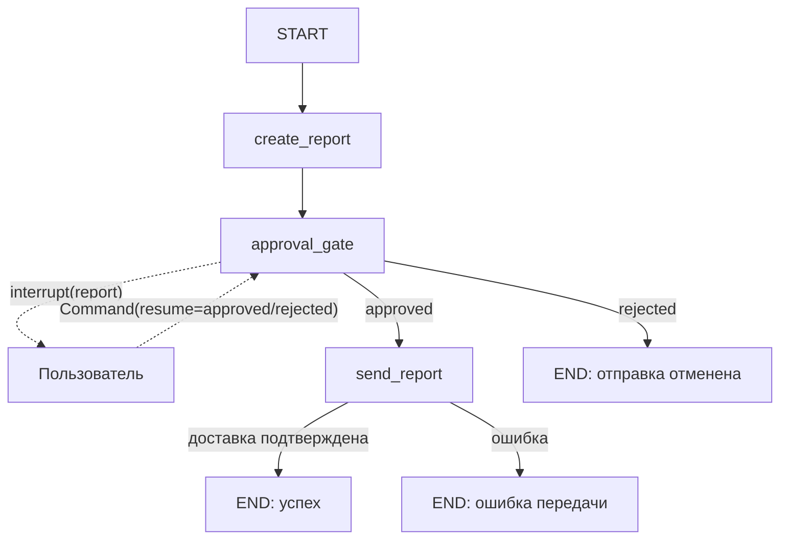

# S08-main-rep04-treatment

- Сценарий: `S8`
- Вариант: `treatment`
- Модель: `gpt-6-luna` (high)

## Ход 1 — запрос пользователя

В существующую архитектуру добавь ручное подтверждение, исходная спецификация требований уже утверждена.

## Ход 1 — ответ агента

Использую правила LangGraph Agent Architect, чтобы выбрать подходящий режим до изучения материалов.

- **Проектирование с нуля** — разработать новую архитектуру.
- **Аудит архитектуры** — проверить существующую и описать проблемы.
- **Модификация архитектуры** — внести в действующую архитектуру согласованные изменения.

Рекомендую **модификацию архитектуры**: вы хотите добавить ручное подтверждение в существующую. Какой режим выбираете? После выбора попрошу точный путь или URL к утверждённой спецификации требований, если он всё ещё не указан.

## Ход 2 — запрос пользователя

Выбираю режим «Модификация архитектуры». Утверждённые требования находятся в `specs/approved-requirements.md`, текущая архитектура — в `specs/current-agent-architecture.md`. Прочитай оба файла.

## Ход 2 — ответ агента

Прочитал оба файла. Требование однозначно: сформировать отчёт, получить явное подтверждение, и только после одобрения передать отчёт во внешний сервис; отказ отменяет передачу. Сейчас граф сразу отправляет отчёт.

Есть два подхода:

1. **Ожидать подтверждения внутри графа.** После формирования отчёта граф приостанавливается; после одобрения продолжает отправку, после отказа завершает работу. Рекомендую этот вариант: он прямо добавляет недостающий шаг в существующий поток. Для возобновления понадобятся checkpoint и идентификатор потока; внешний вызов должен происходить только после подтверждения.
2. **Вынести ожидание в отдельный процесс согласования.** Граф сохраняет отчёт как ожидающий подтверждения, а отдельный обработчик возобновляет или отменяет отправку. Это удобнее при сложной очереди согласований, но требует дополнительных компонентов и связей.

Какой подход выбрать?

## Ход 3 — запрос пользователя

Подтверждаю изменение архитектуры с ручным подтверждением. Требования не меняй; не записывай ничего в файлы или GitHub, выведи результат в чате.

## Ход 3 — ответ агента

## Архитектурное изменение

Ниже — спецификация изменения в чате. Файлы и GitHub не менялись. Утверждённые требования сохранены без изменений.

### Architecture

Существующий граф формирует отчёт и сразу отправляет его. Предлагаю добавить обязательный шаг подтверждения между этими действиями, сохранив текущий граф и поток формирования отчёта.

Рассмотрены два подхода:

1. **Подтверждение внутри графа:** граф приостанавливается после формирования отчёта и продолжает работу после решения пользователя. Выбранный вариант — он добавляет контрольную точку прямо перед передачей.
2. **Отдельный процесс согласования:** граф сохраняет ожидающий отчёт, а отдельный обработчик позже возобновляет или отменяет отправку. Этот вариант требует дополнительных компонентов и нужен, если появится сложная очередь согласований.

### State

Все поля отчёта должны быть доступны на экране подтверждения и сохранены в checkpoint вместе с состоянием графа.

| Поле | Назначение и тип | Читатели / писатели | Обновление и сохранение |
|---|---|---|---|
| `summary` | Краткий отчёт; тип в требованиях не задан, предлагается строка | Формирование отчёта пишет; экран подтверждения и отправка читают | Перезапись при формировании; checkpoint |
| `source_ids` | Идентификаторы источников; тип в требованиях не задан, предлагается список строк | Формирование отчёта пишет; экран подтверждения и отправка читают | Перезапись целым списком; checkpoint |
| `generated_at` | Время создания; предлагается ISO-8601 timestamp | Формирование отчёта пишет; экран подтверждения читает; сервис получает при отправке | Перезапись при формировании; checkpoint |
| `approval_status` | `pending`, `approved` или `rejected` | Формирование отчёта устанавливает `pending`; узел подтверждения записывает решение; маршрутизация читает | Перезапись; checkpoint |
| `operation_id` | Внутренний стабильный идентификатор одной отправки; не часть отчёта | Передающий вызов задаёт до первого запуска; отправка читает | Не меняется при возобновлении; checkpoint |
| `delivery_status` | Результат передачи: например, `succeeded` или `failed` | Узел отправки пишет; завершение читает | Перезапись; checkpoint |
| `delivery_receipt` | Необязательное подтверждение внешнего сервиса; структура не задана | Узел отправки пишет; завершение читает | Перезапись; checkpoint |

Для этих полей не требуется reducer: ветви параллельно не пишут в общий ключ. Типы полей отчёта, кроме их названий и назначения, в требованиях не определены; типы выше — проектное предложение.

### Nodes и маршруты

- **`create_report`** формирует отчёт и устанавливает `approval_status = pending`. Использует существующие зависимости формирования отчёта; их состав в текущей архитектуре не описан. Затем переходит к `approval_gate`.
- **`approval_gate`** передаёт пользователю отчёт и сведения о предстоящей операции через `interrupt()`. До прерывания узел не выполняет внешних действий. При возобновлении принимает только явное решение `approved` или `rejected`, записывает его и передаёт управление по условному маршруту.
- **`send_report`** вызывается только при `approved`. Отправляет отчёт внешнему сервису и записывает результат. `operation_id` предлагается передавать сервису как ключ идемпотентности.
- **Отказ** завершает граф с `approval_status = rejected`; узел отправки недостижим.
- **Успешное завершение** наступает после подтверждённого ответа внешнего сервиса.

### Execution, persistence и завершение

Граф начинает работу с формирования отчёта. Затем он приостанавливается до явного решения. Для продолжения приложение возобновляет тот же поток через `Command(resume=...)`, используя тот же `thread_id`. Для `interrupt()` необходим checkpointer; в рабочей среде он должен сохранять состояние надёжно между запусками.

При возобновлении узел с `interrupt()` выполняется заново с начала. Поэтому код до прерывания должен быть безопасным при повторном выполнении; в этой схеме узел подтверждения только читает состояние и формирует запрос на подтверждение. Сам факт checkpoint не гарантирует однократность внешней отправки. [Документация LangGraph по прерываниям](https://docs.langchain.com/oss/python/langgraph/interrupts), [официальный навык LangGraph HITL](https://github.com/langchain-ai/langchain-skills/blob/main/config/skills/langgraph-human-in-the-loop/SKILL.md).

- **Успех:** сервис подтвердил приём отчёта.
- **Отмена:** пользователь явно отказал; отчёт не отправляется.
- **Ожидание:** граф приостановлен с `pending`; срок ожидания требованиями не задан.
- **Ошибка:** формирование, checkpoint или передача завершились неисправимой ошибкой. Ошибка передачи не должна отображаться как успех.

Невалидный или отсутствующий ответ не считается подтверждением: приложение должно оставить операцию ожидающей и запросить явный выбор. Повторы отправки допустимы только с защитой от дубликатов; после неоднозначного таймаута сначала нужно проверить результат операции, если сервис это позволяет.

### Валидация и заключение

Проверено по описанию архитектуры и требованиям: маршрут проходит через подтверждение; ветвь отказа не достигает отправки; циклов и параллельного объединения нет. Требование к полям отчёта сохранено. Технический контракт внешнего сервиса в предоставленных материалах не описан.

- **Проблема:** не подтверждено, поддерживает ли внешний сервис ключ идемпотентности или проверку результата отправки.
- **Критичность:** высокая для корректности повторного запуска после сбоя.
- **Последствие:** после неоднозначного таймаута повторная передача может создать дубликат.
- **Рекомендация:** перед реализацией подтвердить контракт сервиса; использовать стабильный `operation_id` для идемпотентной отправки либо определить способ сверки результата перед повтором.
- **Вердикт:** **требует доработки** до подтверждения контракта идемпотентности внешнего сервиса. Это архитектурная оценка, не результат тестирования кода.

Поддерживает ли внешний сервис идемпотентный ключ или проверку результата операции по её идентификатору?
