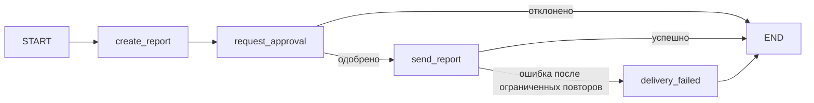

# S08-main-rep05-treatment

- Сценарий: `S8`
- Вариант: `treatment`
- Модель: `gpt-6-luna` (high)

## Ход 1 — запрос пользователя

В существующую архитектуру добавь ручное подтверждение, исходная спецификация требований уже утверждена.

## Ход 1 — ответ агента

Для изменения существующей архитектуры есть три режима:

- **Проектирование с нуля** — создать новую архитектурную спецификацию.
- **Аудит архитектуры** — проверить существующую и описать проблемы и рекомендации.
- **Модификация архитектуры** — внести согласованные изменения в действующую архитектуру.

Рекомендую **модификацию архитектуры**: вы хотите добавить ручное подтверждение. Какой режим выбираете? После выбора попрошу точный путь или URL к утверждённой спецификации требований.

## Ход 2 — запрос пользователя

Выбираю режим «Модификация архитектуры». Утверждённые требования находятся в `specs/approved-requirements.md`, текущая архитектура — в `specs/current-agent-architecture.md`. Прочитай оба файла.

## Ход 2 — ответ агента

Прочитал оба файла. Требования: агент формирует краткий отчёт с полями `summary`, `source_ids`, `generated_at`, а перед отправкой получает явное подтверждение; отказ отменяет отправку. Текущая архитектура создаёт отчёт и сразу передаёт его внешнему сервису.

Предлагаю три варианта:

1. **Пауза внутри узла отправки.** Минимум изменений, но при возобновлении узел запускается заново; важно исключить повторение внешнего действия.
2. **Отдельные узлы подтверждения и отправки.** После создания отчёта граф приостанавливается для ответа человека, затем по решению ведёт либо к отправке, либо к отмене. Это яснее отделяет подтверждение от побочного действия.
3. **Подтверждение вне графа.** Внешний оркестратор собирает решение и запускает граф дальше; подходит, если система уже управляет ожиданием пользователя.

Рекомендую **вариант 2**: он соответствует требованию и делает невозможным маршрут к отправке до явного одобрения. Для паузы и возобновления понадобятся checkpoint и идентификатор потока; узел отправки должен учитывать возможный повторный запуск.

Согласуете этот подход?

## Ход 3 — запрос пользователя

Подтверждаю изменение архитектуры с ручным подтверждением. Требования не меняй; не записывай ничего в файлы или GitHub, выведи результат в чате.

## Ход 3 — ответ агента

## Предлагаемое изменение архитектуры

Результат ниже — спецификация в чате. Файлы и GitHub не изменялись. Она сохраняет исходные требования: отчёт содержит `summary`, `source_ids`, `generated_at`; отправка возможна только после явного подтверждения, а отказ отменяет её.

**Предположение:** текущий граф работает на LangGraph. В прочитанном описании архитектуры фреймворк не указан; решение с `interrupt()` применимо, если это LangGraph.

### Архитектура и выполнение

Сохраняется последовательный граф и добавляется пауза на проверку отчёта человеком. Одобренный ранее вариант с отдельным шагом подтверждения предпочтительнее паузы внутри отправки: внешний вызов остаётся изолированным в отдельном узле.

`request_approval` использует `interrupt()` и маршрутизирует результат через `Command` либо условный переход. У этого узла не должно быть одновременно конфликтующего статического перехода к отправке: `Command(goto=...)` сам по себе статические рёбра не отменяет.

### State

| Поле | Роль и тип | Читатели / писатели | Обновление и сохранение |
|---|---|---|---|
| `report` | Отчёт: `summary`, `source_ids`, `generated_at` | Запись — `create_report`; чтение — `request_approval`, `send_report` | Перезапись; сохраняется в checkpoint на время ожидания |
| `approval_status` | `pending`, `approved` или `rejected` | Запись — узлы формирования отчёта и подтверждения; чтение — маршрутизация и терминальные ветви | Перезапись; начальное значение `pending` |
| `report_key` | Стабильный ключ операции для связывания подтверждения и доставки | Формирование — при подготовке отчёта; чтение — узлы подтверждения и отправки | Перезапись; должен сохраняться через checkpoint |
| `delivery_status` | `pending`, `sent` или `failed` | Запись — `send_report` или ветвь ошибки | Перезапись; хранит результат доставки и, при успехе, квитанцию сервиса |

`report_key` и `delivery_status` — внутренние поля процесса, они не меняют утверждённый состав самого отчёта. Подтверждение должно относиться к неизменённому отчёту; в запросе на проверку следует показывать его содержимое и ключ или версию.

### Узлы и обработка ошибок

- **`create_report`** — формирует отчёт и задаёт состояние ожидания подтверждения. Не отправляет данные во внешний сервис.
- **`request_approval`** — показывает человеку конкретный отчёт, приостанавливает граф и ждёт решения. После возобновления записывает `approved` или `rejected`. До `interrupt()` в этом узле допустимы только безопасные операции: LangGraph повторно запускает узел с начала при resume.
- **`send_report`** — доступен только по маршруту `approved`; передаёт отчёт и записывает квитанцию сервиса. Для неоднозначного сетевого сбоя перед повтором проверяет, не принял ли сервис предыдущую попытку.
- **`delivery_failed`** — фиксирует исчерпание ограниченных повторов отправки. Завершает граф с неуспехом, не помечая отчёт доставленным.

Для `interrupt()` нужны checkpointer и один и тот же `thread_id` при возобновлении; решение человека передаётся в граф как `Command(resume=...)`. Если ответа нет, предлагаю оставить процесс в состоянии `pending` без автоматического одобрения и без отправки. Эти механизмы и повторное выполнение узла подтверждения описаны в [официальном LangGraph Skill по HITL](https://github.com/langchain-ai/langchain-skills/blob/main/config/skills/langgraph-human-in-the-loop/SKILL.md).

### Завершение и валидация

- **Успех:** внешний сервис подтвердил приём отчёта, сохранён статус `sent` и квитанция.
- **Отказ человека:** статус `rejected`, процесс завершён; узел отправки недостижим.
- **Нет ответа:** граф остаётся приостановленным в `pending`; отправки нет.
- **Сбой:** после ограниченных повторов фиксируется `failed`; успешная доставка не утверждается.
- **Потеря checkpoint или ошибка возобновления:** продолжение не должно обходить подтверждение и отправлять отчёт.

Маршруты от создания отчёта проходят через подтверждение; обе его ветви имеют конечный исход. Состояние отчёта сохраняется при ожидании. Отправка отделена от узла с `interrupt()`, поэтому возобновление ожидания само по себе не повторяет внешний вызов.

**Архитектурное заключение**

- **Проблема:** в описании текущей архитектуры нет подтверждения; не указаны также фреймворк графа и возможности внешнего сервиса по идемпотентной отправке или проверке результата.
- **Критичность:** высокая для гарантии отсутствия дублей при сбое на границе между приёмом отчёта сервисом и получением ответа.
- **Последствие:** повторная попытка после неоднозначного сбоя может доставить отчёт дважды.
- **Рекомендация:** использовать стабильный ключ операции, а на стороне внешнего сервиса — идемпотентность по этому ключу либо проверку уже принятой операции перед повтором; подтвердить, что текущая реализация графа поддерживает LangGraph HITL и долговременное хранение checkpoint.
- **Вердикт:** **требует доработки** — схема подтверждения определена, но готовность к реализации зависит от проверки фреймворка, хранилища checkpoint и контракта доставки внешнего сервиса. Это архитектурная оценка, не результат тестирования кода.
