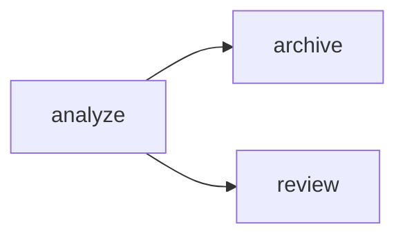

# S07-main-rep05-treatment

- Сценарий: `S7`
- Вариант: `treatment`
- Модель: `gpt-6-luna` (high)

## Ход 1 — запрос пользователя

У меня есть существующий LangGraph-граф, хочу обсудить его маршрутизацию.

## Ход 1 — ответ агента

Для задачи с существующим графом подходят три режима:

- **Аудит архитектуры** — проверить текущую маршрутизацию, найти проблемы и предложить исправления. **Рекомендую его** для вашего запроса.
- **Модификация архитектуры** — спроектировать согласованные изменения в графе.
- **Проектирование с нуля** — разработать новую архитектуру.

Какой режим выбираете?

## Ход 2 — запрос пользователя

Выбираю режим «Аудит архитектуры».

## Ход 2 — ответ агента

В рабочей папке нашлись только инструкции — кода графа нет. Пришлите фрагмент с созданием графа, вызовами `add_node`/`add_edge`/`add_conditional_edges`, функциями маршрутизации и описанием State.

Для аудита маршрутов этого обычно достаточно; если маршрутизация использует `Command(goto=...)` или `Send`, включите и эти места.

## Ход 3 — запрос пользователя

У узла `analyze` есть статический переход к `archive` и он может вернуть `Command(goto="review")`. Почему после analyze идут обе ветки?

## Ход 3 — ответ агента

У `analyze` работают сразу два механизма маршрутизации. Статическое ребро добавляет переход к `archive`, а `Command(goto="review")` добавляет динамический переход к `review`. `Command` не отменяет статические рёбра, поэтому оба узла запускаются в следующем шаге графа. Это соответствует описанной в документации семантике LangGraph: оба перехода исполняются, а для узла рекомендуется выбрать один механизм маршрутизации. ([Graph API LangGraph](https://docs.langchain.com/oss/python/langgraph/graph-api))

**Проблема:** `analyze` одновременно использует статический переход и `Command`.

**Критичность:** средняя, если ожидалась ровно одна ветка.

**Последствие:** выполнятся и `archive`, и `review`; возможны лишние побочные эффекты или конфликтующие обновления State.

**Рекомендация:** оставьте один механизм. Для выбора между узлами используйте либо `Command(goto=...)` без статического ребра из `analyze`, либо условный переход (`add_conditional_edges`) без этого `Command`. Если обе ветки должны выполняться, текущая схема может быть намеренной.

**Вердикт:** **требует доработки**, если ветки должны быть взаимоисключающими. Проверен только описанный фрагмент; остальной граф не оценивался.
