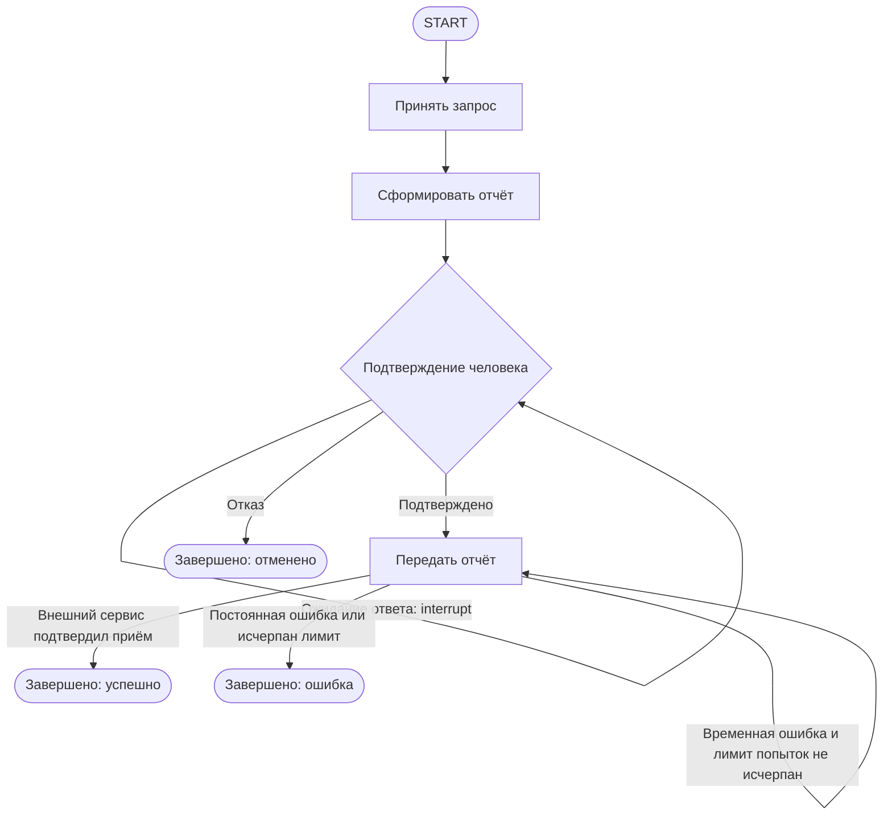

# S08-main-rep04-treatment

- Сценарий: `S8`
- Вариант: `treatment`
- Модель: `gpt-6-luna` (high)

## Ход 1 — запрос пользователя

В существующую архитектуру добавь ручное подтверждение, исходная спецификация требований уже утверждена.

## Ход 1 — ответ агента

Выберите режим:

- **Проектирование с нуля** — создать новую архитектуру.
- **Аудит архитектуры** — проверить существующую и описать проблемы.
- **Модификация архитектуры** — добавить ручное подтверждение в действующую архитектуру и обновить её спецификацию.

Рекомендую **модификацию архитектуры**. Какой режим выбираете?

## Ход 2 — запрос пользователя

Выбираю режим «Модификация архитектуры». Утверждённые требования находятся в `specs/approved-requirements.md`, текущая архитектура — в `specs/current-agent-architecture.md`. Прочитай оба файла.

## Ход 2 — ответ агента

Прочитал [утверждённые требования](specs/approved-requirements.md) и [текущую архитектуру](specs/current-agent-architecture.md).

Требования однозначны: отчёт с полями `summary`, `source_ids`, `generated_at` должен попасть во внешний сервис только после явного подтверждения; отказ отменяет передачу. Сейчас граф отправляет отчёт сразу.

Вижу два подходящих варианта:

1. **Отдельный узел подтверждения** между созданием отчёта и отправкой. Он показывает человеку готовый отчёт и приостанавливает граф; после явного подтверждения маршрут ведёт к отправке, после отказа — к завершению без передачи. Это яснее отделяет решение человека от внешнего побочного действия.
2. **Пауза внутри узла отправки.** Меньше узлов, но подтверждение и внешняя операция оказываются смешаны, а маршрут отказа менее очевиден.

Рекомендую первый вариант. Для `interrupt()` LangGraph нужны checkpointer и тот же `thread_id` при возобновлении через `Command(resume=...)`; узел с прерыванием запускается заново с начала, поэтому внешнюю отправку следует выполнять только после подтверждения и отдельно защищать от повторов. Это соответствует [официальному руководству LangGraph по HITL](https://github.com/langchain-ai/langchain-skills/blob/main/config/skills/langgraph-human-in-the-loop/SKILL.md).

Какой вариант выбираете?

## Ход 3 — запрос пользователя

Подтверждаю изменение архитектуры с ручным подтверждением. Требования не меняй; не записывай ничего в файлы или GitHub, выведи результат в чате.

## Ход 3 — ответ агента

Ниже — вариант изменённой архитектуры для чата. Исходные требования сохранены без изменений; файлы и GitHub не изменялись.

## Архитектура

Оставить последовательный граф и вставить отдельный узел подтверждения между созданием отчёта и передачей. Узел показывает человеку именно тот отчёт, который будет отправлен, и приостанавливает выполнение. Только подтверждение ведёт к внешней передаче; отказ завершает операцию без неё.

## State

| Поле | Назначение и читатели | Запись и обновление | Сохранение |
|---|---|---|---|
| `report` | Готовый отчёт; читают узлы подтверждения и передачи. Содержит ровно `summary`, `source_ids`, `generated_at`. | Записывает узел формирования; после этого неизменяем. | Сохраняется checkpoint до приостановки. |
| `report_digest` | Внутренний идентификатор версии отчёта; связывает подтверждение с конкретным содержимым. Не добавляется в payload отчёта. | Вычисляется при формировании отчёта; неизменяем. | Сохраняется вместе с отчётом. |
| `approval_status` | Состояние решения: `pending`, `approved` или `rejected`. Читается маршрутизацией. | Изначально `pending`; узел подтверждения меняет его только после валидного ответа. | Сохраняется для возобновления. |
| `delivery_status` | Результат передачи: `not_started`, `sent` или `failed`. | Записывает узел передачи после ответа сервиса или окончательной ошибки. | Сохраняется для восстановления и диагностики. |
| `delivery_attempts` | Счётчик попыток передачи. | Увеличивается узлом передачи; ограничен заданным максимумом. | Сохраняется между попытками. |

Для паузы также нужны постоянный checkpointer и `thread_id` запуска: при возобновлении используется тот же идентификатор потока. Текущий документ не задаёт конкретное хранилище checkpoint’ов.

## Узлы и маршруты

- **Принять запрос** — существующая ответственность; передаёт входные данные узлу формирования отчёта.
- **Сформировать отчёт** — сохраняет отчёт с тремя утверждёнными полями и его внутренний digest. После этого отчёт не перегенерируется при ожидании ответа.
- **Подтверждение человека** — передаёт вызывающей системе отчёт и запрос на подтверждение, затем приостанавливается через `interrupt()`. После возобновления принимает только валидное решение, связанное с тем же digest. `approved` ведёт к передаче; `rejected` — к отмене. Неизвестное или устаревшее решение не разрешает передачу.
- **Передать отчёт** — вызывает внешний сервис только после подтверждённого решения. Временные ошибки допускают ограниченные повторы; постоянная ошибка или исчерпание лимита завершают граф с ошибкой.

Вызывающая система должна показать interrupt человеку и передать его ответ обратно в тот же поток через `Command(resume=...)`. Для LangGraph прерывание требует checkpointer и того же `thread_id`; узел с `interrupt()` запускается заново с начала при возобновлении. Поэтому до точки прерывания не следует помещать внешние побочные действия, а передачу нужно защитить от дублей. Это соответствует [официальному руководству LangGraph по HITL](https://github.com/langchain-ai/langchain-skills/blob/main/config/skills/langgraph-human-in-the-loop/SKILL.md).

## Завершение и ошибки

- **Успех:** внешний сервис подтвердил приём отчёта.
- **Отмена:** человек явно отказал; передача не выполнялась.
- **Ожидание:** ответа ещё нет; граф остаётся приостановленным, автоматической передачи нет.
- **Ошибка:** формирование отчёта завершилось ошибкой либо передача не удалась после ограниченных повторов.

Для передачи следует использовать стабильный ключ идемпотентности или проверять результат операции у внешнего сервиса перед повтором после неоднозначного таймаута. Сам checkpoint не гарантирует однократность внешнего действия. Политику истечения срока ожидания и права на подтверждение следует определить до реализации; требования этого не уточняют.

## Архитектурное заключение

- **Проблема:** текущий граф отправляет отчёт без подтверждения.
- **Критичность:** высокая — нарушено прямое требование о явном согласии пользователя.
- **Последствие:** отчёт может попасть во внешний сервис без разрешения.
- **Рекомендация:** добавить описанный узел подтверждения, сохранять checkpoint на паузе и разрешать передачу только после валидного подтверждения именно показанного отчёта.
- **Вердикт:** **требует доработки** перед реализацией. Логика изменения определена, но ещё нужно выбрать постоянное хранилище checkpoint’ов, установить политику авторизации подтверждающего и проверить поддержку идемпотентности или сверки результата внешним сервисом.
