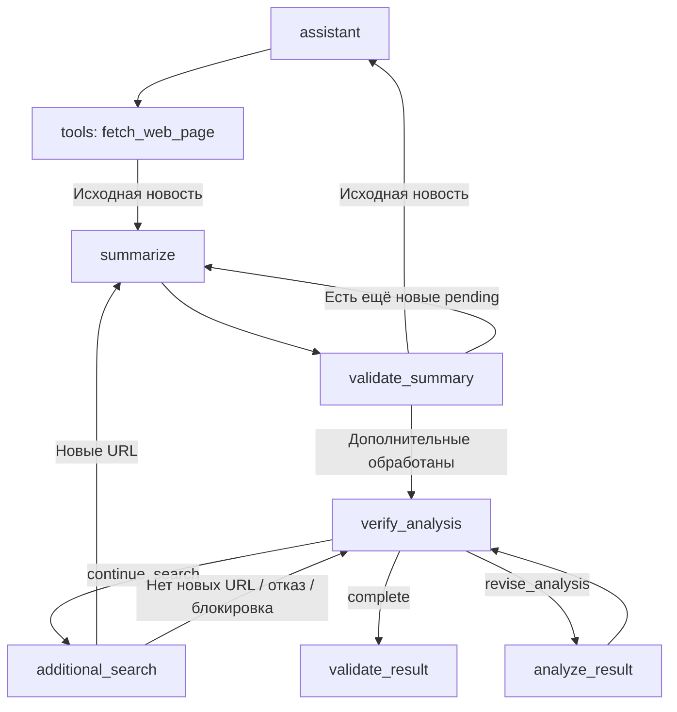

# Контракт отдельной LangGraph-ноды `additional_search` — архитектурная спецификация

**Проект:** BondNavigator  
**Компонент:** `agents/analysis_news`  
**Предмет:** интеграция отдельного слоя получения дополнительных новостей в граф  
**Дата начала:** 2026-11-07  
**Статус:** архитектурные решения согласованы; финальная статическая проверка выполнена 2026-11-09. Готова для подготовки Codex плана интеграции; реализация требует отдельного разрешения после проверки фактического кода.

**Зависимая спецификация:** [Слой `data_sources/additional_news`](../additional_news/spec-2026-11-07.md) — источник истины для моделей `AdditionalSource`, `AdditionalSearchResult`, получения публикаций, ручного запуска и MCP-провайдера. Здесь эти детали не проектируются повторно.

**Базовая спецификация агента:** [AI-агент анализа новостей эмитентов](issuer-news-agent-2026-11-02.md). Это отдельный документ, его согласованные контракты не изменяются автоматически.

## 1. Назначение и граница узла

В графе имеется **отдельная нода `additional_search`**. LLM-эксперт `verify_analysis` формирует `fact` и готовый `query`, а нода вызывает **непосредственно** публичную функцию `data_sources.additional_news.service.search_additional_news(fact, query)`, принимает `AdditionalSearchResult` и преобразует его в обновления состояния.

**Не создавать** промежуточный LangChain `@tool`, функцию-обёртку в `agents/analysis_news/tools.py` или новый `ToolNode` для этого вызова. Решение LLM уже принято в `verify_analysis`, повторный механизм Tool Calling не нужен.

Граница ответственности: нода управляет состоянием `AgentState`; сервис независимо от графа выполняет поиск и формирует структурированный результат. Транспорт провайдера SearXNG (MCP либо JSON API) и чтение HTML — внутренние детали уже реализованного слоя данных, на которые граф не должен опираться. Саму реализацию публичного сервиса не размещать в модуле агента.

## 2. Расположение и ответственность

```text
agents/analysis_news/
├── agent.py                 # get_graph(): регистрация и маршрутизация всех нод.
├── nodes.py                 # Реализация нод, включая additional_search().
├── tools.py                 # Имеющиеся инструменты; обёртка для поиска не нужна.
└── models.py                # AgentState, VerifyTask, SourceData и другие модели.

data_sources/additional_news/
├── service.py               # Только публичная функция search_additional_news(fact, query).
├── models.py                # AdditionalSource и AdditionalSearchResult.
├── reader.py                # Загрузка HTML и извлечение текста публикаций.
└── providers/searxng.py     # Внутренний провайдер поиска SearXNG.
```

**`agent.py`:** регистрация новой ноды выполняется в существующей функции `get_graph()` рядом с другими вызовами `graph.add_node(...)`. Там же задаются переходы графа, но не выполняются поиск и преобразование данных.

**`nodes.py`:** функция `additional_search()` располагается рядом с остальными обработчиками узлов. Она извлекает задание из состояния, вызывает `await search_additional_news(fact=..., query=...)` и преобразует ответ в обновления `AgentState`. Имя ноды в графе сохраняется `additional_search`. Точную сигнатуру функции ноды и переходы согласуем с существующим стилем `nodes.py` при реализации.

**`service.py`:** содержит только одну публичную функцию `search_additional_news(fact: str, query: str) -> AdditionalSearchResult`. Взаимодействие с Docker/SearXNG выполняется через провайдер. Ручной запуск возможен прямым вызовом этой функции без дополнительного `run_test()`.

Нода использует уже существующий слой данных и не дублирует MCP-операции, извлечение текста, модели результата или LLM-суммаризацию.

## 3. Согласованные контракты состояния агента

**Целевое изменение `VerifyTask`:** вместо поля `question` использовать `query`. LLM-эксперт `verify_analysis` формирует проверяемый `fact` и готовую поисковую строку `query`; прежнее поле `question` остаётся только в текущей реализации до внесения изменений. Это изменение контракта необходимо согласованно отразить в схеме ответа LLM, промптах, модели и точках чтения поля во время реализации. В `AgentState` добавляется `search_task` с исходным значением `None`. `SourceData` остаётся общей моделью для основной новости и дополнительных публикаций; удаляются устаревшие `draft` и `is_excerpt`, добавляется дата публикации.

```python
from datetime import date
from typing import Literal, TypedDict


class VerifyTask(TypedDict):
    """Задание эксперта на проверку факта внешними источниками."""

    fact: str  # Проверяемое утверждение о конкретном эмитенте.
    query: str  # Готовый поисковый запрос для SearXNG, сформированный LLM-экспертом.


class SourceData(TypedDict):
    """Публикация и результат проверки её суммаризации в состоянии графа."""

    title: str | None  # Заголовок публикации, если доступен.
    text: str  # Полный текст полученной публикации.
    published_date: date | Literal["unknown"]  # Дата публикации либо «unknown», если неизвестна.
    summary: str | None  # Предварительная либо проверенная суммаризация.
    summary_status: Literal["pending", "validated", "rejected"]  # Статус проверки суммаризации.


class AgentState(TypedDict):
    """Фрагмент модели состояния агента с новым заданием поиска."""

    # Остальные ранее существовавшие поля AgentState сохраняются.
    search_task: VerifyTask | None  # Задание дополнительного поиска; None, если его нет.
```

Показанный `AgentState` — **фрагмент изменений**, не замена полного существующего класса. URL публикации служит ключом существующего `AgentState.sources: dict[str, SourceData]`. **Граница дедупликации (уточнение):** слой `data_sources/additional_news` самостоятельно выбирает не более одной публикации с каждого сайта **в пределах одного вызова** `search_additional_news()`. Нода `additional_search` не повторяет этот отбор по сайтам. Её отдельная задача — защитить **накопленное состояние графа между итерациями** (включая публикации, полученные ранее при других запросах, и исходную новость): перед добавлением она проверяет точное совпадение `AdditionalSource.url` с уже существующими ключами `AgentState.sources`. Совпадающий URL не перезаписывает источник и не отправляется на повторную суммаризацию. Если новая публикация размещена на ранее использованном сайте, но имеет другой URL, она не исключается по признаку сайта на уровне графа. Сложную нормализацию URL на этом этапе не выполнять.

## 4. Согласованное поведение узла

1. `verify_analysis` при решении `continue_search` **сам формирует готовую поисковую строку `query`** для SearXNG вместе с проверяемым `fact`, передаёт `VerifyTask` в `AgentState.search_task` и направляет выполнение в `additional_search`; извлекать задание из текстовых сообщений не требуется.
2. При `search_task=None` поисковый сервис **не вызывается**.
3. Функция ноды `additional_search()` в `nodes.py` **напрямую вызывает** `data_sources.additional_news.service.search_additional_news(fact=..., query=...)`. Готовый запрос не переформулируется, отдельная обёртка или дополнительная LLM не используются.
4. Сервис возвращает `AdditionalSearchResult` с `sources: list[AdditionalSource]`, `errors: list[str]` и `warning: str | None` непосредственно вызывающей ноде. Нода не выполняет HTTP/MCP-операции самостоятельно. `warning` относится к **результату сервиса**, а не к `AgentState`.
5. Только успешно полученные **полные тексты** дополнительных публикаций с **новыми URL** добавляются в существующий `AgentState.sources`. Перед добавлением проверять, отсутствует ли ключ `source["url"]` в текущем словаре `sources` (включая уже добавленные за этот вызов); если ключ присутствует, пропускать дубликат без перезаписи и без повторной суммаризации. Для каждой новой записи: `title`, `text`, `published_date` из `AdditionalSource` (дата или строка `"unknown"`); `summary=None`; `summary_status="pending"`. Никаких дополнительных правил изменения URL и новой инфраструктуры дедупликации не создавать.
6. Не заменять полный текст поисковым сниппетом. Не вводить отдельный словарь дополнительных публикаций в состояние.
7. После обработки результата `search_task` сбрасывается в `None`, **включая контролируемый отказ**, чтобы прежнее задание не выполнялось повторно.
8. При пустой успешной выдаче сервис возвращает **`{"sources": [], "errors": [], "warning": "Дополнительные публикации не найдены."}`**. Нода `additional_search()` получает **весь `AdditionalSearchResult`**; именно `result["warning"]`, а не текст журнала, является источником предупреждения. Нода записывает компактное структурированное сообщение с полученным результатом в уже существующий `AgentState.messages`, чтобы `verify_analysis` прочитал его при следующем запуске. В текущем коде промпт эксперта использует `news`, `analysis` и `sources`, поэтому при реализации потребуется явно добавить обработку сообщения с результатом поиска. При техническом отказе используется `result["errors"]` при `warning=None`. Нода всегда очищает `search_task`; **новых полей `AgentState` не создавать**. Выбор дальнейшей ноды определяется количеством **новых публикаций**, реально добавленных в `AgentState.sources`, согласно разделу 6.

## 5. Взаимодействие с существующими узлами

**Суммаризация:** `summarize` обрабатывает по одному источнику со статусом `pending` через существующий `summary_llm` и записывает предварительный текст прямо в `summary` (без `draft`). Узел `validate_summary` проверяет предварительный текст по исходному `text`, затем устанавливает `validated` либо `rejected`. При отклонении `summary=None`, для существующего fallback доступен исходный `text`. **Если дополнительный поиск добавил несколько новых публикаций, последовательно обработать все новые `pending` через эти же узлы; после обработки последней вернуть управление в `verify_analysis`. Для исходной новости сохранить прежний возврат `validate_summary → assistant`.** Выбор маршрута и отсутствие потерянных `pending` проверить по реальному `AgentState`/графу без новых полей и нод. Новые LLM-узлы не создавать.

**Эксперт:** `verify_analysis` не должен передавать LLM весь словарь исходных текстов без отбора. Для источника со статусом `validated` использовать только **проверенное** `summary` плюс URL и заголовок. При `rejected` использовать оригинальный `text` с пометкой об отклонении суммаризации. При `pending` не передавать непроверенное `summary` как доказательство. Оригиналы сохраняются в `AgentState.sources` и доступны внутренним проверкам. Для пустой выдачи эксперт получает **структурированный `AdditionalSearchResult` с полем `warning`** из сообщения в уже существующем `messages`; это не является доказательством отсутствия самого события и не должно запускать бесконечный повтор того же запроса. Сам `AdditionalSearchResult` — контракт ответа сервиса, а не отдельный канал передачи данных между нодами LangGraph.

**Раздельные пути получения публикаций:** основную новость продолжает читать существующий инструмент `fetch_web_page` (в прежней цепочке агента). Для дополнительных публикаций **отдельная нода `additional_search()` напрямую вызывает `search_additional_news(fact, query)`**; поиск SearXNG и чтение статей выполняются внутри независимого слоя `data_sources/additional_news`. Нода не вызывает инструмент чтения основной новости, не передаёт дополнительные URL в `assistant` / общий `ToolNode` и не обращается к MCP либо HTTP напрямую. Внутренний транспорт и операции принадлежат **[спецификации слоя данных](../additional_news/spec-2026-11-07.md)** и фактической реализации сервиса.

**Exa:** прежний инструмент `find_additional_sources` и связанные с ним ветви целевой реализации заменяются новым маршрутом через отдельную ноду `additional_search` и прямой вызов сервиса; параметры и специфичные поля Exa не сохранять.

## 6. Маршрутизация — два условных выхода из ноды

**Согласовано:** `additional_search()` делает условное ветвление и возвращает **один из двух вариантов обновления состояния и маршрута** через `Command(update=..., goto=...)`. Новые поля в `AgentState` и отдельные ноды для маршрутизации не нужны.

**Вариант 1 — есть хотя бы одна новая публикация.** После сравнения URL с ключами `AgentState.sources` (точное строковое совпадение) нода дополняет существующий `AgentState.sources`, сбрасывает `search_task=None` и направляет выполнение в `summarize`. У новых источников `summary=None`, `summary_status="pending"`. После `summarize` и `validate_summary` эксперт получает проверенные сведения. **Частичный результат (согласовано):** если сервис вернул успешные публикации вместе с ошибками загрузки (`sources` + `errors`), все новые успешно загруженные публикации сохраняются в `AgentState.sources` и направляются в `summarize`; одновременно нода добавляет в существующий `AgentState.messages` компактную запись об ошибках из `AdditionalSearchResult.errors`, чтобы эксперт учитывал неполноту поиска. В `messages` не копировать полные тексты публикаций и не вводить новые поля `AgentState`. Наличие `errors` само по себе не меняет маршрут на `verify_analysis`, если есть хотя бы одна новая публикация.

**Вариант 2 — новых публикаций нет.** Сюда относятся успешная пустая выдача, технический отказ с `sources=[]` или ситуация, когда все вернувшиеся URL уже существуют среди ключей `AgentState.sources` (точное строковое совпадение). Дубликаты не перезаписывают существующие источники и не отправляются в `summarize`. Нода не изменяет `AgentState.sources`, сбрасывает `search_task=None`, добавляет в **существующий** `AgentState.messages` компактный результат `AdditionalSearchResult` (`warning` при успешном пустом поиске, `errors` при отказе) и переходит непосредственно в `verify_analysis`, минуя `summarize` и `validate_summary`. Если сервис вернул источники, но все они дублируются, нода дополнительно обозначает в сообщении отсутствие *новых* публикаций, не меняя исходный результат сервиса.

**Схема:**

```text
verify_analysis [continue_search]
        ↓
additional_search [await search_additional_news(...)]
        ├── новые источники есть → обновить sources, search_task=None → summarize → validate_summary → verify_analysis
        └── новых источников нет → messages: результат/предупреждение, search_task=None → verify_analysis
```

**Mermaid — затрагиваемые маршруты:**



**Важно:** `AdditionalSearchResult` передаётся от сервиса в ноду как результат `await`. Между нодами LangGraph его нельзя передать одной локальной переменной: для второго маршрута компактные данные результата помещаются в **уже имеющееся** `messages`. Формат сообщения должен соответствовать фактическому типу/редьюсеру `AgentState.messages`; возвращать `AdditionalSearchResult` напрямую как замену состояния нельзя. `Command(goto=...)` не должен дублироваться статическими рёбрами, ведущими из `additional_search`. Лимит **две попытки на один факт** и запрет дублирования запросов утверждены ниже; общую защиту от бесконечных итераций нужно проверить отдельно.

### Формат записи результата в `AgentState.messages` (согласовано)

После **каждого фактически выполненного вызова** `search_additional_news()` нода `additional_search()` добавляет **одну компактную запись в формате JSON** в существующее `AgentState.messages`. Запись предназначена одновременно для LLM-эксперта и для программного подсчёта попыток; это **не новое поле `AgentState`** и **не изменение публичного `AdditionalSearchResult`**. Использовать стабильные ключи:

```json
{
  "type": "additional_search_result",
  "fact": "Проверяемое утверждение",
  "query": "Отправленный в SearXNG запрос",
  "sources_count": 3,
  "new_sources_count": 3,
  "errors": ["Не удалось прочитать страницу: https://example.org/article"],
  "warning": null
}
```

- `type` — метка типа записи для однозначного программного поиска в истории.
- `fact` и `query` — фактические входные параметры выполненного поиска; используются для проверки лимита `MAX_SEARCH_ATTEMPTS = 2` на факт и запрета дублирования запросов.
- `sources_count` — число успешно загруженных публикаций в `AdditionalSearchResult.sources` **до** исключения URL, уже имеющихся в `AgentState.sources`.
- `new_sources_count` — число **новых** публикаций после дедупликации, реально переданных в `AgentState.sources`. Если `sources_count > 0`, но `new_sources_count == 0`, найденные публикации уже были в состоянии, и нода идёт в `verify_analysis`.
- `errors` — список строк из `AdditionalSearchResult.errors`; `warning` — точное значение `AdditionalSearchResult.warning` (`str | null`). При успешной пустой выдаче: `sources_count=0`, `new_sources_count=0`, `errors=[]`, `warning="Дополнительные публикации не найдены."`. При техническом отказе — `errors` не пуст и `warning=null`.
- **Никогда не включать** в запись `AdditionalSource.text`, полный `AdditionalSearchResult.sources`, токены или заголовки авторизации. JSON в `messages` не приравнивается к журналу `logging`; он нужен для передачи `fact`/`query` между нодами.
- Сериализовать объект в валидный JSON и поместить его **в содержимое сообщения допустимого для имеющегося `AgentState.messages` типа**. Конкретный тип сообщения и редьюсер проверить в коде при реализации. Не помещать сырой `dict` в список сообщений без проверки его схемы. В `verify_analysis` предусмотреть чтение сообщений с `type="additional_search_result"` для формирования контекста эксперту и проверки лимита.
- **Заблокированное до вызова задание** (совпал `query` или исчерпан лимит попыток) не создавать как ещё один `additional_search_result` — оно не должно увеличивать счётчик выполненных поисков. Об отказе информировать эксперта через существующий механизм сообщений без новой поисковой попытки.

### Ограничение повторных поисков (согласовано)

Для **одного проверяемого факта** разрешено **не более двух фактически запущенных вызовов** `search_additional_news(fact, query)` в пределах одного выполнения графа: `MAX_SEARCH_ATTEMPTS = 2`. Это ограничение относится к интеграции `agents/analysis_news`, а **не** к независимому сервису `data_sources/additional_news`. Нельзя обходить лимит новым `query` к тому же `fact`.

**Глобальный лимит количества поисков на весь запуск агента не вводить (согласовано).** Количество разных проверяемых фактов не ограничивается отдельной константой `MAX_TOTAL_SEARCHES` или аналогичным счётчиком. Лимит `MAX_SEARCH_ATTEMPTS = 2` применяется независимо к каждому факту, а не суммарно ко всем запросам. Это не отменяет стандартные технические ограничения выполнения LangGraph; отдельную общую поисковую квоту не создавать. **Миграция старого A7:** правило двух подряд безрезультатных поисков в ReAct/Exa из базовой спецификации не должно блокировать поиск по *другому* факту через `additional_search`. При замене инструмента Exa удалить/скорректировать только ставшую неактуальной часть A7. Сохранить действующие `max_iterations`, `recursion_limit` и контролируемый терминальный исход при исчерпании бюджета.

- После **каждого выполненного поиска** (включая успешный, пустой, частичный и технически неуспешный) сохранять в **существующем** `AgentState.messages` одну JSON-запись по согласованному выше контракту: `type`, `fact`, `query`, `sources_count`, `new_sources_count`, `errors`, `warning`. Сервисный `AdditionalSearchResult` сохраняет исходные `errors`/`warning`; **полные тексты** `sources` в `messages` не копировать. Не добавлять поля в `AgentState`.
- Перед **каждым** новым обращением к сервису программно проверять историю поисков данного факта: если уже было **две попытки** или тот же `query` уже выполнялся для этого факта, новый запрос к сервису **не отправлять**. Проверка обязательна в графовой логике, одной инструкции LLM недостаточно. Отклонённое до вызова задание не увеличивает счётчик; `search_task` очищается и эксперту возвращается информация о запрете повтора через существующие сообщения.
- После первого неудачного поиска эксперт может предложить **другую** поисковую строку для того же факта. После второй попытки он продолжает анализ уже имеющихся материалов, явно отмечая неподтверждённые утверждения. Не превращать отсутствие публикаций в доказательство отсутствия события.
- **Завершение проверки факта после двух попыток (подтверждено 2026-11-09):** после двух фактически выполненных поисков по одному `fact` эксперт `verify_analysis` обязан **завершить проверку именно этого факта** на основе уже накопленных материалов, не запрашивая третий поиск. Если подтверждения недостаточно, вывод фиксирует неопределённость, а не утверждает, что событие не происходило. Это не запрещает проверять другие факты той же новости. **Если LLM всё же снова возвращает `continue_search` по факту с исчерпанным лимитом, граф детерминированно отклоняет запрос до вызова сервиса, очищает `search_task` и через существующий `messages` передаёт эксперту прямое требование сформировать окончательный вывод по этому факту.** Отклонение не увеличивает число попыток и не создаёт запись `additional_search_result`. Не вводить новую ноду или поле `AgentState` ради этого правила. Общую защиту графа от повторного непослушания LLM проверить в интеграционных тестах.
- Для простого детерминированного сопоставления `fact` и `query` допустимо убрать крайние/повторяющиеся пробелы и игнорировать регистр. Семантически разные формулировки одного факта такая проверка может не объединить; сложную LLM-нормализацию и новые модели на этом этапе **не вводить**.
- Технические ошибки внешнего поиска и чтения также считаются выполненной попыткой, но **не вызывают автоматического повтора**. Общая защита от бесконечных итераций графа и безошибочная маршрутизация при отказе в поиске подлежат проверке на интеграционных тестах.

## 7. Открытые вопросы интеграции

1. Два выхода из ноды согласованы: новые публикации → `summarize`, новых публикаций нет → `verify_analysis`. **Формат истории согласован:** JSON-запись с меткой `type="additional_search_result"`, `fact`, `query`, `sources_count`, `new_sources_count`, `errors`, `warning` в существующем `AgentState.messages`. При реализации проверить фактический тип сообщений и редьюсер, а также мигрировать `VerifyTask.question` в целевой `VerifyTask.query` во всех точках использования.
2. Учёт `AdditionalSearchResult.errors` согласован: при частичном успехе сохранять успешные публикации, вести их в `summarize` и одновременно записывать краткие ошибки в существующий `AgentState.messages`. При техническом отказе без новых публикаций направлять управление в `verify_analysis` с диагностикой в `messages`. При реализации проверить, что эксперт действительно получает эту информацию, а ошибки не превращаются в утверждения об отсутствии события.
3. Лимит поисков согласован: `MAX_SEARCH_ATTEMPTS = 2` на один факт, **без общего лимита поисков за запуск**, без одинакового `query`, с детерминированной проверкой истории в `messages` перед вызовом сервиса. Дедупликация URL согласована как точная проверка наличия ключа в `AgentState.sources`, без сложной нормализации; при реализации протестировать совпадения и случай, когда все найденные URL уже сохранены. Остаётся проверить сохранение истории при реальном редьюсере `messages`, общие технические ограничения итераций LangGraph и гарантированное завершение.
4. Согласование статических рёбер и `Command(goto=...)` в существующем графе; сохранение истории доказательств в `messages` и `sources`.
5. Тестовые сценарии интеграции `verify_analysis`, `additional_search`, `summarize` и `validate_summary`: в частности, частичный результат (например, три успешно загруженные публикации и ошибки других загрузок) должен сохранять все три публикации, передавать их на суммаризацию и добавлять диагностику в `messages` без потери ошибок.

## 8. Уточнение архитектуры

**Актуальное согласованное решение:** отдельная нода `additional_search` реализуется в `nodes.py` рядом с другими нодами; её регистрация и графовые переходы находятся в `get_graph()` модуля `agent.py`. Нода непосредственно вызывает `search_additional_news()` из слоя данных. Предыдущая промежуточная идея создать обёртку `additional_search` в `tools.py` отменена как избыточная. `service.py` содержит только публичную функцию; провайдер отвечает за взаимодействие с SearXNG. Маршрут и модель `search_task` согласованы разделами 3–6; их совместимость с текущими сигнатурами, фактическими рёбрами и обработкой ошибок остаётся предметом проверки исходного кода Codex.

### Принцип будущей реализации — «Ленивый Сеньор» (согласовано 2026-11-09)

Выбирать **самое простое достаточное и проверяемое решение**: минимальный объём изменений в существующем графе, повторное использование `AgentState.messages`, `AgentState.sources`, `summarize`, `validate_summary` и готового сервиса `data_sources/additional_news`. Не вводить дополнительные обёртки, ноды, модели, состояния, уровни абстракции или универсальные механизмы «на будущее» без конкретной необходимости. Не усложнять поток управления ради теоретических сценариев; при этом сохранять обязательные ограничения поиска, корректную обработку ошибок и тестируемость. Это ограничение относится к последующему плану и реализации кода, но само по себе не разрешает изменять код на этапе архитектуры.

### Предреализационная сверка доступных контрактов (2026-11-09)

**Статус:** сверены базовая архитектурная спецификация [issuer-news-agent-2026-11-02.md](issuer-news-agent-2026-11-02.md) и предоставленный пользователем снимок структуры BondNavigator. **Исходный Python-код `agents/analysis_news` и его тесты недоступны в репозитории спецификаций `Codex`; фактические сигнатуры и ветви выполнения не проверены.** Этот раздел фиксирует проверяемые точки для Codex, а не результаты тестирования.

- **State:** базовая спецификация задаёт `messages: Annotated[list[AnyMessage], add_messages]` и `sources: dict[str, SourceData]` без отдельного reducer. Убедиться в этом на уровне `models.py` и при записи возвращать полный обновлённый `sources`, добавляя только новые сообщения в `messages`. Проверить реальные поля `VerifyTask` и `SourceData`, затем провести согласованную миграцию `question → query` и `draft/is_excerpt → published_date` без выдуманных полей.
- **Edges:** базовая спецификация содержит `verify_analysis → assistant` для `continue_search` и `validate_summary → assistant` после исходной публикации. Для дополнительных публикаций требуется `verify_analysis → additional_search → summarize → validate_summary → verify_analysis`, а при отсутствии новых публикаций — `additional_search → verify_analysis`. Проверить текущие `add_edge`/`Command` и обеспечивать обработку всех ожидающих публикаций перед возвратом к эксперту, не создавая дублирующих рёбер.
- **Exa/A7:** свежий снимок структуры показывает в `tools.py` `find_additional_sources`, `_search_exa` и Exa-специфичные вспомогательные функции. Удалять только действительно неиспользуемую после миграции логику Exa; сохранить безопасное чтение исходной новости, необходимые ограничения выполнения и внешнюю обработку `GraphRecursionError`.
- **Граница слоя данных:** свежий снимок структуры называет `providers/searxng.py` клиентом JSON API SearXNG, тогда как ранее согласованная спецификация слоя описывает MCP. Для интеграции **не зависеть ни от одного внутреннего транспорта**: вызывать только уже реализованную публичную `search_additional_news(fact, query)` и проверять её фактический результат. Провайдер в рамках этой задачи не менять.
- **Перед реализацией:** прочитать существующие `agent.py`, `models.py`, `nodes.py`, `tools.py`, `schemas.py`, `prompts.py`, `validation.py`, `data_sources/additional_news/service.py` и затронутые тесты. Только после сверки реального `messages`-редьюсера, маршрутов и структуры результата составлять точные правки и выполнять `pytest`. Не считать этот документ подтверждением работы кода.

### Результат финальной статической проверки (2026-11-09)

**Вердикт: архитектура готова для планирования интеграции Codex; программная готовность не подтверждена.** Проверены цели и границы слоя, модель состояния, два выхода из `additional_search`, обработка частичного результата, сохранение истории, предел двух выполненных поисков на один факт, защита от третьего вызова и разграничение с прежним Exa. Уточнены обход всех новых `pending`, сохранение исходного маршрута новости, отличие нового лимита от старого A7 и независимость от внутреннего транспорта SearXNG. Mermaid показывает предусмотренные маршруты, а не восстановленный из кода граф.

**Остаётся обязательным перед правками:** Codex должен прочитать фактическую реализацию `AgentState`, `verify_analysis`, `summarize`, `validate_summary`, `get_graph()`, текущие промпты/схемы, публичный `additional_news.service` и связанные тесты. Особое внимание — типу `messages` и `add_messages`, отсутствию статических рёбер при `Command(goto=...)`, исчерпанию `pending`, детерминированной блокировке повторных поисков и завершению без циклов. Для повторного запроса сверх лимита передавать указание закончить проверку факта через уже имеющийся механизм; при недоступности подтверждений использовать предусмотренный терминальный результат `impact_unknown` и технические бюджеты, не делать дополнительный поиск. Фактический код здесь не проверен, `pytest` не запускался.

## 9. Происхождение решений

Документ выделен из прежней объединённой [спецификации слоя поиска](../additional_news/spec-2026-11-07.md) по запросу пользователя. В него перенесены согласованные решения об узле и состоянии графа. Подробности реализации внешнего поиска не дублируются и остаются в спецификации `data_sources/additional_news`.
