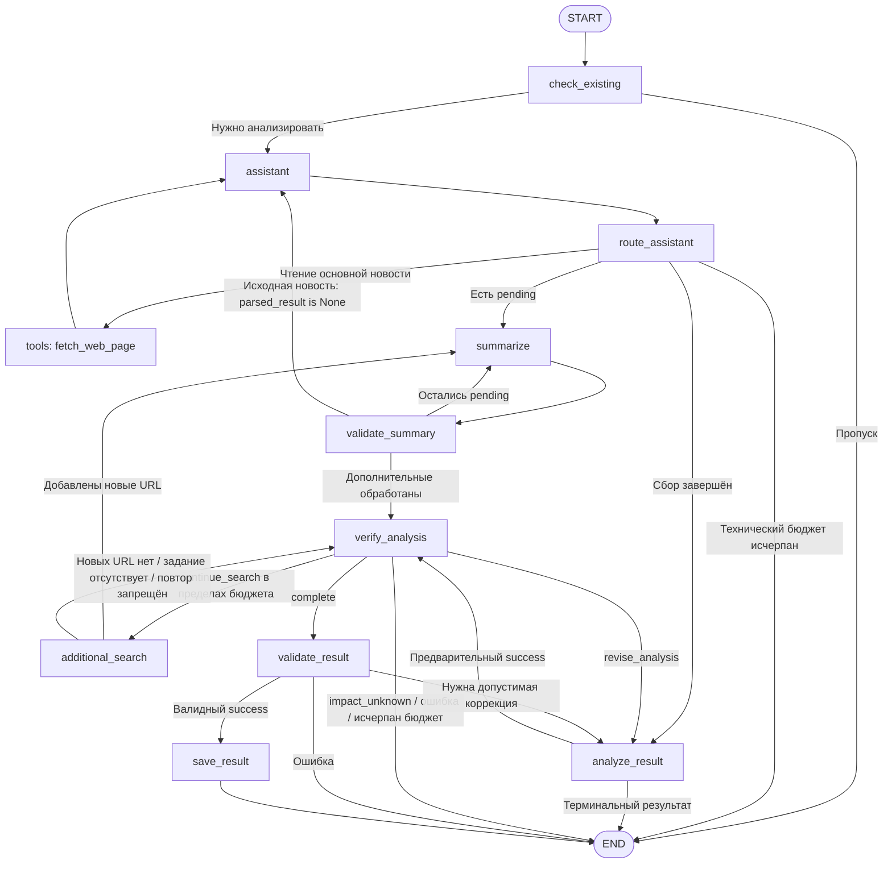

# Интеграция additional_news: план реализации

> **Для исполнителя:** после отдельного разрешения на код применять `superpowers:executing-plans` либо выбранный пользователем `superpowers:subagent-driven-development`. Выполнять чек-лист одного вертикального среза; перед правками повторно сверить исходники и согласованный перечень файлов.

**Цель:** заменить Exa отдельной нодой `additional_search`, которая напрямую вызывает готовый сервис, сохраняет доказательства и возвращает их эксперту через существующую суммаризацию.

**Архитектура:** эксперт формирует `fact/query`; новая нода получает полные публикации через `search_additional_news()` и обновляет существующие `sources/messages`. Маршрутизация остаётся последовательной, без новых инструментов, дополнительных LLM, адаптеров транспорта или отдельного хранилища.

**Стек:** Python 3.11, Poetry, закреплённые в локальном `poetry.lock` LangGraph 1.2.20 и LangChain Core/OpenAI 1.7.2; готовые dataclass-модели слоя данных.

**Основная спецификация:** [additional-search-node-2026-11-07.md](additional-search-node-2026-11-07.md), `main`, blob `50d7888aedad1c09dabae1099efdd47d67d276c4`.
**Базовый контракт:** [issuer-news-agent-2026-11-02.md](issuer-news-agent-2026-11-02.md); локальные уточнения BondNavigator `docs/adr/0023-news-analysis-output-contracts.md` и `0024-additional-news-data-source.md`.

**Дата:** 2026-11-09.
**Статус:** интеграция реализована и проверена локально; код не закоммичен.
**Канонический файл:** этот документ. Новый путь согласован пользователем; прежние планы относятся к предыдущей реализации агента. Копию в `docs/superpowers/plans/` и ещё один текущий план не создавать. Исходную спецификацию требований не менять.

## Основание и проверка фактического кода

Прочитаны правила `instructions/langgraph-agent-architect-rules.md`, специализированный `langgraph-agent-architect`, `bondnavigator-dev`, `langgraph-fundamentals`, Superpowers и `to-tickets`. Режим «Модификация архитектуры» выбран пользователем. Применены локальные инструкции трекера, словарь, относящиеся ADR и карты прежних задач.

Исходная точка BondNavigator: `HEAD=4aec9c1d70e0c5125c800a83fc6d48b0d7f803dc`; отслеживаемых локальных изменений на момент сверки нет. Найден Python окружения Poetry, подтверждён импорт `asyncpg 0.31.0`, выполнен `poetry run python project_explorer.py` и прочитан свежий `PROJECT_STRUCTURE.md`. Живая схема БД не исследовалась: план использует уже загруженную запись новости и не меняет SQL или хранение.

| Область | Что есть в коде | Решение интеграции |
| --- | --- | --- |
| Сервис | `search_additional_news(fact: str, query: str) -> AdditionalSearchResult`; результат и публикации — `@dataclass(slots=True)` | Читать атрибуты `.sources/.errors/.warning` и `source.url`; словарные примеры спецификации не являются Python API |
| State | `messages: Annotated[list[AnyMessage], add_messages]`; у `sources` нет reducer; `search_task` отсутствует | Добавлять только новые сообщения; при изменении источников возвращать весь объединённый словарь; добавить только согласованное `search_task` |
| Решение эксперта | `fact/question` одновременно закреплены в модели, JSON Schema, валидаторе, промпте и чтении задания | Атомарно заменить `question` на `query`; не поддерживать два конкурирующих внутренних формата |
| Источник | `draft`, `summary`, `summary_status`, необязательный `is_excerpt` | Перевести всех производителей и читателей на `published_date` и предварительную `summary`, удалить поля Exa |
| Суммаризация | Обрабатывается первый `pending`; после проверки статическое ребро всегда ведёт в `assistant` | После каждого источника проверять оставшиеся `pending`; затем выбирать исходный либо дополнительный маршрут |
| Контекст эксперта | Передаётся целиком `state.sources`, история поиска в запрос не включена | Формировать представление доказательств по статусу суммаризации и явно передавать результаты/запреты поиска |
| Лимиты | `MAX_ITERATIONS=8`, `RECURSION_LIMIT=128`; обычная проверка эксперта не увеличивает `iterations` | Сохранить бюджеты; учитывать каждое решение продолжить поиск, включая заблокированное, чтобы новый цикл их не обходил |
| Рёбра | 10 существующих нод; `tools → assistant`; ответы `fetch_web_page` содержат обновления без `goto` | Добавить только `additional_search`; сохранить это ребро tools. Удалить `validate_summary → assistant` при переводе проверки на `Command` |
| Основной агент | `AGENT_SYSTEM_MESSAGE` определён, но в запросе `assistant` не используется | Обновить существующий промпт после удаления Exa и передавать его модели при вызове, без записи копии в State |
| Проверки | Исходных `tests/*analysis_news*.py` и `tests/*additional_news*.py` сейчас нет; найденный pyc не является тестовым исходником | Подготовить локальные временные проверки после разрешения на реализацию; прежние отчёты не считать текущим прогоном |

Прочитаны `agent.py`, `models.py`, `nodes.py`, `tools.py`, `schemas.py`, `prompts.py`, `validation.py`, `config.py`, модели и сервис `additional_news`, относящиеся участки ридера и существующего хранилища. Дополнительный каталог `agents/analysis_news/additional_sources/` не содержит используемой реализации; новый код туда не помещать.

## Общие ограничения и совместимость

- Вызов сервиса — непосредственно из `nodes.py`; транспорт, HTTP, чтение HTML и отбор сайтов остаются в готовом слое данных. Не менять его модели, провайдер, конфигурацию и зависимости.
- `VerifyTask` содержит ровно непустые `fact/query`; `_initial_state()` задаёт `search_task=None`. Все остальные поля State сохраняются.
- `SourceData`: `title`, полный `text`, `published_date: date | Literal["unknown"]`, `summary: str | None`, прежние три `summary_status`. Для основной новости брать дату из уже загруженного `news_at`, при её отсутствии — `"unknown"`; для дополнительных — из `AdditionalSource.published_date`.
- Сохранить публичные сигнатуры `get_graph()`, `run_news_analysis()`, `run_analysis()`, плоский `NewsAnalysisResult`, правила `verification`, CLIProxy, блокировку, `force_reanalysis` и сохранение только проверенного `success`. Checkpointer в текущем графе отсутствует; миграция сохранённых состояний не требуется.
- Дополнительные URL сравнивать точно с ключами накопленного `sources`, включая новые записи текущего ответа. Не нормализовать их и не отбирать сайты повторно. Старый источник не перезаписывать; другой URL того же сайта допускается.
- `MAX_SEARCH_ATTEMPTS = 2` разместить рядом с `MAX_ITERATIONS` в `nodes.py`. Лимит — на факт, включая технически неуспешный результат; повтор той же пары факт/запрос блокируется. Для сопоставления достаточно пробелов и `casefold()`; передаваемый сервису запрос сохраняется буквально. Общей поисковой квоты не вводить.
- Сохранить безопасность и кэш чтения основной новости. Исключить Exa-события и прежнюю общую поисковую остановку A7 из дополнительного поиска; история чтения страниц не ограничивает другой проверяемый факт.
- Тесты остаются в локальном `tests/`, не включаются в Git. Код, тесты и временные скрипты разрешается менять только после отдельного согласования файлов по `bondnavigator-dev`.

## Целевой маршрут



Новый источник проходит `summarize → validate_summary` по одному. После исчерпания очереди различать пути по существующему `parsed_result`: до первичного анализа он равен `None`, при дополнительном поиске уже заполнен. Отдельный флаг происхождения источника не нужен.

`additional_search`, `verify_analysis` и обновлённый `validate_summary` управляют переходами через `Command`; статических исходящих рёбер из них не добавлять. `summarize → validate_summary` и `tools → assistant` остаются статическими. Метаданные `destinations` должны отражать реальные выходы, в том числе существующий `route_assistant → summarize`. Это согласуется с [официальными правилами LangGraph](https://docs.langchain.com/oss/python/langgraph/graph-api): `Command` не отменяет статические рёбра.

## Перечень файлов будущей реализации

| Файл BondNavigator | Изменение |
| --- | --- |
| `agents/analysis_news/models.py` | `VerifyTask.query`, `AgentState.search_task`, целевой `SourceData` |
| `agents/analysis_news/schemas.py` | `fact/query` только в ветви `continue_search` |
| `agents/analysis_news/validation.py` | Проверка нового задания и текст ошибок коррекции |
| `agents/analysis_news/prompts.py` | Удаление инструкций Exa; готовый запрос эксперта, ограничения, диагностические результаты |
| `agents/analysis_news/nodes.py` | Новая нода, история и ограничения, представление доказательств, очередь суммаризации, учёт бюджета продолжений |
| `agents/analysis_news/agent.py` | Начальное поле, регистрация ноды и рёбра, привязка только `fetch_web_page` |
| `agents/analysis_news/tools.py` | Целевой источник основной новости; удаление инструмента Exa, его импорта, констант и оставшихся без потребителя помощников |
| `tests/test_analysis_news_additional_search_tmp.py` | Временные локальные проверки с заменёнными сервисом, LLM и storage |

Не расширять перечень автоматически. Изменения `db/`, `data_sources/additional_news/`, `config.py`, манифестов, старых тикетов и пустых каталогов для этой интеграции не требуются.

## Тикет 01. Проверка факта через готовый сервис дополнительных публикаций

**Что даёт:** полный путь от решения эксперта до прочитанных и проверенных источников, повторного решения эксперта и прежнего публичного результата; пустота, частичный успех и недоступность остаются различимыми.

**Blocked by:** нет.
**Статус разбивки:** предложен в этом плане; отдельные исполнительные тикеты пока не опубликованы.

Один вертикальный срез выбран по `to-tickets` и принципу «Ленивый Сеньор»: миграция производителей `SourceData`, контракта эксперта, удаления Exa и маршрутов должна попасть в одно согласованное изменение. Разделение по слоям потребовало бы временно поддерживать старые поля и затем удалять эту работу. Самостоятельный предварительный рефакторинг не нужен.

**Интерфейсы:**

- Потребляет неизменённый `search_additional_news(fact: str, query: str) -> AdditionalSearchResult` через `await`.
- Добавляет `additional_search(state: AgentState, logger: logging.Logger = logger) -> Command[Literal["summarize", "verify_analysis"]]`.
- `validate_summary(state: AgentState, logger: logging.Logger = logger)` возвращает `Command[Literal["summarize", "assistant", "verify_analysis"]]`.
- `verify_analysis` сохраняет параметры `state/model/logger`; среди его выходов `additional_search` заменяет `assistant`.
- Программный разбор истории нужен и ноде, и эксперту: допустим один небольшой приватный помощник в `nodes.py` для собственных JSON-сообщений. Новые классы/модели истории не нужны.

### Пошаговое выполнение

- [x] **1. Зафиксировать поведение локальными проверками.** После разрешения повторить preflight, проверить `import pytest` в Poetry, создать указанный временный файл и тесты из матрицы ниже. Запустить целевой набор; до реализации он должен выявить отсутствие ноды/новых контрактов. Не менять production-код ради импортов.
- [x] **2. Согласованно мигрировать контракты и источники.** Заменить `question` во всех перечисленных точках на `query`, добавить начальное `search_task=None`, убрать `draft/is_excerpt`. Суммаризатор записывает предварительный текст в `summary`; проверяющий устанавливает `validated` либо `rejected/summary=None`. Существующие `verified_source` для первичного анализа и исходный текст для fallback сохраняются.
- [x] **3. Реализовать ноду и учёт истории.** При отсутствии задания не вызывать сервис. До вызова проверить собственные записи `HumanMessage` с `name="additional_search_result"` и валидным JSON `type="additional_search_result"`; другие сообщения не считать попытками. При разрешённом задании вызвать сервис ровно один раз с исходными `fact/query`, добавить только новые URL полных публикаций и вернуть полный объединённый `sources`. При каждом контролируемом результате очистить `search_task` и добавить ровно одно новое сообщение результата с полями `type, fact, query, sources_count, new_sources_count, errors, warning` по спецификации. `sources_count` — длина сервисного списка, `new_sources_count` — фактическое пополнение. Читать атрибуты dataclass, не применять `asdict()` ко всему результату и не копировать статьи в запись истории. Ошибки и предупреждение сохранять буквально. Новые URL ведут в `summarize`, включая частичный успех; иначе — в `verify_analysis`.
- [x] **4. Замкнуть экспертный цикл без потери доказательств.** Эксперт сохраняет `task` в `search_task` и направляет его в новую ноду. Промпт требует после двух попыток закончить проверку этого факта по накопленным данным, с явной неопределённостью при нехватке подтверждений; проверка других фактов допускается. В его запрос включать компактную историю и отдельные сообщения запрета, а из источников — URL, заголовок, дату и проверенную `summary`; для `rejected` — полный `text` с явной пометкой, для `pending` — не передавать непроверенное доказательство. Не отправлять весь исходный `sources`. Проверка суммаризации последовательно исчерпывает `pending` и выбирает возврат по описанному маршруту.
- [x] **5. Сохранить завершение и заменить старую поисковую ветвь.** Одинаковый запрос по факту или третью попытку блокировать до сервиса; очистить задание и добавить отдельный `HumanMessage(name="additional_search_blocked")`, не являющийся `additional_search_result`. После исчерпания лимита его содержание прямо требует окончательного вывода по этому факту; другой факт остаётся доступен. Каждое валидное решение эксперта `continue_search`, включая позднее заблокированное, расходует одну существующую итерацию через `_iteration_error()`; обычное окончательное решение эксперта остаётся без дополнительного расхода. При повторном непослушании LLM это гарантирует прежний терминальный `error`; штатная нехватка доказательств даёт `impact_unknown` по решению эксперта. Сохранить существующую ограниченную коррекцию, `MAX_ITERATIONS=8`, `RECURSION_LIMIT=128` и внешнюю обработку `GraphRecursionError`.
- [x] **6. Подключить маршрут и удалить Exa в том же изменении.** В `get_graph()` зарегистрировать только одну новую ноду; исправить `destinations`, удалить статическое `validate_summary → assistant`. В `bind_tools/ToolNode` оставить `fetch_web_page`. Удалить `find_additional_sources`, `_find_additional_sources`, `_search_exa`, парсинг Exa, его лимиты и rate-limit-ветви после проверки ссылок. Сохранить A5, кэш и ограничение бесполезных чтений основной страницы; они не участвуют в лимите дополнительного поиска. Обновлённый `AGENT_SYSTEM_MESSAGE` передавать основному агенту однократно в запросе модели. Глобальную зависимость `mcp` не удалять.
- [x] **7. Проверить весь срез и совместимость.** Запустить целевой набор, сверить последовательность событий настоящего скомпилированного графа и результаты из матрицы. Проверить отсутствие исполняемых ссылок на Exa, `question`, `draft/is_excerpt` в изменённом агенте, согласованность схем/валидатора и diff. После успешной проверки удалить временный тест; записать фактические результаты в этот канонический план. Согласованный код можно коммитить только по отдельному поручению, без `tests/` и посторонних файлов.

Ожидаемые отказы уже возвращаются сервисом в `AdditionalSearchResult.errors`. Нода обрабатывает их без автоматического retry; неожиданные программные исключения передаются существующей внешней обработке, отмена не подавляется. Новые timeout/retry поверх сервиса и старый Exa-таймаут 20 секунд к нему не добавляются.

### Матрица приёмки

| Проверка в локальном файле | Обязательный результат |
| --- | --- |
| `test_query_contract_and_initial_state` | В схеме/валидаторе только непустые `fact/query`; старый `question` отклоняется; начальное задание — `None`; обе ветви проверки формата согласованы |
| `test_direct_call_and_dataclass_mapping` | Один вызов с буквальными аргументами; дата и полный текст не усечены; `summary=None/pending`; параметры поиска и состояние изолированы между запусками |
| `test_no_task_skips_service` | Нет вызова и записи выполненной попытки; выход в эксперта |
| `test_partial_result_keeps_sources_and_errors` | Три новые публикации и ошибки: все три сохранены, обе величины счётчиков равны 3, ошибки не потеряны, выход в суммаризацию |
| `test_exact_url_deduplication` | Совпадение с основной/ранней/новой записью ничего не перезаписывает; другой URL того же сайта принимается; неэквивалентные строки не склеиваются |
| `test_no_new_sources_returns_to_verifier` | Пустая выдача сохраняет точное «Дополнительные публикации не найдены.»; ошибка — `errors` при `warning=None`; все дубликаты дают `sources_count>0/new_sources_count=0`; во всех случаях суммаризация не вызывается |
| `test_history_reducer_and_per_fact_guards` | Через настоящий `add_messages` сохраняются записи и прежняя история; у каждого нового сообщения новый ID. Ошибочная попытка учитывается; повтор запроса/третья попытка не вызывают сервис и не увеличивают число записей результатов. Регистр/пробелы сопоставляются; другой факт разрешён; JSON из новости или статьи не считается собственной историей |
| `test_summary_queue_and_return_route` | Все три `pending` обработаны по одному, без вызовов `assistant` между ними; после последнего — эксперт. Для исходной новости — прежний возврат в `assistant`; отклонённая сводка обнулена, оригинал доступен |
| `test_verifier_evidence_and_search_diagnostics` | При `validated` исходный длинный текст не попадает в запрос эксперта; при `rejected` передан с пометкой; `pending.summary` не используется. Эксперт получает `errors/warning` и требования завершить факт |
| `test_compiled_graph_success_path` | Настоящий `get_graph()` с подменёнными LLM/сервисом/storage проходит весь путь до одного сохранения проверенного `success`; у основного агента только инструмент чтения; после новой суммаризации нет лишней ветви `assistant`; статьи отсутствуют в JSON истории поиска |
| `test_uncooperative_verifier_respects_budget` | После двух вызовов по факту повторные `continue_search` не запускают третий; блокировки расходуют общий бюджет и завершаются контролируемо без сохранения; внешний `GraphRecursionError` также даёт прежний `error` |
| `test_public_contracts_and_cancellation` | Плоские результаты и идентификаторы, `screening`/существующий анализ, `NewsNotFoundError`, `force_reanalysis`, блокировка и отказ сохранения работают как раньше; `impact_unknown/error` не сохраняются; отмена не превращается в retry |

Будущая команда из корня BondNavigator после preflight:

```powershell
$env:PYTHONPATH = (Get-Location).Path
poetry run pytest tests/test_analysis_news_additional_search_tmp.py -q
```

Критерий успешного прогона: все сценарии матрицы проверены, нет ошибок/провалов и непроверенных пропусков. Живые LLM, поиск и БД в этот воспроизводимый набор не входят; дальнейший ручной запуск требует отдельного поручения и реальных доступных сервисов.

## Фактические результаты реализации (2026-11-09)

- Выполнен весь чек-лист тикета 01 в семи согласованных модулях; сервис `additional_news` вызывается напрямую, Exa-ветвь удалена, контракт состояния и маршруты графа согласованы.
- Исправлена валидация собственных записей истории: принимаются только полные result-события с корректными типами обязательных полей и blocked-события с текстовой причиной.
- Временный локальный набор: **15 passed**. Регрессионная проверка некорректных событий сначала выявила дефект, затем прошла после исправления.
- `poetry run python -m compileall -q agents/analysis_news` и `git diff --check` завершились без ошибок. В изменённых модулях не осталось исполняемых ссылок на Exa и контракт `question`; `draft` используется только как локальная переменная суммаризации.
- Временный тест удалён после успешного прогона. Живые LLM, сервис поиска и БД не вызывались. Изменения кода оставлены незакоммиченными в ветке `codex/additional-news`; посторонние локальные файлы не затрагивались.

## Фокус проверки

1. Dataclass вместо словаря — `test_direct_call_and_dataclass_mapping`.
2. Перезапись истории reducer или поддельное событие из текста публикации — `test_history_reducer_and_per_fact_guards`.
3. Частичный успех, все URL уже известны либо потеря второго/третьего pending — соответствующие проверки частичного результата, дедупликации и очереди.
4. Непроверенная сводка или полный оригинал при принятой суммаризации в запросе эксперта — `test_verifier_evidence_and_search_diagnostics`.
5. Непослушание эксперта и обход счётчика после удаления ReAct-поиска — `test_uncooperative_verifier_respects_budget`.

## Архитектурное заключение

**Проблемы:** несовместимые старые поля, отсутствующий маршрут новой ноды, неполная обработка очереди, отсутствие поисковой диагностики у эксперта и обход прежнего бюджета в новом прямом цикле. **Критичность: высокая** для интеграции: буквальный перенос примеров вызовет ошибку dataclass-доступа; неполная миграция потеряет источники либо оставит повторный цикл.

**Рекомендация:** выполнить один описанный срез в семи существующих модулях, переиспользуя сервис, состояние, роли LLM и хранение. Статически согласованы читатели/писатели State, reducer сообщений, достижимость переходов, два выхода поиска, очередь суммаризации, ограничения и терминальные пути.

**Вердикт: интеграция реализована и локально проверена по этому плану.** Результат подтверждён 15 целевыми проверками, успешной компиляцией модулей и чистым `git diff --check`. Живые поиск, LLM и запись в БД не запускались.

Остаются принятые ограничения: точное строковое сравнение URL не объединяет их смысловые варианты; простая нормализация факта не распознаёт семантические переформулировки; получение статей может занять больше одного сетевого таймаута; fallback полного текста ограничен возможностями контекста используемой LLM. Расширять интеграцию ради устранения этих ограничений сейчас не требуется.
