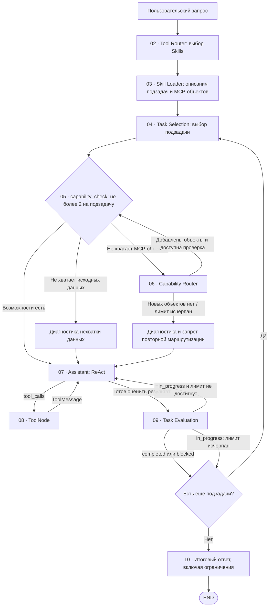

# Архитектура MCP-клиента BondNavigator и Skills — 2026-10-29

> **Статус:** рабочая спецификация. Содержит согласованные архитектурные решения и открытые вопросы. Не является заданием на реализацию.

## 1. Назначение

Универсальный MCP-клиент с агентом на **LangGraph** принимает пользовательский запрос, определяет необходимые возможности и решает задачу в цикле **ReAct**. Анализ портфеля и подбор облигаций — примеры задач, а не закрытый перечень сценариев.

Агент должен использовать существующие **MCP Tools, MCP Resources, MCP Prompts** и каталог **Skills** сервера BondNavigator без дублирования серверного каталога на клиенте.

## 2. Размещение и подключение

- Пакет клиента: `mcp_client/`.
- Конфигурация: `mcp_client/config.py`.
- MCP-клиент: `MultiServerMCPClient` (LangChain MCP adapters).
- Транспорт: **Streamable HTTP**.
- Адрес MCP-сервера (включая HTTP endpoint) настраивается в `mcp_client/config.py`; адрес для локальной отладки: `127.0.0.1:8000`.
- **Токены, ключи авторизации и другие секреты читаются только из переменных окружения**. Не прописывать секреты в `mcp_client/config.py`, коде или логах. `config.py` содержит параметры подключения и логику чтения необходимых переменных окружения, с комментариями к параметрам.
- **Локальная отладка:** при подключении к локальному MCP-серверу (`127.0.0.1` / `localhost`) допускается режим **без токена**.
- **Удалённое подключение:** обязательно использовать `Authorization: Bearer <token>`; токен считывается только из переменной окружения. При отсутствии токена подключение к удалённому серверу не выполняется, причина фиксируется без раскрытия секретов.
- Режим авторизации определяется адресом подключения в конфигурации; дополнительные узлы LangGraph не создаются. **Точный HTTP-путь MCP endpoint и имя переменной окружения** пока не согласованы.

### 2.1. Подключение LLM через CLIProxyAPI (пример пользователя)

Подключение к **LLM** и подключение к **MCP-серверу** — разные соединения с независимыми адресами и ключами. Для LLM используется OpenAI-совместимый клиент `ChatOpenAI` через локальный CLIProxyAPI. В `.env` задаются:

```dotenv
CLIPROXY_BASE_URL=http://127.0.0.1:8317/v1
CLIPROXY_API_KEY=<секрет из окружения>
CLIPROXY_MODEL=gpt-6-luna
```

`mcp_client/config.py` читает эти переменные окружения и содержит поясняющие комментарии к параметрам. Ключ не хранится в исходном коде и не выводится в логах. Переданный пример использует `httpx.Client(trust_env=False)` для обхода системного прокси Windows при доступе к локальному SSH-туннелю, `http_socket_options=()` и `use_responses_api=True`. Совместимость последних двух аргументов с установленной версией `ChatOpenAI` и выбранным CLIProxyAPI необходимо проверить при реализации.

**Согласовано:** для `ChatOpenAI` использовать `timeout=90` секунд (из `llm_timeout_seconds`) и **не более одной повторной попытки** (`max_retries=1`, если повтор выполняет сам клиент). Значения `timeout=120` и `max_retries=2` из первоначального примера не применяются. Повторы `ChatOpenAI` и внешнего обработчика **не суммируются**: одна операция допускает всего один повтор, независимо от места реализации. Политика допустимых ошибок и таймаутов описана в разделе 7.6.

Это **не** настройка MCP Bearer-токена; правило отдельной авторизации удалённого MCP-сервера остаётся в силе.

## 3. Модель Skills и подзадач

- **Skill** — промежуточный слой между пользовательским запросом и MCP-объектами.
- Один Skill содержит **несколько логически связанных подзадач**.
- Подзадача описывает назначение, условия применения, входные данные, ожидаемый результат и связанные **Tools, Resources, Prompts**.
- Внутри Skill **нет обязательного фиксированного порядка** подзадач. Отдельный узел `Task Selection` (04) выбирает следующую подзадачу, а отдельный узел `Task Evaluation` (09) оценивает её завершение; оба используют описания подзадач и доступный контекст.
- **Skill и MCP Prompt — разные сущности.** Skill описывает возможности; MCP Prompt — отдельный объект MCP-сервера.
- При выборе Skill загружаются его описание, описания всех подзадач, имена/URI и краткие описания соответствующих MCP-объектов.
- **Полное содержимое MCP Resources и MCP Prompts не загружается заранее:** оно запрашивается по мере необходимости в ReAct.

### 3.1. Клиентские функции

```python
async def get_skills() -> list[dict]:
    ...

async def get_skill(url_skill: str) -> dict:
    ...
```

- `get_skills()` возвращает каталог с полями `name`, `url_skill`, `description` из ресурса `bondnavigator://skills`.
- `get_skill(url_skill)` читает **MCP Resource `bondnavigator://get_skill/{url_name}`** по полному URI из `url_skill` каталога и возвращает описание Skill с подзадачами и доступными MCP-объектами **без предварительного чтения полного содержимого** объектов. URI `bondnavigator://skills/{skill_name}` относится к старой реализации и для нового контракта не используется.
- Обе функции используют подключение к MCP-серверу через `MultiServerMCPClient`. Точные модели возврата и ошибки уточняются при реализации.

## 4. Выбор одного или нескольких Skills

Узел **Tool Router** использует LLM для выбора Skills из каталога по пользовательскому запросу.

**Согласовано:**

- За один запрос Tool Router может выбрать **несколько Skills**.
- Выбираются только Skills, необходимые для запроса.
- Их MCP Tools, Resources и Prompts объединяются **без дубликатов**.
- Assistant продолжает работать в **едином ReAct-цикле**, а не запускает отдельный граф для каждого Skill.

**Пример запроса, затрагивающего две области:**

> Оцени эффективность моего облигационного портфеля и предложи, какие облигации купить на свободные деньги.

Области:

1. **Анализ портфеля** — доходность, риски, концентрации и денежные потоки.
2. **Подбор облигаций** — поиск кандидатов, оценка доходности и риска, сопоставление с ограничениями портфеля.

Условные имена Skills: `portfolio_analysis` и `bond_selection`. **Фактические идентификаторы берутся из каталога MCP**, а не задаются на клиенте жёстко.

## 5. Состояние LangGraph и ReAct

Основой `AgentState` служит `MessagesState`, расширенный полями:

| Поле | Назначение |
| --- | --- |
| `selected_skills` | Список выбранных Skills. |
| `selected_tools` | Объединённый список доступных MCP Tools. |
| `selected_resources` | Доступные MCP Resources, **включая ресурсы с описаниями полей и схемами результатов** (`bondnavigator://schemas/*`). |
| `selected_prompts` | Доступные MCP Prompts. |
| `needs_more_capabilities: bool` | `True` только при `capability_status == "missing_mcp"`; переход в Router дополнительно зависит от лимита проверок. |
| `capability_status` | Одно из `ready`, `missing_mcp`, `missing_data`, результат `capability_check`. |
| `capability_reason` | Текстовое пояснение решения `capability_check` для маршрутизации и Assistant. |
| `current_subtask` | Текущая подзадача, выбранная узлом 04. |
| `subtask_status` | Результат `Task Evaluation`: `completed`, `in_progress` или `blocked`. |
| `subtask_results` | Результаты подзадач с их статусами и причинами незавершённости; используются следующими подзадачами и итоговым ответом. |
| `subtask_attempt_count` | Счётчик повторных переходов `Task Evaluation → Assistant` для текущей подзадачи; не более 2. Сбрасывается при выборе новой подзадачи. Обычные переходы `Assistant → ToolNode → Assistant` не учитываются. |
| `capability_check_count` | Число вызовов `capability_check` для текущей подзадачи, не более 2; при выборе новой подзадачи сбрасывается. |

Для MCP Tools используется предварительно сформированный реестр `tools_by_name` из адаптированных инструментов сервера. Assistant получает инструменты, разрешённые выбранными Skills:

```python
tools = [tools_by_name[name] for name in state["selected_tools"]]
model = llm.bind_tools(tools) if tools else llm
```

Граф **не перекомпилируется** при расширении возможностей. Набор инструментов изменяется **при добавлении новых Skills/MCP-объектов**, а не произвольно на каждом шаге ReAct.

Выбор подзадачи (`Task Selection`, этап 04) и оценка её результата (`Task Evaluation`, этап 09) являются **двумя отдельными узлами LangGraph**.

- `Task Selection` выбирает следующую подзадачу из описаний выбранных Skills, учитывая общий запрос, результаты, статусы и зависимости; фиксирует `current_subtask` и сбрасывает счётчики текущей подзадачи.
- `Assistant` решает текущую подзадачу в ReAct: при необходимости формирует `tool_calls`.
- `ToolNode` исполняет вызовы; результат возвращается **непосредственно в Assistant** как `ToolMessage`, без `capability_check`.
- `Task Evaluation` сопоставляет полученный результат с критериями подзадачи, описанными в Skill, возвращает `subtask_status` и причину оценки, записывает результат в `subtask_results`; затем либо возвращает выполнение Assistant, либо направляет к следующей подзадаче, либо завершает запрос.
- Отсутствие `tool_calls` у Assistant само по себе не гарантирует успешного завершения подзадачи и не является признаком нехватки возможностей.

## 6. MCP Resources и Prompts

Для LLM предусмотрены **два клиентских инструмента**:

- `read_mcp_resource(uri)` — чтение разрешённого MCP Resource.
- `get_mcp_prompt(name, arguments)` — получение разрешённого MCP Prompt.

Оба клиента обращаются к MCP-серверу по запросу, возвращая содержимое через `ToolMessage`. Проверка доступа опирается на MCP-объекты выбранных Skills.

**Отдельное правило для описаний полей:** схемы и определения полей результатов (`bondnavigator://schemas/*`) являются частью **общего** `selected_resources`; отдельное поле `selected_schemas` в `AgentState` **не создаётся**. В описании Skill указывается связь MCP-инструмента с ресурсом, объясняющим поля его результата.

Полученный MCP Prompt **не заменяет системный промпт** Assistant и **не применяется автоматически**; Assistant интерпретирует его как полученные через инструмент инструкции/контекст для решения задачи.

Конкретный способ чтения MCP Prompt через установленную версию LangChain MCP adapters ещё должен быть проверен.

## 7. Проверка и расширение доступных возможностей

### 7.1. `capability_check` перед выполнением подзадачи

**Уточнено 30.10.2026:** после выбора подзадачи узлом `Task Selection` вызывается `capability_check` — отдельный LLM-узел оценки доступных возможностей. Для **одной подзадачи допускается не более двух вызовов** `capability_check`, включая первоначальную проверку и возможную повторную после расширения возможностей. Счётчик сбрасывается при выборе следующей подзадачи.

`capability_check` должен **различать** как минимум три ситуации:

1. **`ready`** — подходящие MCP-объекты доступны; переход в `Assistant`. Ещё не запрошенные данные, которые можно получить существующими инструментами, **не** означают `missing_data`.
2. **`missing_mcp`** — недостаёт необходимого MCP Tool, Resource или Prompt; `needs_more_capabilities=True`. Переход к `Capability Router` возможен только при соблюдении ограничений цикла.
3. **`missing_data`** — подтверждена недоступность или неполнота исходных данных при имеющихся возможностях. Недостаток данных сам по себе не означает необходимость нового Skill; причина передаётся Assistant.

**Согласованный контракт:** `capability_check` возвращает структурированный `status` со значениями `ready | missing_mcp | missing_data` и текстовое поле `reason`. Поле `needs_more_capabilities: bool` сохраняется и истинно **только** для `missing_mcp`. При исчерпании лимита проверок маршрутизатор не запускается повторно, даже если статус остался `missing_mcp`.

- **Стандартный ReAct-цикл:** `Assistant → ToolNode → Assistant`; `ToolMessage` **не вызывает** `capability_check`.
- Повторная проверка возможна в рамках установленного лимита; её точный механизм запуска при выполнении одной подзадачи ещё предстоит согласовать.
- Если лимит в две проверки исчерпан, повторно вызывать `capability_check` нельзя: Assistant получает диагностику и продолжает с доступными возможностями, без зацикливания.

Используется условное ребро LangGraph (`conditional_edge`), которое учитывает результат проверки и доступный лимит.

### 7.2. `Capability Router`

Вместо клиентского инструмента `request_additional_skills()` применяется **ветка графа** с LLM-узлом `Capability Router`.

Этот узел определяет, **каких MCP-возможностей не хватает**, находит связанные Skills и MCP-объекты в каталоге, дополняет `selected_skills`, `selected_tools`, `selected_resources`, `selected_prompts`, сохраняя предыдущие значения и убирая дубликаты. Если лимит позволяет, выполнение возвращается к `capability_check` для той же подзадачи. **Отсутствие исходных данных само по себе не запускает Capability Router.**

Вновь доступные MCP Tools подключаются через `bind_tools()` для следующего вызова Assistant. **Перекомпиляция графа не нужна**.

### 7.3. Нет дополнительных MCP-объектов

**Согласовано:** если Capability Router не обнаружил новых MCP-объектов, он **передаёт управление Assistant с соответствующим диагностическим сообщением**.

Пример смысла сообщения:

> Дополнительных MCP-объектов не найдено. Продолжай с доступными возможностями. Если выполнить запрос полностью нельзя, объясни ограничения и причины.

- Сообщение передаётся через состояние графа и **не меняет системный промпт**.
- Повторная маршрутизация **без новых условий или объектов не должна зацикливаться**.
- Если новых объектов не обнаружено, управление переходит **напрямую к Assistant с диагностическим сообщением**, минуя повторную проверку возможностей. Техническая форма защитного состояния ещё подлежит определению.

### 7.4. Оценка и завершение подзадач

**`Task Selection` (04) и `Task Evaluation` (09) остаются отдельными существующими узлами. Новые узлы для контроля прогресса не создаются.**

После ответа Assistant без `tool_calls` управление передаётся `Task Evaluation`. Узел сравнивает результат с ожидаемыми результатами и критериями подзадачи, описанными в Skill, и возвращает структурированную оценку:

| `status` | Значение | Переход |
| --- | --- | --- |
| `completed` | Критерии подзадачи выполнены. | Записать результат, выбрать следующую подзадачу либо закончить запрос. |
| `in_progress` | Есть обоснованная возможность продолжить работу. | Передать Assistant причину незавершённости и продолжить текущую подзадачу в пределах лимита попыток. |
| `blocked` | Продолжение невозможно или лимит попыток достигнут. | Сохранить причину и частичные результаты, затем перейти к следующей подзадаче либо завершить запрос с ограничениями. |

**Контроль прогресса (согласовано):** для одной подзадачи допускается не более **двух повторных переходов `Task Evaluation → Assistant`**. Счётчик `subtask_attempt_count` начинается с нуля и увеличивается только при таком повторном переходе; при выборе следующей подзадачи сбрасывается. Обычные переходы `Assistant → ToolNode → Assistant` в лимит не входят. Когда после двух повторных попыток `Task Evaluation` снова получает `in_progress`, он фиксирует `blocked` с причиной исчерпания лимита, сохраняет частичные результаты и направляет выполнение к следующей подзадаче либо итоговому ответу. Не вводить отдельного проверяющего узла. Причину `in_progress` или `blocked` передавать Assistant через `AgentState`.

**Повторное использование результатов:** итоги всех подзадач, включая неполные и заблокированные, фиксируются в `subtask_results` и доступны `Task Selection`, `Task Evaluation`, Assistant и `Final Response`. Отсутствие `tool_calls` само по себе не гарантирует успешного завершения.

После каждого `ToolMessage` стандартный переход — **непосредственно к Assistant**, без вызова `capability_check` и `Task Evaluation`.

### 7.5. Контроль сложности архитектуры

- Не создавать дополнительные узлы LangGraph для проверки прогресса, подсчёта попыток, накопления результатов и измерения метрик; использовать существующие узлы, `AgentState` и `logger.info()`.
- Хранить только действительно необходимые данные состояния, не дублировать `messages` и результаты MCP-вызовов без причины.
- Выделять самостоятельную сущность только при доказанной необходимости, когда существующее разделение ответственности становится некорректным.
- Приоритет: **минимум узлов и LLM-вызовов при сохранении понятной диагностики и проверяемости**.

### 7.6. Таймауты внешних вызовов (согласовано)

- Устанавливаются **отдельные настраиваемые таймауты**: `llm_timeout_seconds = 90` для ответа LLM и `mcp_timeout_seconds = 30` для обращения к MCP-серверу. Значения указаны в секундах и согласованы как значения по умолчанию.
- **Все согласованные конфигурационные параметры** (включая `max_react_iterations = 20`) размещаются в `mcp_client/config.py`, каждый с поясняющим комментарием о назначении и единице измерения. Пример записи в будущем модуле (это спецификация, не изменение исходного кода):

  ```python
  # Максимальное число полных ReAct-циклов в рамках одного запроса.
  max_react_iterations = 20

  # Максимальное время ожидания одного ответа LLM, в секундах.
  llm_timeout_seconds = 90

  # Максимальное время ожидания одного вызова MCP-сервера, в секундах.
  mcp_timeout_seconds = 30
  ```

- Ограничения применяются к соответствующим внешним операциям внутри существующих узлов; **новые узлы LangGraph для таймаутов не создаются**.
- **Согласованное восстановление после таймаута:** выполнить **одну повторную попытку** той же внешней операции (LLM или MCP) с соответствующим таймаутом. Если повторная попытка тоже завершилась таймаутом, сохранить диагностическую ошибку (узел/инструмент, операция, причина) и передать её в существующий `Task Evaluation` для решения о продолжении или статусе `blocked` текущей подзадачи. Таймаут не считается автоматически ни `missing_data`, ни `missing_mcp`; новые узлы не создаются. Если подзадача ещё не выбрана и `Task Evaluation` неприменим, завершить запрос с диагностикой, не имитируя результат подзадачи.
- **Согласованная обработка остальных ошибок LLM/MCP:** автоматически повторять только временные HTTP-ошибки `429`, `502`, `503`, `504` — **не более одной повторной попытки** соответствующего внешнего вызова. Ошибки авторизации (`401`, `403`), некорректных параметров (`400`, `422`) и прочие ошибки, не отнесённые к временным, **не повторять**. При исчерпании попыток или неретрабельной ошибке фиксировать код, операцию и причину без токенов/секретов; передавать ошибку в существующий `Task Evaluation`, если текущая подзадача выбрана. До выбора подзадачи завершать запрос с диагностикой. Таймауты сохраняют ранее согласованную самостоятельную политику одного повтора. Дополнительные узлы и отдельный механизм ретраев не создаются.

## 8. Диагностическое логирование

Для отладки предусмотрено **`logger.info()`**:

- для каждого входа/выхода **Tool Router**, `Task Selection` (04), `capability_check`, **Capability Router**, `Task Evaluation` (09) и `Assistant`;
- для каждого фактического вызова MCP Tool;
- для клиентских `read_mcp_resource()` и `get_mcp_prompt()`.

Как минимум фиксируются начало и завершение этапа, название узла или инструмента, статус выполнения; для Router — выбранные Skills. **Дополнительно измеряются длительность каждого LLM-узла и расход токенов, когда провайдер возвращает статистику использования.** При недоступной статистике токенов показатель остаётся неизвестным, а не оценивается по догадке. Отдельные узлы или новая система трассировки только ради этих метрик не добавляются.

**Не логировать** токены, секреты, чувствительные аргументы инструментов и полное содержимое финансовых ответов. Дополнительный формат диагностических полей будет уточнён.

## 9. Концептуальная схема графа



Схема определяет маршруты графа, **не порядок подзадач внутри Skill**.

### 7.6. Общий лимит ReAct-итераций (согласовано)

- Для **всего пользовательского запроса**, независимо от числа Skills и подзадач, устанавливается **настраиваемый предел ReAct-итераций**. Он задаётся в конфигурации клиента (предлагаемое имя параметра — `max_react_iterations`).
- Это **отдельное ограничение**, которое не заменяет согласованные лимиты: два вызова `capability_check` и два повторных перехода `Task Evaluation → Assistant` на подзадачу.
- Достижение общего лимита должно прекращать дальнейший ReAct-цикл без добавления новых узлов, сохранять полученные результаты и формировать диагностическое завершение с указанием невыполненных частей запроса.
- **Согласованное определение ReAct-итерации:** одна полная последовательность `Assistant → ToolNode → Assistant` считается **одной итерацией**, независимо от количества инструментов, вызванных в рамках одного шага `ToolNode`. Число инструментов внутри цикла не увеличивает счётчик. Если Assistant не вызвал инструменты, полного цикла не было, поэтому итерация не засчитывается. Счётчик общий для запроса, а не отдельный для каждой подзадачи.
- **Согласовано:** `max_react_iterations = 20` по умолчанию. Значение можно изменить через конфигурацию клиента; после появления эксплуатационных данных его можно пересмотреть.

## 10. Открытые вопросы — ещё не согласованы

1. Формат описаний Skills/подзадач и валидация схем на MCP-сервере.
2. Точный HTTP endpoint и имя переменной окружения для Bearer-токена (локальное подключение без токена и обязательный Bearer при удалённом подключении согласованы).
3. Детали реализации обработки ошибок транспортного уровня и провайдерских кодов вне согласованного набора. Политика HTTP-ошибок согласована: единственный повтор для `429`/`502`/`503`/`504`, отсутствие автоматического повтора для ошибок авторизации и параметров.
4. Механизм повторного запуска `capability_check` для текущей подзадачи (не более двух вызовов), защита от повторной безрезультатной маршрутизации. Значения статуса и поле `reason` согласованы; точная схема структурированного ответа — вопрос реализации.
5. API и обработка результатов `get_mcp_prompt` / чтения Resources для фактической версии `langchain-mcp-adapters`.
6. Финальная структура пакета, типизированные контракты, тестовые сценарии.
7. Детальный формат диагностических логов.

---

*Согласованные решения зафиксированы на основе обсуждения 29.10.2026. Несогласованные параметры отделены от принятых решений.*

## История уточнений

- **30.10.2026:** отменён вызов `capability_check` после каждого `ToolMessage`. Стандартная петля ReAct — `Assistant → ToolNode → Assistant`.
- **30.10.2026:** этапы 04 (`Task Selection`) и 09 (`Task Evaluation`) оформлены как отдельные узлы LangGraph. Для одной подзадачи согласован лимит **два вызова `capability_check`**. Проверка различает нехватку MCP-возможностей и нехватку исходных данных.
- **30.10.2026:** согласован результат `capability_check`: `status` (`ready`, `missing_mcp`, `missing_data`) и текстовый `reason`; `needs_more_capabilities=True` только при `missing_mcp`. Не считать отсутствие ещё не запрошенных данных подтверждённым `missing_data`.
- **30.10.2026:** согласованы статусы `Task Evaluation`: `completed`, `in_progress`, `blocked`; причина незавершённости и результаты подзадач сохраняются в `AgentState`. `missing_data` требует подтверждения, иначе `ready`. Длительность и расход токенов LLM-узлов логируются при наличии данных. **Принцип контроля сложности:** не добавлять новые узлы для задач, решаемых существующими.

- **30.10.2026:** установлен лимит не более **двух повторных переходов `Task Evaluation → Assistant` на одну подзадачу**. Переходы `Assistant → ToolNode → Assistant` не учитываются; при исчерпании лимита незавершённая подзадача становится `blocked` с диагностикой.

- **30.10.2026:** согласован **настраиваемый общий лимит ReAct-итераций** на пользовательский запрос, без новых узлов. **Одна итерация — один полный цикл `Assistant → ToolNode → Assistant`**, независимо от числа инструментов внутри него. Значение по умолчанию `max_react_iterations = 20` согласовано; параметр настраиваемый.

- **30.10.2026:** согласовано значение `max_react_iterations = 20` по умолчанию; параметр настраивается в конфигурации, правило подсчёта итераций не меняется.

- **30.10.2026:** согласованы отдельные настраиваемые таймауты внешних вызовов LLM и MCP-сервера. Реализация внутри существующих узлов, без новых узлов графа; значения по умолчанию и восстановление после таймаута ещё не согласованы.

- **30.10.2026:** согласованы таймауты по умолчанию: LLM — **90 секунд**, MCP-сервер — **30 секунд**. Настраиваемые параметры и комментарии к ним располагаются в `mcp_client/config.py`; исходный код пока не изменён.

- **30.10.2026:** при таймауте LLM или MCP выполняется ровно **одна повторная попытка**; при повторном таймауте ошибка с диагностикой передаётся в `Task Evaluation` для продолжения или блокировки подзадачи. Новые узлы не создаются.

- **30.10.2026:** для временных ошибок LLM/MCP (`429`, `502`, `503`, `504`) допускается **одна повторная попытка**; ошибки авторизации и некорректных параметров повторно не вызываются. После ошибки — диагностика и передача в существующий `Task Evaluation`, если подзадача выбрана. Без новых узлов.

- **30.10.2026:** адрес MCP-сервера хранится в `mcp_client/config.py`; токены, ключи и другие секреты читаются из переменных окружения. Точный endpoint и способ авторизации пока открыты для согласования.

- **30.10.2026:** авторизация MCP: локальный сервер на `127.0.0.1` / `localhost` допускает подключение без токена; удалённый сервер требует Bearer-токен из переменной окружения. Без токена удалённое подключение не начинается. Новых узлов LangGraph нет.

- **30.10.2026:** предоставлен пример подключения LLM через CLIProxyAPI (`CLIPROXY_BASE_URL`, `CLIPROXY_API_KEY`, `CLIPROXY_MODEL`), с `trust_env=False` для локального SSH-туннеля; не смешивать с авторизацией MCP. Для LLM подтверждены **90 секунд и одна повторная попытка** вместо `timeout=120` / `max_retries=2`; вложенные повторы не допускаются.

- **30.10.2026:** уточнены ранее согласованные MCP Resources клиента: `get_skills()` читает `bondnavigator://skills`, а `get_skill(url_skill)` — полный URI `bondnavigator://get_skill/{url_name}` из каталога; прежний `bondnavigator://skills/{skill_name}` не является частью нового контракта.

## Дополнение от 03.11.2026: идентификаторы пользователя и счёта

**Последнее согласованное уточнение.** Если подзадача работает с `account_id`, в её `inputs` должен присутствовать также `user_id`. Для обеих подзадач MVP — `sub_portfolio_analysis` и `sub_month_cash_flow` — актуальная запись: `inputs: ["user_id", "account_id"]`. `user_id` является явным входным значением, переданным при запуске задачи (в пользовательском запросе или контексте приложения), а не скрытым значением из `mcp_client/config.py`.

Ресурс `bondnavigator://users/{user_id}/accounts` используется для получения сохранённых счетов и сопоставления `account_id` с `account_name`, когда это необходимо. Если `account_id` уже однозначно указан, список счетов повторно запрашивать не обязательно; наличие идентификатора пользователя во входных данных от этого не отменяется. Если счёт указан названием, `account_id` разрешается получить по каталогу счетов на основании `user_id`; не подставлять произвольные идентификаторы.

Это уточнение отменяет более раннее предложение хранить `user_id` только в конфигурации; остальные параметры конфигурации клиента остаются без изменений. Детальный контракт определён в документе [План реализации MCP-клиента](mcp-client-bondnavigator-2026-10-30.md). Исходный Python-код не изменялся, `pytest` не запускался.
