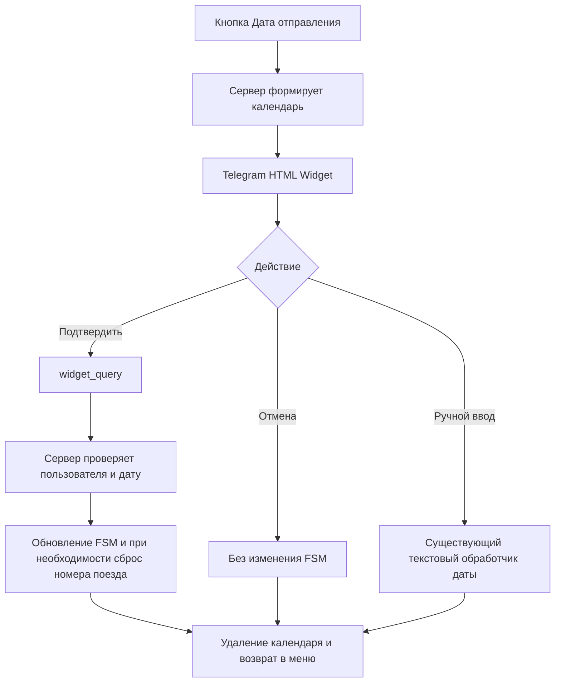

# Техническая архитектура календаря TrainBot — черновик для согласования

- **Дата:** 2026-11-12
- **Статус:** проект технической архитектуры; **раздел 3.1 (транспорт Widget) согласован**, остальные технические решения и документ в целом ещё не утверждены
- **Сценарий:** создание и редактирование подписки «Отслеживание»
- **Источник функциональных требований:** [календарь — функциональная спецификация](./calendar-widget-2026-11-12.md)
- **Исходные материалы:** предоставленные `handlers/subscrib.py` и `bot.py`; фактически установленный релиз aiogram пока не подтверждён (`aiogram>=3,<4`)

## 1. Назначение и границы

В этом документе обсуждаются **только технические решения**: интеграция HTML Widget с существующими обработчиками и FSM, транспорт Telegram Bot API, обработка подтверждения/отмены, авторизация запросов, fallback, ошибки и тесты.

Функциональные требования (период 90 дней, формат `YYYY-MM-DD`, UI, поведение кнопок, редактирование/отмена и т. д.) уже согласованы и не дублируются здесь. **Изменение функциональных требований необходимо фиксировать в отдельной функциональной спецификации.**

## 2. Установлено по предоставленному `handlers/subscrib.py` (2026-11-12)

- `StSubscr.dt_depart` — состояние ожидания даты; данные подписки находятся в том же `FSMContext` (`dt_depart`, `DepCode`, `DestCode`, `TrainNumber` и др.).
- `prm_sub_otslej()`, строки 172–225, рисует кнопку даты; `select_sub_otsl()`, строки 229–271, в ветке `dt_depart` отправляет текст «Введите дату...» и устанавливает `StSubscr.dt_depart`.
- `@router.message(StSubscr.dt_depart)`, строки 274–289, проверяет ввод через `util_bot.ch_dt_depart()`, записывает `dt_depart` в FSM и возвращает `prm_sub_otslej()`.
- Создание новой «Отслеживание»: обработчик `vid_subs` вызывает `state.clear()` и `prm_sub_otslej()` (строки 137–145).
- **То же меню используется при редактировании:** в `ch_subs()` данные существующей подписки загружаются в FSM (строки 745–775). `save_otslej()` отличает обновление от вставки по `user_data.get('id_sub')` (строки 779–799).
- Поиск номера поезда `set_NumTrain()` уже берёт `dt_depart` из FSM (строки 352–397); сохранение новой подписки менять не требуется.
- В обработчике текстовой даты после ошибочного ввода происходит выход из состояния даты и возврат в меню. **Согласовано сохранить прежнее поведение**, без автоматического запроса повторного ввода.
- Для ручного ввода потребуется точечное дополнение `@router.message(StSubscr.dt_depart)`: сравнить старое значение `dt_depart` с корректно введённым новым и при изменении сбросить `TrainNumber`/`TimeDepart`. Остальное поведение текстового ввода остаётся прежним, если не согласовано иное.
- В предоставленном `bot.py` обнаружены `MemoryStorage`, `Dispatcher`, `dp.start_polling(bot)`; комментарий о `aiogram-3.0.0rc2` не подтверждает фактически установленную версию. **Пользователь сообщил зависимость `aiogram>=3,<4`**, но это диапазон допустимых версий, не точный установленный релиз.
- По официальному Telegram Bot API 10.4: `sendWidget` принимает самодостаточный HTML, `allow_queries=True` и при необходимости `reply_markup`; запрос приходит как `widget_query`, ответ — `answerWidgetQuery` не позднее 15 секунд. Точная поддержка этих сущностей фактической версией aiogram TrainBot ещё не установлена.

### 2.1. Дополнительная проверка Telegram и aiogram (2026-11-12)

- Официальный [Telegram Bot API changelog](https://core.telegram.org/bots/api-changelog) подтверждает появление `sendWidget`, `widget_query` и `answerWidgetQuery` в **Bot API 10.4 от 2026-11-09**. В production отправка Widget допускается в личные чаты.
- Официальная [документация aiogram](https://docs.aiogram.dev/en/latest/) на момент просмотра показывает **3.31.0** с поддержкой Bot API **10.3**. **Проектное допущение (решение пользователя): для TrainBot считаем, что установленный aiogram 3 не поддерживает Widgets; интеграцию проектируем через адаптер, без ветвления по наличию нативных методов.** Это допущение не выдаётся за проверенный факт о среде.
- Проверен загруженный `bot.py`: используется `Dispatcher(storage=MemoryStorage())`, подключён `subscrib.router`, в `main()` создаётся `Bot` (при необходимости с `AiohttpSession(proxy=...)`), затем выполняется `await dp.start_polling(bot)` **без явного `allowed_updates`**.
- Ограничение пользователя `aiogram>=3,<4` описывает зависимость, но **не позволяет установить точный релиз**. Для выбранной архитектуры нет необходимости выбирать между native API и адаптером по версии: **всегда используем адаптер**. При реализации потребуется проверить сериализацию/получение неизвестного события в фактически установленном aiogram и сохранить совместимость с его текущим polling.
- По [документации aiogram о polling](https://docs.aiogram.dev/en/latest/migration_2_to_3.html) при отсутствии `allowed_updates` aiogram автоматически использует только зарегистрированные типы событий. Если поддержка `widget_query` реализуется через дополнительный обработчик/перехват, событие необходимо явно добавить, **сохранив все ранее используемые типы**.

## 3. Предложение по минимальной интеграции — **не утверждено**

- В ветке `sub_otsl_prm/dt_depart` использовать один календарь как при **создании**, так и при **редактировании**: если в FSM имеется `dt_depart`, передавать его как выделенную дату; если даты нет, ничего не выделять. Не создавать отдельный календарь для редактирования.
- Использовать существующее состояние `StSubscr.dt_depart`, но принимать подтверждение Widget через отдельный путь обработки `widget_query`, а не пытаться вызвать обработчик `@router.message` фиктивным сообщением.
- После проверки типа запроса, пользователя, идентификатора сообщения, состояния FSM и допустимой даты выполнить `state.update_data(dt_depart=YYYY-MM-DD)`, выйти из состояния, удалить сообщение виджета и вызвать существующее `prm_sub_otslej()`.
- При отмене вернуться в это же меню без изменения `dt_depart` и других параметров. Альтернативный путь текстового ввода — inline-кнопка «✏️ Ввести дату вручную» под сообщением календаря. Обработчик кнопки удаляет/закрывает календарь, предлагает отправить дату в формате `ГГГГ-ММ-ДД` и устанавливает `StSubscr.dt_depart`. Используется существующий `@router.message(StSubscr.dt_depart)`.
- Транспорт `sendWidget` / `answerWidgetQuery` выполняется через **изолированный адаптер Telegram Bot API**, независимо от нативных возможностей aiogram (согласованное решение). Детали реализации адаптера и перехвата `widget_query` предстоит определить.

### 3.1. Транспорт Widget — **согласовано 2026-11-12**

Архитектурное допущение: **установленный aiogram 3 не поддерживает Telegram Widgets**. Отказываемся от разветвления «если поддерживает — native API, если не поддерживает — адаптер». Выбран **один фиксированный путь интеграции: небольшой изолированный адаптер Telegram Bot API 10.4**.

Утверждены следующие правила:

1. **Адаптер Widget:** отправлять календарь через `sendWidget`, принимать `widget_query` и отправлять `answerWidgetQuery` без использования неподтверждённых нативных типов или обработчиков aiogram. Конкретные методы обращения к Bot API и точка перехвата входящего Update должны быть проверены отдельно до реализации.
2. **Long Polling:** явно включить `widget_query` в `allowed_updates`, **сохранив все события, необходимые уже зарегистрированным обработчикам**, например на базе `dp.resolve_used_update_types()`. Не заводить второй polling.
3. **Сессия:** использовать **существующие `Bot` и его HTTP-сессию**, сохраняя текущую настройку прокси, аутентификацию и управление жизненным циклом сессии. Не создавать отдельного клиента/сессии Telegram для Widget.
4. **Сохранение архитектуры TrainBot:** **не перестраивать существующие Router и FSM подписок**. Новый транспорт Widget изолировать; переиспользовать `StSubscr.dt_depart`, `prm_sub_otslej()` и существующее хранилище FSM. Допускаются только необходимые точечные изменения точек входа и отдельная обработка нового типа события.
5. **Границы:** не обновлять aiogram специально ради Widgets, не создавать отдельного бота, не дублировать бизнес-логику выбора/сохранения даты в транспортном слое.

**Ещё не согласовано:** конкретная точка перехвата `widget_query` (например, `dp.update.outer_middleware()`), формат передачи сырых данных, обработка неизвестного события до маршрутизации, гарантированный ответ на каждый запрос и точная организация функций адаптера. Это следующий вопрос, а не часть уже утверждённого решения.

## 4. Поток события — предварительный вариант, не утверждён

Это **схема для обсуждения**, не проверенная реализация. Технический механизм «Отмена» и использование конкретного события `widget_query` зависят от проверки актуального Telegram API и установленного aiogram.

## 5. Открытые архитектурные вопросы

- Технический формат передачи уже рассчитанных сервером границ в HTML Widget и их безопасная сериализация.
- Технический способ возврата из Widget по «Отмена» в существующее меню без изменения остальных параметров FSM.
- Как организовать минимальную сборку/инлайнинг локальных CSS и JS и подстановку параметров без дополнительных ненужных зависимостей.
- Конкретная реализация адаптера и точка перехвата входящего `widget_query` при неподдерживаемом aiogram; проверить работу сырого события в реальной среде.
- Проверки устаревшего виджета, владельца, повторного запроса и перезапуска `MemoryStorage`.
- Проверить доступность Telegram inline-кнопки под виджетом у клиентов без поддержки HTML Widgets и корректный запуск текстового ввода.
- Тесты UI в Telegram-клиентах, fallback и критерии приёмки.
- Проверить смысл поля `id_sub` на актуальной сборке и корректность применения одной формы для создания/редактирования.

## 6. Порядок согласования

1. **Согласовано:** фиксированный адаптер Bot API 10.4 для aiogram 3 без native Widgets, сохранение текущих Router/FSM, Bot-сессии и всех существующих allowed_updates плюс `widget_query`. Следом согласовать точку перехвата сырого события.
2. Согласовать минимальный путь обновления существующей FSM и общий механизм применения даты для календаря/ручного ввода.
3. Согласовать обработку «Отмена», удаление сообщения, идентификацию пользователя, недействительных и повторных запросов.
4. Утвердить **этот документ** как техническую архитектуру. Только после этого подготовить план реализации отдельным файлом в `specs/trainbot-widget/`.

**Production-код не изменён; проверки runtime и Telegram E2E не проводились.**

## 7. История архитектурных решений

- **2026-11-12:** пользователь утвердил фиксированный адаптер Telegram Widget API вместо условного выбора native/адаптер, включение `widget_query` вместе со всеми прежними событиями, использование существующей `Bot`-сессии и отказ от перестройки Router/FSM.
