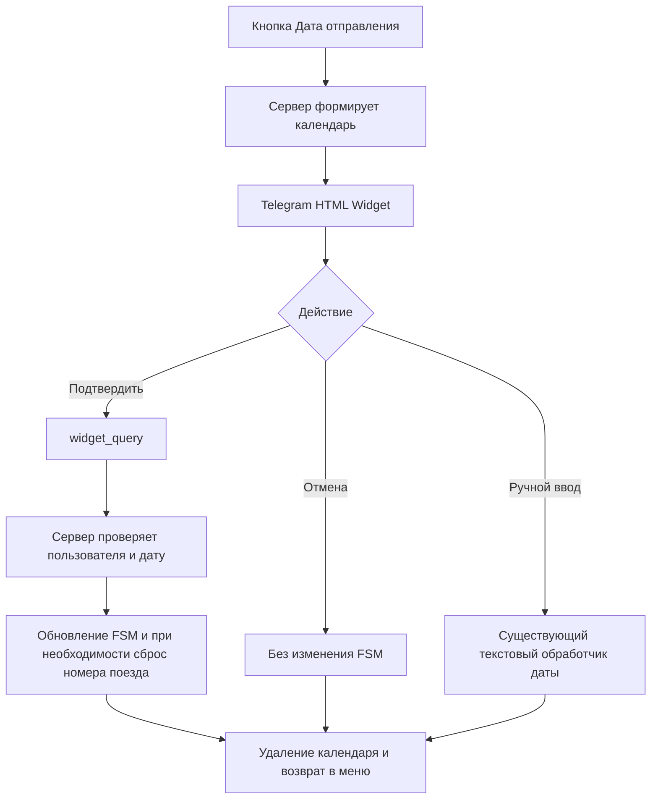

# Техническая архитектура календаря TrainBot — черновик для согласования

- **Дата:** 2026-11-12
- **Статус:** проект технической архитектуры; **согласованы решения разделов 3.1–3.10, включая сборку HTML без новых зависимостей**; документ в целом ещё не утверждён
- **Сценарий:** создание и редактирование подписки «Отслеживание»
- **Источник функциональных требований:** [календарь — функциональная спецификация](./calendar-widget-2026-11-12.md)
- **Исходные материалы:** предоставленные `handlers/subscrib.py` и `bot.py`; фактически установленный релиз aiogram пока не подтверждён (`aiogram>=3,<4`)

## 1. Назначение и границы

В этом документе обсуждаются **только технические решения**: интеграция HTML Widget с существующими обработчиками и FSM, транспорт Telegram Bot API, обработка подтверждения/отмены, авторизация запросов, fallback, ошибки и тесты.

Функциональные требования (период 90 дней, формат `YYYY-MM-DD`, UI, поведение кнопок, редактирование/отмена и т. д.) уже согласованы и не дублируются здесь. **Изменение функциональных требований необходимо фиксировать в отдельной функциональной спецификации.**

## 2. Установлено по предоставленному `handlers/subscrib.py` (2026-11-12)

- `StSubscr.dt_depart` — состояние ожидания даты; данные подписки находятся в том же `FSMContext` (`dt_depart`, `DepCode`, `DestCode`, `TrainNumber` и др.).
- `prm_sub_otslej()`, строки 172–225, рисует кнопку даты; `select_sub_otsl()`, строки 229–271, в ветке `dt_depart` отправляет текст «Введите дату...» и устанавливает `StSubscr.dt_depart`.
- `@router.message(StSubscr.dt_depart)`, строки 274–289, проверяет ввод через `util_bot.ch_dt_depart()`, записывает `dt_depart` в FSM и возвращает `prm_sub_otslej()`.
- Создание новой «Отслеживание»: обработчик `vid_subs` вызывает `state.clear()` и `prm_sub_otslej()` (строки 137–145).
- **То же меню используется при редактировании:** в `ch_subs()` данные существующей подписки загружаются в FSM (строки 745–775). `save_otslej()` отличает обновление от вставки по `user_data.get('id_sub')` (строки 779–799).
- Поиск номера поезда `set_NumTrain()` уже берёт `dt_depart` из FSM (строки 352–397); сохранение новой подписки менять не требуется.
- В обработчике текстовой даты после ошибочного ввода происходит выход из состояния даты и возврат в меню. **Согласовано сохранить прежнее поведение**, без автоматического запроса повторного ввода.
- Для ручного ввода потребуется точечное дополнение `@router.message(StSubscr.dt_depart)`: сравнить старое значение `dt_depart` с корректно введённым новым и при изменении сбросить `TrainNumber`/`TimeDepart`. Остальное поведение текстового ввода остаётся прежним, если не согласовано иное.
- В предоставленном `bot.py` обнаружены `MemoryStorage`, `Dispatcher`, `dp.start_polling(bot)`; комментарий о `aiogram-3.0.0rc2` не подтверждает фактически установленную версию. **Пользователь сообщил зависимость `aiogram>=3,<4`**, но это диапазон допустимых версий, не точный установленный релиз.
- По официальному Telegram Bot API 10.4: `sendWidget` принимает самодостаточный HTML, `allow_queries=True` и при необходимости `reply_markup`; запрос приходит как `widget_query`, ответ — `answerWidgetQuery` не позднее 15 секунд. Точная поддержка этих сущностей фактической версией aiogram TrainBot ещё не установлена.

### 2.1. Дополнительная проверка Telegram и aiogram (2026-11-12)

- Официальный [Telegram Bot API changelog](https://core.telegram.org/bots/api-changelog) подтверждает появление `sendWidget`, `widget_query` и `answerWidgetQuery` в **Bot API 10.4 от 2026-11-09**. В production отправка Widget допускается в личные чаты.
- Официальная [документация aiogram](https://docs.aiogram.dev/en/latest/) на момент просмотра показывает **3.31.0** с поддержкой Bot API **10.3**. **Проектное допущение (решение пользователя): для TrainBot считаем, что установленный aiogram 3 не поддерживает Widgets; интеграцию проектируем через адаптер, без ветвления по наличию нативных методов.** Это допущение не выдаётся за проверенный факт о среде.
- Проверен загруженный `bot.py`: используется `Dispatcher(storage=MemoryStorage())`, подключён `subscrib.router`, в `main()` создаётся `Bot` (при необходимости с `AiohttpSession(proxy=...)`), затем выполняется `await dp.start_polling(bot)` **без явного `allowed_updates`**.
- Ограничение пользователя `aiogram>=3,<4` описывает зависимость, но **не позволяет установить точный релиз**. Для выбранной архитектуры нет необходимости выбирать между native API и адаптером по версии: **всегда используем адаптер**. При реализации потребуется проверить сериализацию/получение неизвестного события в фактически установленном aiogram и сохранить совместимость с его текущим polling.
- По [документации aiogram о polling](https://docs.aiogram.dev/en/latest/migration_2_to_3.html) при отсутствии `allowed_updates` aiogram автоматически использует только зарегистрированные типы событий. Если поддержка `widget_query` реализуется через дополнительный обработчик/перехват, событие необходимо явно добавить, **сохранив все ранее используемые типы**.

## 3. Предложение по минимальной интеграции — **не утверждено**

- В ветке `sub_otsl_prm/dt_depart` использовать один календарь как при **создании**, так и при **редактировании**: если в FSM имеется `dt_depart`, передавать его как выделенную дату; если даты нет, ничего не выделять. Не создавать отдельный календарь для редактирования.
- Использовать существующее состояние `StSubscr.dt_depart`, но принимать подтверждение Widget через отдельный путь обработки `widget_query`, а не пытаться вызвать обработчик `@router.message` фиктивным сообщением.
- После проверки типа запроса, пользователя, идентификатора сообщения, состояния FSM и допустимой даты выполнить `state.update_data(dt_depart=YYYY-MM-DD)`, выйти из состояния, удалить сообщение виджета и вызвать существующее `prm_sub_otslej()`.
- При отмене вернуться в это же меню без изменения `dt_depart` и других параметров. Альтернативный путь текстового ввода — inline-кнопка «✏️ Ввести дату вручную» под сообщением календаря. Обработчик кнопки удаляет/закрывает календарь, предлагает отправить дату в формате `ГГГГ-ММ-ДД` и устанавливает `StSubscr.dt_depart`. Используется существующий `@router.message(StSubscr.dt_depart)`.
- Транспорт `sendWidget` / `answerWidgetQuery` выполняется через **изолированный адаптер Telegram Bot API**, независимо от нативных возможностей aiogram (согласованное решение). Детали реализации адаптера и перехвата `widget_query` предстоит определить.

### 3.1. Транспорт Widget — **согласовано 2026-11-12**

Архитектурное допущение: **установленный aiogram 3 не поддерживает Telegram Widgets**. Отказываемся от разветвления «если поддерживает — native API, если не поддерживает — адаптер». Выбран **один фиксированный путь интеграции: небольшой изолированный адаптер Telegram Bot API 10.4**.

Утверждены следующие правила:

1. **Адаптер Widget:** отправлять календарь через `sendWidget`, принимать `widget_query` и отправлять `answerWidgetQuery` без использования неподтверждённых нативных типов или обработчиков aiogram. Конкретные методы обращения к Bot API и точка перехвата входящего Update должны быть проверены отдельно до реализации.
2. **Long Polling:** явно включить `widget_query` в `allowed_updates`, **сохранив все события, необходимые уже зарегистрированным обработчикам**, например на базе `dp.resolve_used_update_types()`. Не заводить второй polling.
3. **Сессия:** использовать **существующие `Bot` и его HTTP-сессию**, сохраняя текущую настройку прокси, аутентификацию и управление жизненным циклом сессии. Не создавать отдельного клиента/сессии Telegram для Widget.
4. **Сохранение архитектуры TrainBot:** **не перестраивать существующие Router и FSM подписок**. Новый транспорт Widget изолировать; переиспользовать `StSubscr.dt_depart`, `prm_sub_otslej()` и существующее хранилище FSM. Допускаются только необходимые точечные изменения точек входа и отдельная обработка нового типа события.
5. **Границы:** не обновлять aiogram специально ради Widgets, не создавать отдельного бота, не дублировать бизнес-логику выбора/сохранения даты в транспортном слое.

**Ещё не согласовано:** формат извлечения сырых данных из Update, детальный алгоритм обработки и ответа на каждый запрос, организация функций адаптера. Точка перехвата согласована в разделе 3.2.

### 3.2. Перехват `widget_query` — **согласовано 2026-11-12**

Для нового, не поддерживаемого установленным aiogram 3 события использовать **`dp.update.outer_middleware()`** — единый внешний middleware для входящих `Update` перед стандартной маршрутизацией.

- При наличии `widget_query` передавать его **изолированному обработчику/адаптеру Widget**; исходный Update не должен дополнительно попадать в существующие Router как неизвестное событие.
- Все прочие обновления **без изменений передавать далее через `await handler(event, data)`**, сохраняя обычный маршрут aiogram и поведение подписок/бронирования.
- Middleware не содержит бизнес-логики выбора даты: только обнаружение/передача события и изоляция обработки.
- Работоспособность схемы необходимо подтвердить на фактически установленной версии aiogram: проверка сериализации неизвестного `widget_query` (включая доступность `event.model_extra`), реального вызова outer middleware **до** стандартного разбора типа, и отсутствия потерь других Updates.
- Обработка ошибок и гарантированный однократный `answerWidgetQuery` для каждого полученного запроса — отдельный нерешённый технический вопрос; факт согласования middleware не означает успешной проверки runtime.

### 3.3. Единая функция применения даты в FSM — **согласовано 2026-11-12**

Для подтверждения даты календарём и для **успешно проверенного** ручного ввода используется **одна общая функция применения даты**. Её задача — менять данные существующего `FSMContext`, не дублируя бизнес-правило в двух обработчиках.

Контракт функции (логический, конкретное имя и модуль определяются при плане реализации):
- Вход: текущий `FSMContext` и уже проверенная новая дата в формате `YYYY-MM-DD`.
- Прочитать прежнее `dt_depart` из `state.get_data()`, сравнить с новой датой.
- При **совпадении** не сбрасывать `TrainNumber` и `TimeDepart`; при **изменении** записать новую `dt_depart` и сбросить `TrainNumber`/`TimeDepart` (без сброса других полей FSM).
- При отсутствии прежней даты заполнить `dt_depart` как при создании подписки; очистка ранее выбранных `TrainNumber` и `TimeDepart`, если они вдруг присутствуют, выполняется по тому же правилу изменения.
- Возврат в `prm_sub_otslej()`, отправка ответов на `widget_query`, логирование и завершение состояния ввода выполняются **вызывающими обработчиками**, не общей функцией.
- **Валидация до вызова:** Widget-путь проверяет дату, диапазон и авторизацию запроса; ручной путь сохраняет действующий `util_bot.ch_dt_depart()` и его поведение при ошибке. Общую функцию **не вызывать** при ошибочном вводе или отмене. Тогда дата, поезд и время остаются прежними, а старая ветка с предупреждением и возвратом в меню не меняется.

Вызовы: новый обработчик `widget_query` после проверок и существующий `@router.message(StSubscr.dt_depart)` после успешной проверки введённой даты. **Не создавать фиктивные Telegram Message для повторного вызова другого хендлера**.

### 3.4. Привязка Widget к FSM и проверка владельца — **согласовано 2026-11-12**

Выбран минимальный способ защиты без отдельной таблицы БД: **при отправке календаря сохранять идентификатор активного сообщения Widget в FSM текущего пользователя** (служебное поле черновика подписки; конкретное имя выбрать при реализации).

- После успешной отправки `sendWidget` сохранить `message_id` календаря в существующий `FSMContext` пользователя. Этот идентификатор относится к **текущему активному календарю**, а не к сохранённой подписке в БД.
- При получении `widget_query` проверить **`from.id` пользователя, идентификатор личного чата, `message_id` запроса и сохранённый идентификатор активного Widget в FSM**; убедиться, что запрос относится к текущему черновику/режиму ввода даты. Значения из клиентского Widget не считать доказательством авторизации.
- Если активный идентификатор отсутствует или не совпадает, либо пользователь/чат не соответствует FSM, **не применять дату, не сбрасывать номер поезда и не менять другие поля подписки**. Отказать в действии через предусмотренный Telegram API ответ; детали единого ответа на ошибочные запросы согласовать отдельно.
- После завершения взаимодействия (успешное подтверждение даты, отмена, переход к ручному вводу) **снять признак активного Widget в FSM**, чтобы прежнее сообщение больше не могло применить дату. При открытии нового календаря действительным становится только его идентификатор.
- **Ограничение `MemoryStorage`:** после перезапуска данные FSM теряются; старые виджеты считаются недействительными. Восстановление старых виджетов или отдельная БД для этого не вводятся.
- **До реализации** проверить, что `sendWidget` действительно возвращает ожидаемый `message_id`, а сырой `widget_query` содержит надёжные поля `from.id`, `chat.id`, `message_id` для данного сценария.

**Отдельно не утверждено:** конкретная техника сериализации параллельных запросов в рамках FSM, порядок удаления Telegram-сообщения при неудаче и механика отмены. Принцип идемпотентности согласован в разделе 3.5.

### 3.5. Однократное применение подтверждения и поведение кнопки — **согласовано 2026-11-12**

- **Защита от дублирования обязательна:** успешно подтверждённая дата применяется к FSM не более одного раза для одного активного календаря. При успешной обработке `widget_query` сервер сразу снимает признак активного Widget из FSM; повторные запросы от того же сообщения не должны повторно менять дату, сбрасывать поезд или создавать второе меню.
- Повторная доставка и два почти одновременных запроса требуют защиты не только от «дважды нажать», но и от **гонки двух обработчиков**: сравнение активного `message_id` и его погашение должны выполняться как единая защищённая операция. Конкретный способ синхронизации с существующим `MemoryStorage` выбрать и проверить в плане реализации; не добавлять отдельную БД без необходимости.
- **UX-кнопка:** сразу после первого нажатия «Подтвердить» локально сделать кнопку недоступной и показать ожидание ответа; при ошибке по ответу/отклонению запроса восстановить возможность попытки, если календарь ещё актуален.
- **Важно:** `TelegramWidget.request()` **не закрывает и не удаляет сообщение автоматически**. API возвращает Promise с результатом `answerWidgetQuery`; в состоянии ожидания следующий запрос может получить `BUSY`. Закрытие календаря в TrainBot означает **явное удаление сообщения ботом после успешной серверной обработки** с последующим показом существующего меню. Само завершение Promise не равнозначно удалению сообщения.
- Ошибочные и повторные запросы должны получать своевременный `answerWidgetQuery`, но не создавать дополнительные Telegram-сообщения с меню. Детальный формат ответов и отказов определим отдельно.

Источник: [официальная документация Telegram Widgets](https://core.telegram.org/bots/widgets), раздел «Requests to the bot»; [Telegram Bot API — answerWidgetQuery](https://core.telegram.org/bots/api#answerwidgetquery).

### 3.6. Отмена календаря — **согласовано 2026-11-12**

Кнопка **«Отмена»** внутри календаря вызывает `TelegramWidget.request("cancel")`. Это служебная команда (не дата), которая доставляется боту как `widget_query` по тому же каналу, что и подтверждение.

- Сервер валидирует пользователя, личный чат и активный `message_id` по FSM так же, как при подтверждении.
- Для действительного календаря обработчик **не вызывает общую функцию применения даты** и не меняет `dt_depart`, `TrainNumber`, `TimeDepart`, прочие параметры или `id_sub`. Меняется только служебная отметка активности Widget: календарь считается закрытым.
- Бот отвечает на `widget_query` через `answerWidgetQuery`, удаляет сообщение с календарём и показывает существующее меню `prm_sub_otslej()`.
- При повторной отмене или запросе из устаревшего/чужого Widget никаких действий с подпиской и повторного меню не выполнять; обеспечить однократность.
- При ошибке удаления Telegram-сообщения **не восстанавливать активность Widget**, не терять FSM-параметры и не считать отмену незавершённой; механика уведомления об ошибках будет рассмотрена отдельно.
- Клиентский `TelegramWidget.request("cancel")` **сам по себе не закрывает сообщение**; удаление выполняет бот. Проверка фактического порядка `answerWidgetQuery` и удаления, а также поведения клиента входит в план тестирования.

**Это согласованное решение для архитектуры**, не подтверждённая работающая реализация в aiogram.

### 3.7. Ошибка отправки `sendWidget` — **согласовано 2026-11-12**

Если Telegram API отклонил `sendWidget` или вызов завершился ошибкой, **без повторной попытки отправки Widget перейти к действующему ручному вводу даты**.

- Не записывать в FSM идентификатор активного Widget для неуспешной отправки. Если календарь перед этим уже открывался, не считать прежнее сообщение активным. При неопределённом результате запроса (например, таймаут после фактической отправки) запросы от календаря **без подтверждённого активного `message_id`** отклоняются как устаревшие.
- Сохранить текущие поля черновика подписки: `dt_depart`, `TrainNumber`, `TimeDepart`, `id_sub` и другие параметры. Ошибка отправки сама по себе не изменяет данные подписки.
- Отправить обычное сообщение с предложением ввести дату в формате `ГГГГ-ММ-ДД` и установить существующее состояние `StSubscr.dt_depart`. Принимать дату через текущий `@router.message(StSubscr.dt_depart)`, **без нового дублирующего обработчика**; при успешном вводе использовать согласованную общую функцию применения даты.
- При неверном ручном вводе **не изменять существующее поведение**: сообщение об ошибке, выход из состояния ввода и возврат в меню.
- Ошибку `sendWidget` зарегистрировать в серверном логе без токенов и персональных данных. Не запускать второй polling, не создавать другую HTTP-сессию и не предпринимать скрытых повторных отправок Widget.
- Если не удалось отправить **и обычное сообщение** для fallback, не объявлять переход в ручной ввод успешным: корректно зарегистрировать/обработать сбой по правилам существующего бота. Детальный алгоритм этой редкой ошибки будет определён при планировании.

Это решение применяется к созданию и редактированию «Отслеживание». Оно не равно определению поддержки Widget конкретным клиентом: ситуация, когда `sendWidget` успешно отправлен, но не отображается в старом клиенте Telegram, покрывается отдельной согласованной inline-кнопкой ручного ввода и должна проверяться на клиентах.

### 3.8. Отклонённые `widget_query`: обратная связь в Widget — **согласовано 2026-11-12**

Для **каждого полученного** `widget_query` сервер стремится отправить ровно один `answerWidgetQuery` в пределах предусмотренного Telegram **15-секундного окна**, в том числе при отказе. **Не отправлять дополнительных сообщений в чат** при перечисленных штатных отказах.

- **Недопустимая дата** (неверный ISO-формат, несуществующий день, вне разрешённого диапазона): не менять FSM и не закрывать активный календарь; вернуть код ошибки и понятный текст, позволяющий выбрать другую дату.
- **Устаревший/чужой календарь** (неверный владелец, чат, `message_id`, отсутствие активного Widget в FSM или неверный сценарий): не менять ни пользовательские, ни служебные поля другого сеанса; вернуть отказ «Календарь больше неактивен» или эквивалентный короткий текст. Никаких попыток открыть меню из этого запроса.
- **Повторный запрос** (уже обработанное подтверждение или отмена): вернуть соответствующий отказ без повторного изменения даты, сброса поезда, удаления сообщения и отправки меню.
- **Транспорт ошибки:** `answerWidgetQuery` имеет параметр `data` (строка до 1024 байт). Это **не системное всплывающее уведомление Telegram и не автоматический вывод ошибки**. Сервер передаёт согласованный компактный результат, например JSON-строку с `status`, `code`, `message`, а **JS календаря самостоятельно отображает текст внутри Widget**, получив ответ `TelegramWidget.request()`. Детальный формат и обработка отклонённого Promise/сбоев сети уточняются на этапе плана реализации.
- Запросы, которые уже отклоняются клиентом или не доставлены в бот, не могут гарантированно получить ответ сервера. События, обработанные ботом, необходимо отслеживать и логировать без чувствительных данных.

Источник: [официальный Bot API: `answerWidgetQuery`](https://core.telegram.org/bots/api#answerwidgetquery) описывает только `widget_query_id` и возвращаемые данные `data`; отдельного параметра `show_alert` или `text`, аналогичного `answerCallbackQuery`, у метода нет.

### 3.9. Одновременные запросы — **согласовано 2026-11-12**

- Использовать простой **`asyncio.Lock` на пользователя** внутри текущего процесса TrainBot.
- Внутри блокировки последовательно проверять активный календарь и применять дату/отмену; повторный запрос не создаёт второе меню.
- **Не добавлять** Redis, отдельную БД, распределённые блокировки и другие усложнения ради этого сценария.
- По решению пользователя дальнейшие архитектурные обсуждения **не углублять в защиту и избыточные проверки**; сосредоточиться на практической интеграции Widget.

### 3.10. Сборка самодостаточного HTML Widget — **согласовано 2026-11-12**

- Исходники календаря располагаются в общем каталоге `widgets/calendar/`: `calendar.html`, `calendar.css`, `calendar.js`; конфигурация — `widgets/calendar/config.py`.
- При отправке календаря сервер средствами **стандартной библиотеки Python** читает локальные файлы, подставляет начальную дату (либо отсутствие выбора) и допустимые границы, затем встраивает CSS и JS в **единый самодостаточный HTML** для `sendWidget`.
- **Не использовать Jinja2, сборщики JavaScript или дополнительные зависимости** только ради календаря; не обращаться к внешним стилям и скриптам из Telegram Widget.
- Подстановка динамических значений должна учитывать контекст HTML/JS (например, корректная JSON-сериализация данных вместо конкатенации необработанного текста). Конкретный минимальный метод определить в плане реализации.
- Перед отправкой проверить ограничения размера/сжатия HTML согласно Telegram Bot API. При ошибке сборки/отправки применяется уже согласованный fallback к существующему ручному вводу даты.
- Календарь остаётся универсальным: HTML/CSS/JS не содержат бизнес-логику подписки, а получают только параметры отображения/выбора даты.

## 4. Поток события — предварительный вариант, не утверждён

Это **схема для обсуждения**, не проверенная реализация. Технический механизм «Отмена» и использование конкретного события `widget_query` зависят от проверки актуального Telegram API и установленного aiogram.

## 5. Открытые архитектурные вопросы

- Технический формат передачи уже рассчитанных сервером границ в HTML Widget и их безопасная сериализация.
- **Согласовано:** «Отмена» через `TelegramWidget.request("cancel")` → `widget_query` → проверка активного календаря → `answerWidgetQuery`, деактивация, удаление сообщения и возврат в меню без изменения параметров подписки. Реальную работу проверить в клиенте Telegram.
- **Согласовано:** собирать единый HTML стандартной библиотекой Python из `calendar.html`, `calendar.css` и `calendar.js`, без Jinja2 и сборщиков. Детали сериализации параметров и проверку размера уточнить в плане реализации.
- Проверить в рабочей версии aiogram прохождение неизвестного `widget_query` до `dp.update.outer_middleware()`, способ извлечения данных из сырого Update и отсутствие вмешательства в остальные события; ответы на ошибки через `answerWidgetQuery` согласованы, требуется тест своевременности и однократности.
- **Согласовано:** привязка Widget к `message_id` в FSM, проверка пользователя/чата/сообщения, отказ после перезапуска `MemoryStorage`, защита от повторного применения и формат ошибок через `answerWidgetQuery`/клиентский JS. **Согласовано:** последовательная обработка через `asyncio.Lock` на пользователя в рамках текущего процесса, без дополнительных хранилищ.
- Проверить доступность Telegram inline-кнопки под виджетом у клиентов без поддержки HTML Widgets и корректный запуск текстового ввода.
- Тесты UI в Telegram-клиентах, fallback и критерии приёмки.
- Проверить смысл поля `id_sub` на актуальной сборке и корректность применения одной формы для создания/редактирования.

## 6. Порядок согласования

1. **Согласовано:** фиксированный адаптер Bot API 10.4 для aiogram 3 без native Widgets, сохранение текущих Router/FSM, Bot-сессии и всех существующих allowed_updates плюс `widget_query`; входящее событие перехватывается через `dp.update.outer_middleware()`. Фактическая совместимость с версией aiogram требует проверки.
2. **Согласовано:** единая функция применения подтверждённой даты для календаря и ручного ввода; при изменении даты сбрасываются `TrainNumber` и `TimeDepart`, при ошибке/отмене данные не меняются. Расположение функции и конкретная сигнатура определяются при планировании.
3. **Согласовано:** проверять активный `message_id`, владельца и чат по FSM, отклоняя чужие/старые календари; запросы на подтверждение обрабатывать однократно, а сообщение календаря удалять ботом после успешной обработки. Отмена через `TelegramWidget.request("cancel")` согласована; остаются ответы на ошибки и конкретная синхронизация.
4. **Согласовано:** если `sendWidget` завершается ошибкой, без повторной попытки открыть существующий ручной ввод через `StSubscr.dt_depart`. Ответы `answerWidgetQuery`, `asyncio.Lock` и сборка HTML стандартным Python согласованы. Далее обсудить оставшийся контракт обмена Widget с сервером и утвердить архитектуру; затем подготовить отдельный план реализации в `specs/trainbot-widget/`.

**Production-код не изменён; проверки runtime и Telegram E2E не проводились.**

## 7. История архитектурных решений

- **2026-11-12:** пользователь утвердил фиксированный адаптер Telegram Widget API вместо условного выбора native/адаптер, включение `widget_query` вместе со всеми прежними событиями, использование существующей `Bot`-сессии и отказ от перестройки Router/FSM.
- **2026-11-12:** согласован перехват `widget_query` через `dp.update.outer_middleware()` с передачей всех остальных Update штатной маршрутизации; реальную работу с неизвестным типом aiogram нужно проверить до реализации.
- **2026-11-12:** согласована единая функция обновления `dt_depart` в FSM, вызываемая календарём и успешным ручным вводом, со сбросом номера/времени только при фактическом изменении даты; старая обработка ошибочного текста сохраняется.
- **2026-11-12:** согласовано хранить идентификатор активного календаря в FSM пользователя и сверять его с `widget_query` вместе с пользователем/чатом; старые и чужие календари отклонять без изменений FSM.
- **2026-11-12:** пользователь утвердил защиту от повторного подтверждения; уточнено по официальному Telegram API, что `request()` не закрывает Widget автоматически. Клиент временно блокирует кнопку, сервер обеспечивает однократное применение и удаляет календарь после успеха.
- **2026-11-12:** утверждена команда отмены через `TelegramWidget.request("cancel")` с обработкой `widget_query`: деактивировать Widget, удалить календарь и вернуть меню, оставив параметры подписки без изменений.
- **2026-11-12:** при ошибке `sendWidget` согласован автоматический переход к существующему ручному вводу `StSubscr.dt_depart` без повторной отправки Widget и без изменения данных подписки.
- **2026-11-12:** согласованы ответы на недопустимую дату, чужой/устаревший календарь и повторный запрос через `answerWidgetQuery`, без дополнительных сообщений в чат. Сведения об ошибке передаются в `data`; их отображает клиентский JS, а не Telegram автоматически.
- **2026-11-12:** согласована минимальная синхронизация запросов через `asyncio.Lock` на пользователя; по просьбе пользователя дальнейшее проектирование не усложнять дополнительной защитой и проверками.
- **2026-11-12:** утверждена сборка самодостаточного HTML из `calendar.html`, `calendar.css`, `calendar.js` средствами стандартной библиотеки Python, без Jinja2, JS-сборщиков и новых зависимостей.
