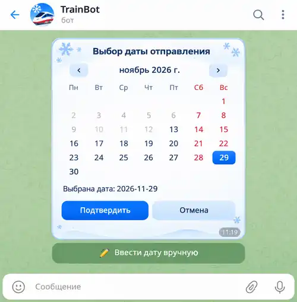

# TrainBot — календарь выбора даты отправления

**Статус:** новый визуальный макет утверждён пользователем **13 ноября 2026 года**.
**Каталог:** `specs/trainbot-widget/calendar/`.

## Утверждённое изображение

[Открыть макет](./calendar-widget-winter-approved.webp)

**ОБЯЗАТЕЛЬНО ПРИ РЕАЛИЗАЦИИ:** использовать изображение `calendar-widget-winter-approved.webp` как **основной визуальный эталон** HTML/CSS календаря TrainBot. Оно заменяет старый, более крупный белый дизайн. В репозитории хранится оптимизированная для просмотра WebP-копия согласованного изображения (500 × 510 пикселей).

### Обязательные визуальные условия

- **Компактная форма** меньше исходного календаря; белая скруглённая карточка, светло-голубая зимняя отделка, тёмно-синий текст и синий выбранный день.
- **Только снежинки** как декоративные изображения **внутри календаря**. Не переносить из дизайна главного меню кота, поезд, ели или другие иллюстрации.
- **Суббота и воскресенье — красные:** заголовки `Сб`/`Вс` и номера дней. Недоступные даты остаются недоступными; при выборе выходного синий фон и белая цифра имеют приоритет.
- Сохранить стрелки переключения месяцев, строку выбранной даты и кнопки `Подтвердить` / `Отмена`; снизу отдельная Telegram-кнопка `✏️ Ввести дату вручную`.
- Дата `2026-11-29` на иллюстрации — **лишь пример**; реализация использует текущий месяц, допустимый диапазон и значение из FSM, как установлено спецификацией.
- На скриншоте присутствуют элементы интерфейса Telegram (шапка, фон, поле ввода). **Они не входят в HTML Widget** и не должны копироваться в его шаблон.

### Проектные документы

- [Функциональные требования](./calendar-widget-2026-11-12.md)
- [Утверждённая техническая архитектура](./calendar-widget-architecture-2026-11-12.md)
- [План реализации](./calendar-widget-implementation-plan-2026-11-12.md)
- [Общий визуальный стиль TrainBot](../ui-style-guide.md)

Этот макет — **визуальный эталон**, а не результат тестирования HTML Widget или Telegram E2E. Его утверждение не является поручением изменять production-код.
