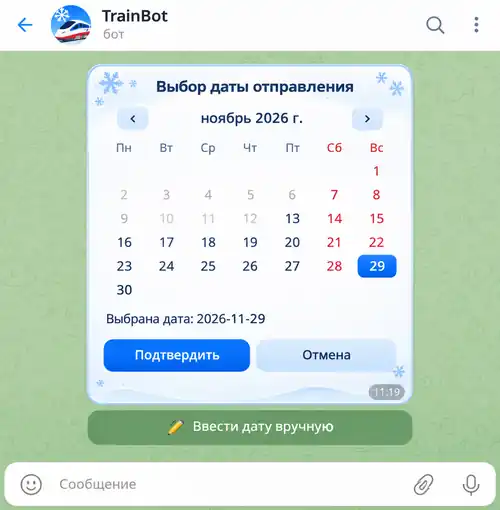

# Календарь выбора даты отправления TrainBot — спецификация

- **Дата начала:** 2026-11-12
- **Статус:** функциональные требования согласованы; [техническая архитектура](./calendar-widget-architecture-2026-11-12.md) утверждена 2026-11-12. План реализации ещё не составлен.
- **Проект:** TrainBot / aiogram 3
- **Этап:** проектирование, исходный код не изменён
- **Актуальный утверждённый UI-макет:** [зимний календарь](./calendar-widget-winter-approved.webp), утверждён 2026-11-13. **Обязателен при реализации**, заменяет первоначальный эскиз.

### Утверждённый визуальный эталон — 2026-11-13

**Использовать при реализации обязательно.** Это актуальная версия интерфейса календаря, которая заменяет ранее обсуждавшийся более крупный белый вариант. [README с критериями](./README.md) и [руководство по стилю](../ui-style-guide.md) дополняют макет. Дата «2026-11-29» на изображении — **пример состояния**, а не фиксированное значение: фактические месяц/дата задаются FSM и допустимым диапазоном. Фон и элементы Telegram вне карточки не требуется воспроизводить внутри HTML Widget.

## 1. Цель и границы

Добавить календарь выбора даты отправления прямо в сообщение Telegram, упростив ввод даты. **Первый этап — создание и редактирование подписки «Отслеживание»**. При создании дата ещё не задана, при редактировании в FSM загружается сохранённое значение даты, которое должно быть отмечено в календаре. Архитектура компонента должна позволять переиспользовать его для других сценариев TrainBot без дублирования самого календаря; другие сценарии пока не изменять.

## 2. Согласованные решения

1. **Способ отображения:** Telegram HTML Widget, а не отдельная Mini App.
2. **Внешний вид:** **обязательно воспроизвести утверждённый [зимний макет](./calendar-widget-winter-approved.webp)**: более компактная белая карточка с мягкой светло-голубой отделкой в стиле [общего руководства](../ui-style-guide.md), тёмно-синий заголовок «Выбор даты отправления», навигация по месяцам, выделение выбранного дня синим, строка выбранной даты и кнопки «Подтвердить» / «Отмена». **Из декоративных изображений внутри Widget разрешены только снежинки**; не добавлять котика, поезд, ели и другие иллюстрации. **Суббота и воскресенье — красным**: и заголовки столбцов, и доступные числа выходных; недоступные даты остаются неактивными, выбранный выходной отображается белым текстом на синей подложке.
3. **Поведение:** переходы по месяцам и выбор дня выполняются локально; дата передаётся боту только после нажатия «Подтвердить». До подтверждения выбор не сохраняется.
4. **Доступные дни:** **сегодня и следующие 90 дней включительно** (допустимый диапазон от `today` до `today + 90 days`); прошедшие дни и дни за верхней границей нельзя выбрать.
5. **Настройки:** число дней вперёд задаётся в **конфигурации самого виджета** (начальное значение 90), а не захардкожено в `handlers/subscrib.py`. Конкретное имя и место конфигурационного файла пока не утверждены.
6. **Интеграция:** использовать существующий сценарий «Отслеживание», его FSM и поле даты `dt_depart`, не переписывая бизнес-логику подписки.
7. **Совместимость:** под сообщением календаря разместить обычную Telegram inline-кнопку «✏️ Ввести дату вручную», доступную в том числе при отсутствии поддержки HTML Widgets клиентом. По нажатию запустить существующий сценарий текстового ввода даты через `StSubscr.dt_depart`, не дублируя обработчик проверки и сохранения даты. Эта опция действует и при создании, и при редактировании подписки.
8. **Порядок работы:** значимые архитектурные решения согласовать до программирования; менять production-код только по отдельному поручению.
9. **Часовой пояс:** для всех пользователей «сегодня» и границы допустимого диапазона рассчитываются по московскому времени (`Europe/Moscow`), независимо от часового пояса устройства или станции отправления.
10. **Формат даты отправления:** календарь выбирает и передаёт дату строго в формате `ГГГГ-ММ-ДД` (`YYYY-MM-DD`, например, `2026-11-20`) для поля `dt_depart`. Время суток, часы, минуты и часовой пояс в значение даты не включаются; `Europe/Moscow` используется только для определения «сегодня» и допустимого диапазона.
11. **Начальное состояние:** при создании подписки календарь открывается на текущем месяце без выделенного дня; сегодняшняя дата автоматически не выбирается. При редактировании, если сохранённая `dt_depart` находится в допустимом диапазоне, открывается её месяц, а день выделен. Если сохранённая дата уже прошла или находится за пределами допустимого диапазона «сегодня + 90 дней», открывается текущий месяц **без выделенного дня**, кнопка «Подтвердить» неактивна до выбора нового допустимого дня. Пока пользователь не подтвердил новый выбор, прежняя дата в FSM не меняется; при отмене она остаётся прежней.
12. **Кнопка подтверждения:** при создании подписки кнопка «Подтвердить» неактивна, пока пользователь не выбрал допустимую дату. При редактировании, если сохранённая дата `dt_depart` находится в допустимом диапазоне, она выделена и кнопка активна сразу — пользователь может подтвердить её без изменения либо выбрать другой день. В остальных случаях подтверждение доступно только после выбора допустимой даты. До подтверждения изменения не сохраняются.
13. **Кнопка «Отмена»:** возвращает в меню параметров создаваемой или редактируемой подписки «Отслеживание» без изменения даты и других параметров в FSM. При редактировании сохраняется прежняя дата. Технический способ закрытия/замены виджета требует проверки Telegram API.
14. **Завершение работы с календарём:** после успешного подтверждения даты или отмены сообщение с календарём удаляется из чата, а пользователю показывается существующее меню параметров создаваемой или редактируемой подписки «Отслеживание». При неудачном удалении дата и остальные параметры FSM не должны теряться; технический порядок операций и обработка ошибок уточняются при реализации.
15. **Структура файлов:** выделить общий модуль `widgets/calendar/`. Настройки календаря хранить в `widgets/calendar/config.py`, HTML-шаблон — в том же каталоге. Компонент переиспользуется другими сценариями TrainBot; бизнес-логику подписки в него не переносить. Точные имена HTML-файла и модулей адаптера уточнить при планировании реализации.
16. **Источник диапазона:** сервер по настройкам из `widgets/calendar/config.py` и текущей дате `Europe/Moscow` вычисляет нижнюю и верхнюю допустимые даты и передаёт их при открытии Widget. Клиент отображает только этот диапазон; при подтверждении сервер выполняет обычную проверку допустимости даты. Отдельные сценарии смены даты после полуночи, автоматического обновления или повторного открытия календаря не проектируются.
17. **Расположение стилей и скриптов:** если используются отдельные исходные CSS и JavaScript, хранить их рядом с `calendar.html`, внутри `widgets/calendar/` (например, `calendar.css`, `calendar.js`). Для Telegram HTML Widget итоговый отправляемый HTML должен быть самодостаточным: содержимое этих файлов встраивать в разрешённые inline CSS/JS при подготовке к отправке, не рассчитывая на загрузку внешних ресурсов. Конкретный способ сборки/подстановки параметров выбрать при планировании без добавления ненужного инструментария.
18. **Согласованность номера поезда с датой при редактировании:** при подтверждённом изменении `dt_depart` **любым способом — через календарь или ручной текстовый ввод** — сбросить `TrainNumber` и `TimeDepart` (ранее выбранный поезд и время). Пользователь повторно выбирает поезд для новой даты. Если подтверждённая дата совпадает с прежней, оба поля остаются без изменений. При «Отмена» или ошибочном ручном вводе не изменять дату, поезд и время. Станции и другие параметры подписки сохраняются. Логика сравнения старой и новой даты должна быть общей для обоих способов ввода.

19. **Ошибочный ручной ввод:** оставить текущую логику `@router.message(StSubscr.dt_depart)` из предоставленного `subscrib.py`: если `util_bot.ch_dt_depart()` не принимает введённую дату, бот показывает сообщение об ошибке, выходит из состояния ввода даты (`state.set_state(None)`) и возвращает пользователя в меню `prm_sub_otslej()`. Повторный ввод не запрашивается автоматически; дата `dt_depart`, `TrainNumber` и `TimeDepart` не изменяются. Изменение правила сброса поезда применяется только после успешно принятой новой даты.

## 3. Рассмотренные варианты

| Вариант | Вывод |
| --- | --- |
| Inline-календарь | Совместим с существующими callback, но переключение месяцев создаёт дополнительные события бота. |
| **Telegram HTML Widget** | **Выбран**: календарь непосредственно в сообщении; локальная навигация и единичное подтверждение. |
| Telegram Mini App | Избыточна для выбора одной даты и добавляет отдельный веб-интерфейс. |

## 4. Техническая архитектура — отдельный документ

Технические варианты, контракты Bot API и aiogram, FSM-интеграция, безопасность, обработка ошибок и открытые архитектурные вопросы описываются только в [документе технической архитектуры](./calendar-widget-architecture-2026-11-12.md). Его черновик **не считается утверждённым решением**. Этот файл — источник согласованных функциональных требований.

## 5. Проверки и статус

- [x] Обсуждены назначение, первый сценарий и UI-макет
- [x] Согласованы текущая дата, горизонт +90 дней и настройка через config виджета
- [x] Проверен предоставленный снимок `handlers/subscrib.py` (ветки создания/редактирования, FSM, текстовый ввод)
- [x] Уточнён заявленный диапазон зависимости `aiogram>=3,<4`
- [ ] Проверена точная фактически установленная версия aiogram в среде TrainBot и наличие поддержки Widget API
- [x] Сверены актуальные Telegram Bot API 10.4 и основные ограничения Widget по официальной документации
- [ ] Согласована и утверждена архитектура
- [ ] Подготовлен план реализации
- [ ] Реализовано и проверено локальными тестами
- [ ] Проверено в реальном Telegram

## 6. История согласования

- **2026-11-12:** выбран Telegram HTML Widget и согласован визуальный образец календаря.
- **2026-11-12:** первый этап — «Отслеживание», компонент — переиспользуемый.
- **2026-11-12:** диапазон — сегодня и следующие 90 дней; горизонт регулируется конфигурацией виджета.
- **2026-11-12:** согласовано создание этой живой спецификации, дальнейшие утверждённые решения следует вносить сюда по мере обсуждения.
- **2026-11-12:** «сегодня» определяется по `Europe/Moscow` для всех пользователей; календарь выбирает только дату в формате `YYYY-MM-DD`, без времени.
- **2026-11-12:** первоначально обсуждалось только создание новой подписки без выделенной даты; **2026-11-12 уточнено:** добавлено редактирование, при котором ранее сохранённая дата выделена.
- **2026-11-12:** кнопка «Подтвердить» неактивна до выбора допустимой даты, затем становится активной.
- **2026-11-12:** «Отмена» возвращает в меню параметров новой подписки «Отслеживание», не сохраняя дату и сохраняя остальные поля FSM.
- **2026-11-12:** после подтверждения даты или отмены сообщение календаря удаляется; диалог возвращается в меню параметров создаваемой подписки.
- **2026-11-12:** утверждён каталог `widgets/calendar/`, файл конфигурации `widgets/calendar/config.py`, HTML-шаблон рядом; компонент универсальный.
- **2026-11-12:** сервер вычисляет и передаёт виджету границы дат из config, повторно проверяя их при подтверждении; CSS и JS, если используются, располагаются рядом с HTML и встраиваются в отправляемый самодостаточный виджет.
- **2026-11-12:** исключён отдельный сценарий смены даты после полуночи; календарь остаётся простым выбором одной даты с обычной проверкой на сервере.
- **2026-11-12:** явно закреплён формат даты отправления `ГГГГ-ММ-ДД` (`YYYY-MM-DD`) для передачи в `dt_depart`, без времени.

- **2026-11-12:** изучен предоставленный `handlers/subscrib.py`; факты внесены отдельно от неутверждённого предложения минимальной интеграции. Официальная документация Telegram Widget API сверена; установленная версия aiogram ещё не определена.
- **2026-11-12:** пользователь уточнил: календарь также используется при редактировании подписки с предварительно выбранным `dt_depart`; зависимость установлена как `aiogram>=3,<4`, но точная версия неизвестна.
- **2026-11-12:** при редактировании с ранее сохранённой допустимой датой кнопка «Подтвердить» активна сразу; дату можно подтвердить без изменения.
- **2026-11-12:** если сохранённая дата при редактировании недопустима (прошла или дальше горизонта), календарь открывается на текущем месяце без выбора; при отмене прежняя дата сохраняется.
- **2026-11-12:** согласована отдельная inline-кнопка «✏️ Ввести дату вручную» под календарём — резервный путь через существующий текстовый обработчик `StSubscr.dt_depart` при создании и редактировании.
- **2026-11-12:** согласовано: при редактировании с изменением даты через календарь сбрасываются `TrainNumber` и `TimeDepart`; если дата не изменилась, оба поля сохраняются.
- **2026-11-12:** то же правило сброса номера поезда и времени распространяется на ручной ввод даты: один результат независимо от способа выбора.
- **2026-11-12:** при ошибочном ручном вводе сохранена существующая логика: сообщить об ошибке, выйти из состояния ввода, показать меню; параметры FSM не изменять.

- **2026-11-12:** по решению пользователя функциональная спецификация перенесена в `specs/trainbot-widget/`; техническая архитектура выделена в самостоятельный документ для последующего согласования.

- **2026-11-12:** отдельная техническая архитектура календаря утверждена; следующим документом станет план реализации в `specs/trainbot-widget/`.

- **2026-11-13:** пользователь утвердил новый компактный зимний визуальный макет с декором только из снежинок и красными субботой/воскресеньем; изображение сохранено рядом со спецификацией и обязательно при реализации.
