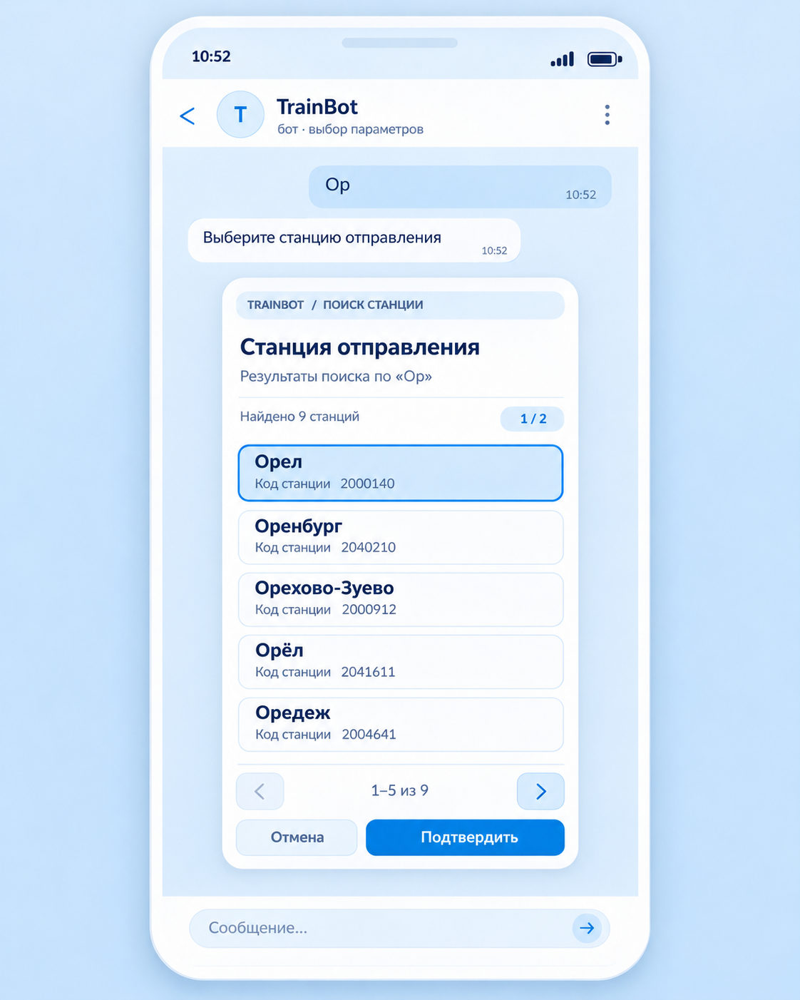

# TrainBot — результат поиска станций

**Статус:** графический макет утверждён владельцем 13 ноября 2026 года.  
**Каталог:** `specs/trainbot-widget/station-search-results/`.

## Утверждённый макет

[Открыть утверждённый макет](./station-search-results-approved.jpg)

**ОБЯЗАТЕЛЬНО ДЛЯ РЕАЛИЗАЦИИ:** при разработке виджета **результатов поиска станций** использовать файл `station-search-results-approved.jpg` как эталон визуального интерфейса. Не заменять его ранними эскизами, не добавлять кружки/радиокнопки, галочки в кружках, картинки или более широкую форму без отдельного согласования с владельцем.

- [Функциональные и визуальные требования](./requirements.md) — утверждённый UX.
- [Техническая архитектура](./architecture.md) — рамки и вопросы **на отдельное согласование**.

Это **новый, ограниченный сценарий** отображения результатов поиска после ввода названия станции в обычном чате. Он не отменяет архивное решение об отказе от прежнего **виджета ввода/поиска станций** ([архив требований](../stations/station-widget-2026-11-12.md)). При внедрении использовать старый ввод текста и существующий поиск РЖД; меняется только способ предъявления найденных вариантов. Создание этого документа **не является разрешением менять production-код**.

Макет — статичное изображение, а не подтверждённый работающий HTML Widget или результаты E2E-тестирования.
