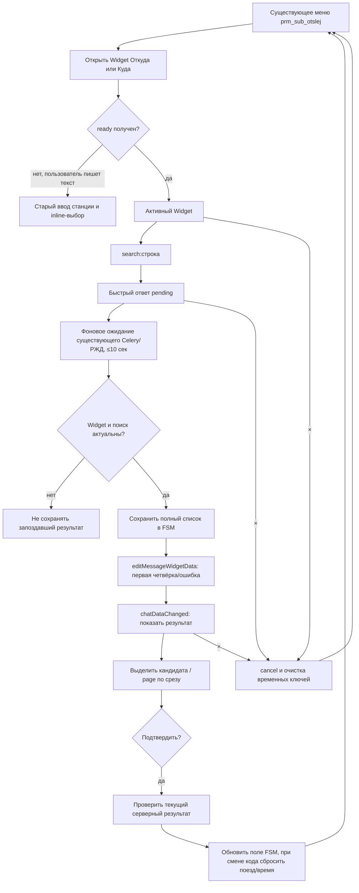

# TrainBot — архитектура виджета выбора станций: согласование

- **Дата начала:** 2026-11-12
- **Статус:** итоговый вариант для отдельного утверждения составлен 2026-11-12 (раздел 8). Все ранее согласованные решения сохранены; **архитектура целиком ожидает подтверждения владельца**, production-код TrainBot не изменялся.
- **Режим:** расширение существующего TrainBot, не проектирование нового транспортного слоя с нуля
- **Функциональные требования:** [station-widget-2026-11-12.md](./station-widget-2026-11-12.md)
- **Предыдущий черновик:** [station-widget-architecture-2026-11-12.md](./station-widget-architecture-2026-11-12.md) — справочный материал; новые решения фиксируются здесь
- **Архитектура календаря:** [calendar-widget-architecture-2026-11-12.md](../calendar/calendar-widget-architecture-2026-11-12.md)

## 1. Установленные вводные

1. **Календарный виджет TrainBot уже реализован и проверен** — подтверждено владельцем проекта 2026-11-12. Поэтому не проектировать новый транспорт Telegram Widgets без необходимости. **Действующая реализация календаря статически изучена по загруженным `bot.py`, `subscrib.py`, `middleware.py`, `telegram_api.py`, `render.py`, `calendar.html/css/js`.** Это не Telegram E2E-тест; перед реализацией проверить версии зависимостей и фактический проект.
2. Один общий виджет для выбора станции **отправления** или **прибытия**; создание и редактирование подписки используют одну реализацию. Для направления используются существующие поля `DepName/DepCode` либо `DestName/DestCode`; точные имена и способ обновления подтвердить по текущему исходному коду TrainBot.
3. Существующие поисковые функции РЖД, обработчики подписки и FSM — основа интеграции; не переписывать их ради Widget. Сохранённый текстовый ввод через чат — резервный способ.
4. Утверждённый UX и поведение (первый экран, локальный алфавит, поиск по нажатию, до 4 результатов и пагинация, «Подтвердить», активная «×», ошибки поиска, сброс номера поезда и времени при **фактической** смене станции) подробно описаны в функциональных требованиях; здесь UX не переутверждается.

## 2. Принцип реализации — утверждён владельцем проекта

**Простота, понятность и минимум дублирования.**

- Повторно использовать **уже работающий календарный механизм** отправки Widget, получения `widget_query`, ответа `answerWidgetQuery`, взаимодействия с ботом, привязки к пользователю и FSM.
- Проверки владельца, текущего сообщения, состояния, повторов и ошибок **не дублировать** в нескольких слоях: опираться на существующий общий вход/проверки; если его возможностей недостаточно для выбора станции, добавить только необходимую проверку.
- **Специфично для станций:** поиск по прежнему сервису, сопоставление результатов с серверными идентификаторами, подтверждение конкретной станции и изменение нужных FSM-полей/зависимостей.
- Не вводить дополнительную БД, кеш, менеджер сессий, очередь, новый middleware, второй polling, универсальный framework Widget или набор обёрток «на всякий случай».
- Безопасность не удаляется ради сокращения кода: не доверять коду станции и типу поля, присланным из JS; не принимать устаревшие/чужие подтверждения; ответить на каждый запрос в пределах лимита Telegram.
- Изменения в существующем коде — точечные, с сохранением отработавшего календаря и старого ввода станций.

## 3. Первое архитектурное решение — согласовано 2026-11-12

**Вопрос:** как подключить станционный Widget к уже работающему календарному механизму?

**Вариант A — утверждён:** использовать **тот же входной обработчик `widget_query` и тот же адаптер Bot API**, добавив **минимальное разграничение** между календарём и выбором станции. **Существующую логику выбора станций менять только там, где без этого Widget не сможет работать**: переиспользовать действующий поиск РЖД, проверки и применение результатов через FSM, не создавать отдельную параллельную бизнес-логику. Изменения календаря ограничить необходимым подключением нового типа Widget, без регрессий в его работе.

**Вариант B — не рекомендуется:** создать отдельный перехватчик/адаптер для станций. Это дублирует прием событий, авторизацию и отправку ответов, повышает риск конфликта с календарём.

**Статус:** вариант A **утверждён пользователем**. Точный способ маршрутизации и место минимальных изменений определить после просмотра действующего календарного кода. Не придумывать заранее имена функций, новую абстракцию или дополнительный защитный слой.

Предлагаемая цепочка при варианте A:

```text
Widget станций
  → существующий транспорт / widget_query календаря
  → минимальная ветка «station» в уже работающем обработчике
  → существующая функция поиска станций РЖД (только по кнопке «Поиск»)
  → выбор кандидата локально
  → «Подтвердить» → имеющаяся серверная проверка ID станции (дополнить лишь при необходимости)
  → обновление DepName/DepCode или DestName/DestCode
  → при реальной смене: сброс TrainNumber/TimeDepart
  → существующее меню параметров подписки
```

«×» отменяет изменение данных; при ошибке РЖД остаются ввод и возможность повтора, а «×» активна. Способ доставки поисковых результатов в Widget (ответ запроса или обновление widget data) проверить на действующем календарном транспорте и официальном Telegram Bot API отдельно; не смешивать `answerWidgetQuery` с `editMessageWidgetData`.

**Расположение кода подтверждено владельцем:** актуальный TrainBot и реализованный календарь находятся **в локальном проекте**, а не в доступном здесь GitHub-репозитории регламентов. Доступа к локальному рабочему дереву из этого диалога нет; ранее приложенный `bot.py` не подтверждает текущие функции календаря. Перед детализацией маршрутизации необходимо получить актуальные исходники соответствующих модулей (без `.env`, токенов и пользовательских данных) либо результаты локального обзора кода. Это не блокирует уже согласованное повторное использование общего транспорта.

## 4. Аудит предоставленных исходников — подтверждённые факты

Изучены **актуальные загруженные пользователем** `bot.py`, `subscrib(1).py` (по структуре это `handlers/subscrib.py`), `util_bot.py`, `middleware.py`, `telegram_api.py` и `PROJECT_STRUCTURE.md`. **Это статический аудит**, без запуска бота и Telegram E2E; завершённую проверку календаря подтверждает владелец.

| Участок | Что действительно есть в коде | Вывод для Widget станций |
| --- | --- | --- |
| `bot.py:53,68–69` | `dp.update.outer_middleware(CalendarWidgetMiddleware(subscrib.handle_calendar_query))`; `allowed_updates` уже включает `widget_query` | Не добавлять новый middleware, новый polling или повторную подписку на событие |
| `widgets/middleware.py:10–19` | Перехватывает `event.model_extra['widget_query']`, вызывает переданный callback; прочие события пропускает | Само перехватывание подходит обоим виджетам; имя класса календарное, но это не основание делать второй |
| `widgets/telegram_api.py:7–30` | `send_widget`, `answer_widget_query` через текущую сессию Bot; ответ ограничен 1024 UTF-8 байт | Использовать существующий адаптер; нового API-клиента не требуется |
| `handlers/subscrib.py:354–413` | `handle_calendar_query` проверяет личный чат, владельца, сообщение, тип `data`, активное состояние `StSubscr.dt_depart` и поля `calendar_*`; `_calendar_lock`, ответы `date:` / `cancel` | **Напрямую добавить `station:` к этой ветке недостаточно** — она допускает только календарный FSM. Нужна **минимальная маршрутизация** по двум сценариям, без копирования транспортного слоя |
| `handlers/subscrib.py:181–281` | `prm_sub_otslej()` строит меню, `select_sub_otsl()` по `DepName`/`DestName` вызывает старый ввод в чат | Заменить только вход в выбор станции для `Отслеживание`, сохранив старый путь для fallback |
| `handlers/subscrib.py:472–529` | Два текстовых обработчика вызывают `util_bot.get_expressCode_async()`; два callback устанавливают `DepName/DepCode` или `DestName/DestCode` и возвращают в `prm_sub_otslej()` | Переиспользовать поиск, названия полей и меню; не писать заново старый текстовый сценарий |
| `handlers/subscrib.py:285–296` | `apply_departure_date()` очищает `TrainNumber` и `TimeDepart` только при изменении даты | Для станции требуется эквивалентный **однократный** сброс при реальной смене кода, без отдельного состояния или БД |
| `handlers/subscrib.py:938–976` | При редактировании `util_bot.get_prm_sub()` восстанавливает подписку в FSM; `save_otslej()` сохраняет её позднее | Виджет обновляет **черновик FSM**, а не непосредственно БД; действующий механизм сохранения подписки остаётся |
| `core/util_bot.py:103–119` | `get_expressCode_async()` отправляет Celery `ts_req_expressCode.delay(city)` и ждёт `AsyncResult` без таймаута; при ошибке worker возвращает `[]` | **Важный риск:** запрос Widget обязан получить ответ за 15 секунд. Пустой результат `[]` сейчас не отличает «ничего не найдено» от ошибки Celery |
| `handlers/subscrib.py:490–529` | Старый callback парсит значение вида `name_code` через `split('_')`; код записывается в FSM | Формат списка из реальной Celery-задачи и допустимые символы в имени/коде проверить до выбора JSON-контракта; не считать клиентский текст доверенным источником |

**Дополнительно изучены:** `tasks.py`, `core/rzd_track.py` и `widgets/calendar/render.py`. Python-сборка календаря подтверждена. **Также предоставлены:** `widgets/calendar/calendar.js`, `calendar.html`, `calendar.css`; фактический вызов `TelegramWidget.request()` и обработка JSON подтверждены по коду. Совместимость станционного JS под Telegram-клиентом остаётся предметом будущих тестов.

### Технические ограничения подтверждены Telegram Bot API 10.4

- `widget_query.data` — максимум 64 байта, включая UTF-8 кириллицу.
- `answerWidgetQuery.data` — максимум 1024 байта, ответ должен быть отправлен за 15 секунд. Он доставляется только виджету, вызвавшему запрос; **не изменяет** общие данные сообщения.
- `editMessageWidgetData` меняет `chat_data`/`public_data` (каждое до 1024 байт) — потребность в этом методе при пагинации следует обосновать, а не добавлять по умолчанию.

### Решение 2 — ожидание поиска и семантика ошибок (согласовано 2026-11-12)

**Согласовано:** для поиска из Widget ограничить ожидание ответа существующей `util_bot.get_expressCode_async()` **примерно 10 секундами**, оставив запас до обязательного срока ответа на `widget_query` (15 секунд); техническую реализацию и бюджет времени финального `answerWidgetQuery` проверить перед программированием. Не создавать отдельный сервис поиска.

- **Найдены станции:** передать результаты в виджет; пользователь выбирает кандидата, подтверждение отдельно.
- **Станций нет:** отобразить «Станции не найдены»; это допустимый пустой результат.
- **Ошибка Celery/РЖД или таймаут:** отобразить «Ошибка поиска. Попробуйте ещё раз»; оставить введённый текст и возможность повторить поиск, не изменять FSM-поля подписки.
- **«×» всегда активна:** во время поиска и после ошибки можно отменить выбор; сетевой поиск не должен задерживать обработку отмены из-за долгого удержания пользовательского `asyncio.Lock`. Не блокировать общий обработчик до окончания работы Celery. Опоздавший результат запроса не должен применяться после отмены или нового выбора.
- **Сохранить совместимость:** изменить существующую функцию поиска минимально (например, дополнительный *необязательный* режим/параметр для таймаута и сообщения об ошибке), сохранив прежнее поведение и формат результата у старых чат-обработчиков по умолчанию. Не дублировать Celery-поиск или цикл ожидания ради Widget.

**Форма API и тип ошибки пока не утверждены:** точные поля/исключения согласовать после просмотра `tasks.ts_req_expressCode` и `RzdTrack.req_expressCode`. Не смешивать ошибку worker с пустым `[]` именно в новом Widget-сценарии.

### Решение 3 — временное хранение результатов в существующем FSM (согласовано 2026-11-12)

**Утверждено:** использовать уже имеющийся `FSMContext` с `MemoryStorage` для временного списка найденных станций одного активного виджета. **Не создавать** отдельное хранилище, кеш, менеджер сессий или повторные запросы к РЖД для каждой страницы.

1. По кнопке «Поиск» один вызов действующей функции `util_bot.get_expressCode_async()` (с ранее согласованным таймаутом); после успешного завершения записать список результатов в **отдельные временные ключи того же FSM**. Существующие значения `DepName/DepCode`, `DestName/DestCode`, `TrainNumber/TimeDepart` пока не менять.
2. Стрелки «‹» / «›» показывают по четыре элемента из **уже сохранённого списка**; повторного Celery/RЖД поиска нет. Конкретный транспорт передачи одной страницы в Widget и компактный формат ответа ещё согласуются отдельно; лимит `answerWidgetQuery` — 1024 байта.
3. Новый поиск заменяет предыдущий временный список только на актуальный успешный результат; при пустом результате список очищается, а при ошибке не показывать устаревшие кандидаты. Не принимать подтверждение кандидата из старого поискового запроса.
4. После успешного «Подтвердить» либо «×» удалять **только временные ключи** станционного Widget из FSM; не вызывать `state.clear()` и не трогать остальные данные подписки. При подтверждённой фактической смене станции применить отдельно согласованный сброс `TrainNumber/TimeDepart`.
5. При рестарте процесса `MemoryStorage` и результаты поиска теряются: старый Widget не должен подтверждать станцию по несуществующему списку. Никакой дополнительной персистентности на этом этапе.

**Конкретные имена временных ключей, серверный формат кандидатов и порядок получения страницы:** подобрать после проверки реального формата результата Celery; не создавать универсальные классы/обёртки ради хранения списка.

### Решение 4 — передача только одной страницы через answerWidgetQuery (согласовано 2026-11-12)

**Утверждено:** бот возвращает в `answerWidgetQuery` **не весь список, а только четыре станции текущей страницы** (или меньше на последней), беря данные из уже имеющегося FSM.

1. Первый успешный поиск сохраняет полный список в FSM и отвечает **первой страницей**; отображается счётчик найденных станций и состояние стрелок.
2. Нажатие «‹»/«›» создаёт короткий запрос `widget_query` с указанием страницы. Backend проверяет существующий активный Widget и допустимость страницы, берёт соответствующую четвёрку из FSM, возвращает её через **существующий** `answer_widget_query()` (`widgets/telegram_api.py`). **Новых запросов к РЖД нет**.
3. Widget обновляет правую колонку из полученного ответа локально, не вызывая `editMessageWidgetData`, поскольку ответ нужен лишь виджету-инициатору. Смена выделенной станции до подтверждения не меняет FSM-поля подписки.
4. В ответе передавать минимум, необходимый для отображения и выбора: короткие данные текущей страницы, количество найденных станций и номер страницы/признаки доступности стрелок. **Проверять весь JSON-ответ по UTF-8 байтам ≤1024**, в том числе при длинных названиях, и не выдавать переполнение за успешный ответ. Точный формат списка/сокращение отображаемых названий — после изучения реального контракта РЖД.
5. Клиентские запросы на страницу — не более 64 UTF-8 байт; сервер не должен доверять индексу/номеру страницы без проверки против списка текущего активного Widget. Имеющиеся проверки календарного транспорта повторно не дублировать.

### Решение 5 — подтверждение станции по индексу (согласовано 2026-11-12)

**Утверждено:** при нажатии «Подтвердить» Widget передаёт **индекс выбранной станции в актуальном серверном списке FSM**, а **не** её имя или код из JavaScript. На клиенте выбор кандидата до подтверждения остаётся локальным.

1. Для результатов поиска использовать индекс **в полном списке FSM**, а не локальную позицию 0–3 на странице: страница лишь отображает соответствующую четвёрку. Подтверждение должно однозначно указывать на элемент того списка, из которого была показана станция.
2. Бот проверяет, что запрос относится к текущему активному виджету и его актуальному набору результатов; индекс — целое число в допустимых границах. При замене/очистке поисковых результатов **старое выделение недействительно**. Дублирующий слой проверок владельца, сообщения и FSM не создавать — использовать уже согласованную общую обработку.
3. Имя и код станции берутся **только из проверенного серверного списка**, после чего обновляются `DepName/DepCode` либо `DestName/DestCode`. При фактическом изменении кода сбросить `TrainNumber` и `TimeDepart` одним обновлением состояния; при выборе прежней станции ничего не сбрасывать.
4. **Популярные станции на первом экране — момент поиска согласован:** при нажатии на «Москва», «Санкт-Петербург», «Казань» или «Сочи» Widget запускает **обычный поиск** `util_bot.get_expressCode_async(city)` по выбранному названию, с общим таймаутом и обработкой ошибок из решения 2. Полученный список сохраняется во **временных ключах существующего FSM**, как и при поиске через алфавит. Не загружать коды четырёх городов заранее при открытии Widget, не создавать отдельный справочник или параллельную функцию. Нажатие популярного города **не обновляет поля подписки**; сохранение — только после «Подтвердить» по индексу реального результата FSM. **Согласовано:** если РЖД вернуло несколько станций, показывать их как обычный список результатов (по четыре на странице, со стрелками), без автоматического выбора первой. Пользователь выбирает конкретную станцию и отдельно нажимает «Подтвердить». Если найдена лишь одна станция, не выбирать её автоматически — действует тот же принцип.
5. Индекс передавать короткой командой `TelegramWidget.request`; конкретные названия команд и формат данных согласовать вместе с отображением популярных станций и проверкой формата Celery-ответа.

**Следующий этап:** уточнить минимальный контракт данных, реально возвращаемых `tasks.ts_req_expressCode` / `RzdTrack.req_expressCode`, и компактные команды Widget. Самостоятельно не изобретать новый формат станций.

### Проверка фактического контракта поиска РЖД — установлено по загруженным исходникам (2026-11-12)

Изучены `tasks.py:347–355` и `core/rzd_track.py:1641–1662` из актуальных файлов, предоставленных пользователем:

- `tasks.ts_req_expressCode(city)` **без преобразования** возвращает результат `bk_bot.req_expressCode(city=city)` (Celery задача `req_expressCode`, очередь `default`; при исключениях включён autoretry).
- `RzdTrack.req_expressCode(city)` запрашивает `https://ticket.rzd.ru/api/v1/suggests`, с параметрами `GroupResults=true`, `RailwaySortPriority=true`, `MergeSuburban=true`, `Query=city`, `Language=ru`, `TransportType=rail`.
- Код обходит `res['city']`, берёт `name` и `expressCode`, применяет **существующую** `util_bot.upd_st(name)` и возвращает `list[str]` в формате **`<сокращённое_название>_<expressCode>`**. Например из документации самой функции: `['Оричи_2060476', 'Орехово_2004247']`. Это описанный в исходнике пример, **не результат проведённого сейчас запроса к РЖД**.
- Ранее загруженный `core/util_bot.py:103–119` возвращает этот список как есть. `handlers/subscrib.py:472–529` уже умеет показать его как inline-кнопки и на подтверждении разобрать `name_code`.
- В `RzdTrack.req_expressCode()` вызов `self.session.get(...)` **без HTTP timeout**, а Celery `autoretry_for=(Exception,)` допускает задержку/повтор задачи. Ограничение времени ожидания в Widget, согласованное в решении 2, должно касаться ожидания результата именно Widget, без глобального изменения старого поиска.
- РЖД может вернуть пустой массив `city`; при ошибках HTTP/JSON/структуры возможны исключения. Текущий `get_expressCode_async()` приводит неуспешную завершённую задачу к `[]`, поэтому для Widget нужна уже утверждённая минимальная возможность отличить неуспех/таймаут от допустимого пустого списка.
- **Решение по данным:** не вводить DTO станций, таблицу кодов, преобразование исходного списка в словари или новый RЖД-поиск. Список `list[str]` оставить **как есть в существующем FSM**; при построении страницы взять только краткое отображаемое имя, а при подтверждении индекса прочитать серверную строку и разделить её **по последнему `_`** на имя и код. Проверить формат возвращённой строки прежде, чем записывать в FSM подписки.

### Решение 6 — минимальные команды Widget (согласовано 2026-11-12)

**Первоначально утверждены четыре пользовательские команды `TelegramWidget.request`**, без передачи имени/кода станции при подтверждении. **Позднее согласована пятая служебная команда `ready` (решение 15)** — не пользовательская кнопка:

| Запрос | Значение |
| --- | --- |
| `search:<текст>` | Выполнить обычный поиск РЖД по строке из алфавита или кнопке популярного города; записать список `name_code` в существующий FSM; отдать первую четвёрку |
| `page:<номер>` | Взять четыре станции запрошенной страницы из того же списка FSM; РЖД повторно не вызывать |
| `confirm:<индекс>` | Подтвердить элемент **актуального полного списка** в FSM, получить имя и код из серверной строки `name_code`, применить выбранное поле подписки |
| `cancel` | Закрыть виджет без изменения данных подписки, удалить только временные данные станции |

**Ответ `answerWidgetQuery` — упрощён по решению 8 ниже:** для `search` и `page` возвращать компактный JSON с **названиями четырёх станций из среза** и **общим числом результатов**. Передавать каждому элементу отдельный индекс и дублировать номер страницы в ответе не требуется: клиент знает запрошенную страницу и локальную позицию. **Коды не передавать в Widget.** Для `confirm`/`cancel` — короткий статус успеха или ошибки. Использовать действующий `widgets/telegram_api.py`.

**Обязательные технические границы:** `search:` вместе с кириллической строкой должен помещаться в 64 байта UTF-8; весь JSON-ответ — в 1024 байта UTF-8. Проверки пользовательского сообщения, владельца, FSM, индекса и страницы выполняются на сервере. При новом поиске старое клиентское выделение сбрасывается и больше не должно подтверждаться; реализацию защиты от гонки двух поисковых запросов/старого подтверждения решить при детализации контракта, **не добавляя лишних сервисных слоёв**.

**Не согласованы как обязательные:** конкретные имена JSON-полей, способ нумерации страниц с нуля или с единицы и механизм различения одновременных запросов. Это детали проектирования/проверки совместимости, не дополнительные пользовательские команды.

**Следующее уточнение:** `render.py` изучен: он собирает HTML, но не реализует `TelegramWidget.request()`. Для проверки действующего клиентского контракта нужен `widgets/calendar/calendar.js`; после чтения уточнить JS-вызовы `search`/`page`/`confirm`/`cancel` и обработку JSON без изменения календаря.

### Проверка сборки календарного HTML — установлено по `widgets/calendar/render.py` (2026-11-12)

По актуальному файлу, предоставленному владельцем:

- `render_calendar(today, selected_date)` готовит календарные границы, валидирует начальную дату, формирует `params` через `json.dumps(..., ensure_ascii=True).replace('<', '\\u003c')`.
- Сборка выполняется **без дополнительных ресурсов в Telegram**: `Path(__file__).parent` → чтение `calendar.html`, `calendar.css`, `calendar.js` → однократная замена плейсхолдеров `__CALENDAR_CSS__`, `__CALENDAR_JS__`, `__CALENDAR_CONFIG__` → возврат готовой строки HTML.
- Прежде чем вернуть HTML, проверяются NUL, размер от 1 до 32768 байт UTF-8, `len(zlib.compress(encoded, 9)) <= 4096`. Это **готовый образец сборки и проверки лимитов** для нового виджета станций.
- **Минимальная реализация для станций:** использовать тот же принцип статических `stations.html` / `stations.css` / `stations.js` с инъекцией исходного значения станции и направления. Не модифицировать существующий `render_calendar()`, не создавать универсальный рендерер/фреймворк лишь ради второго Widget.
- **Нельзя пока установить по одному `render.py`:** как именно `calendar.js` вызывает `TelegramWidget.request()`, обрабатывает `Promise`/`result`/ошибки и меняет интерфейс. Файлы `calendar.html`, `calendar.css`, `calendar.js` не предоставлены; для следующего шага первостепенно нужен **`widgets/calendar/calendar.js`**.
- По официальной документации Telegram Widgets: `TelegramWidget.request()` возвращает `Promise<{ result: string | null }>`, который может отклониться с `WidgetRequestError`. Клики по поиску/пагинации/подтверждению — отдельные пользовательские события; браузерных `fetch()` у Widget нет. Это **платформенное правило**, а не вывод из ещё не прочитанного `calendar.js`.

**Статус:** фактический паттерн Python-сборки календаря подтверждён статическим просмотром. Клиентская интеграция JS не проверена и архитектура целиком ещё не утверждена.

### Проверка клиентской реализации календаря — установлено по исходникам (2026-11-12)

Изучены загруженные `widgets/calendar/calendar.js`, `calendar.html`, `calendar.css`. Это **статический анализ**, не запуск в Telegram.

1. В `calendar.html` есть плейсхолдеры `__CALENDAR_CSS__`, `__CALENDAR_JS__`, `__CALENDAR_CONFIG__`, которые заполняются уже изученным `render_calendar()`. `calendar.js` заключён в IIFE и обращается к DOM через `document.getElementById`. `calendar.css` задаёт простой карточный интерфейс, но не содержит станционной двухколоночной формы.
2. Реальный клиентский транспорт календаря (`calendar.js:32–41`): `const answer = await TelegramWidget.request(data)`, затем `JSON.parse(answer.result)`; серверный ответ ожидается как JSON, при `result.status === 'ok'` интерфейс выставляет `done=true`, при ином статусе показывает `result.message`, в `catch` — ошибку.
3. Команды существующего календаря (`calendar.js:45–46`): `date:<YYYY-MM-DD>` и `cancel`. Календарный сервер отвечает через общий `answer_widget_query()`. Это **подтверждает возможность использовать тот же способ** отправки четырёх согласованных команд станций и получения JSON без второго адаптера и без `editMessageWidgetData`.
4. **Важное отличие:** в `calendar.js:10–13,32–41` при любом запросе `busy=true` и все действия, **включая кнопку `cancel`**, недоступны; по первому успешному ответу устанавливается `done=true`. **Такой контроллер нельзя без изменений использовать для станций:** `search` и `page` — незавершающие операции, а станционная кнопка «×» по согласованному UX должна оставаться активна во время ожидания РЖД.
5. **Рекомендуемая минимальная интеграция:** отдельные `stations.html/css/js` и маленькая станционная сборка HTML по образцу календаря. В `stations.js` повторить только проверенный вызов `TelegramWidget.request()` + `JSON.parse(answer.result)`, для `search/page` обновлять DOM и сохранять возможность следующих запросов, для `confirm/cancel` завершать взаимодействие. `calendar.js`, `calendar.html`, `calendar.css` и `render_calendar()` **не менять**.
6. **Гонка «×» и поиска:** нельзя ставить на «×» общий `busy`-запрет календаря. Если во время поиска пользователь закрыл Widget, клиент должен игнорировать запоздалый результат, а сервер до записи найденных кандидатов в FSM повторно проверять актуальность этого поиска/виджета. Использовать минимальный признак в существующих временных FSM-данных, без нового менеджера сессий; способ немедленного закрытия и доставки `cancel` ещё нужно согласовать.
7. В `calendar.js` результат считывается как JSON **из** `answer.result`, а не напрямую из возвращаемого `answer`; при отсутствии ответа/отклонении Promise UI должен показывать безопасное сообщение, не объявляя результат сохранённым.

**Проверка документации:** Telegram Bot API 10.4 подтверждает `widget_query.data` 1–64 байта, максимум 5 запросов на 5 секунд от пользователя и `answerWidgetQuery` до 1024 байт за 15 секунд. Схема `answerWidgetQuery` остаётся прежней, менять общий адаптер для нового JS не требуется.

### Решение 7 — немедленная отмена во время поиска (согласовано 2026-11-12)

**Утверждено:** нажатие «×» **не ждёт завершения `search` или ответа РЖД**. Клиент сразу переводит станционный Widget в локальное состояние закрытия/отмены, инициирует `TelegramWidget.request('cancel')` и игнорирует любой поздний ответ прежних `search`/`page`.

- Станционный JS **не блокирует ×** общим `busy` из календаря; остальные действия можно временно блокировать, чтобы не размножать конкурирующие поиски. Повторные клики × не создают серию `cancel`.
- В обработчике `cancel` бот **без ожидания текущего поиска РЖД** помечает активный станционный виджет как отменённый/неактуальный и очищает **только его временные ключи в существующем FSM**. Нельзя вызывать `state.clear()` и менять сохранённые `DepName/DepCode`, `DestName/DestCode`, `TrainNumber` или `TimeDepart`.
- После `await get_expressCode_async(...)` **до записи** найденных результатов в FSM бот повторно проверяет активность текущего виджета и актуальность именно этого поиска. Если отмена или новый поиск уже произошли, результат **не записывается** и не восстанавливает временный список. Достаточно минимальной отметки актуальности в том же FSM, без отдельного менеджера сессий.
- Не удерживать блокировку пользователя во время ожидания Celery/РЖД: иначе `cancel` не сможет обработаться немедленно. Короткие проверки и изменение временных FSM-данных допускают точечную синхронизацию в рамках уже используемой обработки.
- Сервер отправляет `answerWidgetQuery` в предусмотренный срок **на каждый полученный запрос**, в том числе если поиск устарел/отменён. После локального закрытия клиент игнорирует любой результат предыдущего поиска, даже если ответ пришёл успешно.
- «Сразу закрыть» здесь означает **немедленно отключить интерфейс выбора локально и инициировать отмену**, а не гарантировать мгновенное удаление Telegram-сообщения. Точный способ закрытия сообщения должен быть проверен по действующему календарному сценарию и Bot API; нельзя обещать несуществующий клиентский метод. Возможность отправить `cancel` при другом незавершённом `TelegramWidget.request` проверить в реальном Telegram-клиенте, **не объявлять проверенной заранее**.

**Уточнение после аудита:** поисковый `search` теперь получает короткий `pending` через `answerWidgetQuery`, а окончательные результаты/ошибки поиска передаются через `editMessageWidgetData(chat_data=...)` (решение 13). `page` продолжает отвечать своей четвёркой через `answerWidgetQuery`. Клиент обязан обрабатывать `chatDataChanged` и не подтверждать прежний результат.

### Решение 8 — пагинация обычным срезом единого списка (согласовано 2026-11-12)

**Уточнение владельца:** «Храним в списке все найденные города, а при выводе используем срез списка». Это **заменяет прежнее предложение** отправлять отдельные индексы у каждого элемента и номер страницы в JSON. Не создавать дополнительные списки/DTO станций или сложную схему сериализации.

- Хранить в существующем FSM **весь исходный `list[str]`** результатов `get_expressCode_async()` в формате `name_code`.
- Для страницы с нумерацией **с нуля** использовать простой срез исходного списка:

```python
start = page * 4
page_items = stations[start:start + 4]
names = [item.rsplit('_', 1)[0] for item in page_items]
```

- Возвращать через `answerWidgetQuery` только отображаемые `names` и `total = len(stations)` в компактной JSON-обёртке, совместимой с `JSON.parse(answer.result)`; например `{"status":"ok","items":["Москва","Москва Казанская"],"total":10}`. **Это образец структуры, не данные РЖД.** Статус необходим для различения успешного и неуспешного поиска; имена полей могут быть минимально уточнены при реализации.
- Клиент уже знает запрошенную страницу `page` и позицию выбранной станции `position` от 0 до 3, поэтому глобальный индекс для утверждённой команды `confirm:<индекс>` вычисляется как `page * 4 + position`. Проверка наличия такого элемента и принадлежности текущему актуальному поиску остаётся на сервере.
- Для всех способов поиска (алфавит/популярный город) используется **один и тот же список и один и тот же срез**. `page` не вызывает Celery/RЖД.
- По-прежнему проверять лимит 1024 байта UTF-8 на конечный JSON-ответ. Ошибки, истёкший запрос, отмена и повторный поиск не должны позволять подтвердить старое выделение.

**Эта простая схема и есть итоговый принцип пагинации.** Проверка протокола в реальном Telegram и конкурентных `widget_query` — отдельные пункты тестового плана; рабочий код в ходе обсуждения не менялся.

### Решение 9 — использовать существующие FSM-состояния (согласовано 2026-11-12)

**Утверждено:** новых состояний `StSubscr` для Widget станций **не создавать**. Повторно использовать уже имеющиеся:

- `StSubscr.DepName` — ввод/выбор станции отправления;
- `StSubscr.DestName` — ввод/выбор станции прибытия.

**Практическое следствие:** при открытии виджета для нужного направления остаётся тот же FSM-сценарий, что и при прежнем вводе станции. Поиск по РЖД выполняет существующая `util_bot.get_expressCode_async()`; временный полный список `name_code`, текущий `message_id`/актуальность запроса и другие строго необходимые метаданные Widget хранятся в **отдельных ключах данных этого же FSM**. Нельзя перезаписывать до подтверждения `DepName/DepCode` или `DestName/DestCode`.

**Старые чат-обработчики `@router.message(StSubscr.DepName)` и `@router.message(StSubscr.DestName)` сохраняются** для fallback **только когда Widget не активен** (например, клиент не поддерживает Widgets или отправка Widget не удалась). Пока действует активный Widget, **обычные текстовые сообщения в чат не запускают смену станции и не применяют результаты поиска**: подтверждать можно только конкретную станцию из списка, полученного через Widget. Виджет получает данные через `widget_query` middleware. Разделение двух сценариев сделать минимальной проверкой признака активного Widget в существующих данных FSM; не добавлять новые состояния/обработчики/хранилища.

**Дальнейшее уточнение согласовано решением 10:** после подтверждения или отмены завершать состояние ввода станции и возвращать `prm_sub_otslej()`; при неудачном открытии Widget сохранять `DepName`/`DestName` для текстового fallback.

### Решение 10 — выход из Widget и текстовый fallback (согласовано 2026-11-12)

**Утверждено:** не создавать новые меню или FSM-состояния; после окончания выбора станции возвращаться в существующее меню подписки `prm_sub_otslej()`.

1. **`confirm:<индекс>`**: после серверной проверки актуального списка и индекса получить `name_code` из FSM, обновить только соответствующую пару `DepName/DepCode` или `DestName/DestCode`; при реальном изменении станции очистить `TrainNumber/TimeDepart`. Очистить только временные данные Widget, завершить активное состояние ввода станции (без `state.clear()`) и отобразить существующее `prm_sub_otslej()`. Данные основной подписки остаются в FSM; запись в БД выполняется прежним отдельным процессом сохранения подписки, а не по нажатию выбора станции.
2. **`cancel` / «×»**: немедленно отменить актуальный поиск, удалить только временные ключи станционного Widget, завершить активное состояние ввода станции, вернуться к `prm_sub_otslej()`. Имя и код выбранной ранее станции, номер поезда, время и остальные параметры **не изменять**. Запоздавший ответ РЖД не восстанавливает временные данные.
3. **Ошибка отправки/открытия Widget:** не закрывать существующее `StSubscr.DepName` или `StSubscr.DestName`; предложить старый путь ввода названия станции текстом, не вызывать `state.clear()`. Существующие текстовые обработчики остаются доступными. Не объявлять Widget успешно открытым, если отправка завершилась ошибкой.
4. При техническом отказе `confirm` (устаревший индекс, список утрачен, неверный пользователь, неверное состояние) **не применять изменений к подписке**. Отдельную логику завершения выбирать в обработчике на основе действительного результата, а не показывать меню как подтверждение неуспешного выбора.

**Реализация:** пользоваться прежними средствами изменения FSM-состояния и существующим меню `prm_sub_otslej()`, без дублирования бизнес-логики старого текстового выбора. Конкретные параметры вызова меню сверить с `handlers/subscrib.py` перед кодированием.

### Решение 11 — только выбор из результатов активного Widget (согласовано 2026-11-12)

**Поправка пользователя:** «Нет, только выбор из найденных станций». Если Widget успешно открыт и активен, пользователь не должен обходить его, отправляя в чат название станции:

- Источник кандидатов — **только сохранённый результат существующего поиска РЖД** `get_expressCode_async()`, инициированного `search:` внутри этого Widget.
- Выбрать конкретный результат из списка и нажать `confirm:<индекс>` — **единственный путь сменить станцию при активном Widget**. Введённое в чат название станции не является подтверждением и не должно менять `DepName/DepCode` или `DestName/DestCode`.
- Поскольку используются прежние `StSubscr.DepName` / `StSubscr.DestName`, в существующих текстовых хендлерах нужна **минимальная проверка** уже имеющегося признака активного станционного Widget в данных FSM: пока он активен, текст не запускает конкурирующий поиск и не приводит к изменению станции. Можно кратко направить пользователя обратно к выбору в виджете, без создания нового FSM-состояния.
- **Ранее согласованный fallback не отменяется:** когда Widget открыть не удалось либо Telegram-клиент не поддерживает Widgets, работает прежний текстовый путь без параллельного активного Widget. Это отдельная ситуация и не нарушает правило «только из найденных станций» для работающего Widget.
- После `cancel`/`confirm` возвращаться в уже существующее меню `prm_sub_otslej()` согласно решению 10; не делать автопереход на текстовый ввод при произвольном сообщении во время работы Widget.

**Техническое следствие:** проверка активности Widget обязательна именно потому, что его FSM-состояния совпадают со старыми текстовыми обработчиками; новая FSM-машина или ещё один поиск не нужны.

### Решение 12 — блокировка действий во время поиска (согласовано 2026-11-12)

**Утверждено:** пока выполняется запрос РЖД, в активном Widget доступна **только «×»**. Повторный `search`, запрос другой страницы `page`, выделение/подтверждение станции и прочие элементы выбора временно неактивны. После ответа управление восстанавливается согласно состоянию поиска.

1. В `stations.js` использовать простой локальный флаг `busy` при ожидании `TelegramWidget.request('search:...')`. Кнопку «×» **не блокировать** этим флагом; это отличие от `calendar.js`.
2. При успехе показать найденные станции и пагинацию, не выбирать кандидата автоматически; после ответа повторный поиск и выбор вновь доступны.
3. При пустом результате показать «Станции не найдены»; выбор и «Подтвердить» недоступны, повторный поиск/редактирование запроса доступны.
4. При технической ошибке или таймауте показать уже согласованное сообщение, разрешить повтор, **не возвращать старый выбор как актуальный**.
5. При «×» во время `busy` сразу перейти в локально отменённое состояние и отправить `cancel`; запоздалый `search`-ответ игнорировать, на сервере не допускать записи устаревших результатов в FSM (решение 7).
6. Клиентский `busy` не служит проверкой безопасности: сервер всё равно сверяет текущий FSM, владельца, актуальный запрос, корректность индекса/страницы; внеочередные `widget_query` не должны обходить ограничения только потому, что в JS кнопка была disabled.

**Никаких новых FSM-состояний, очередей запросов или дополнительного слоя управления не создавать.** Транспорт и старые обработчики календаря остаются без изменений. Проверка одновременного `cancel` и `search` в реальном Telegram остаётся обязательным тестом перед признанием реализации рабочей.

### Решение 13 — быстрый ответ поиска и доставка результата через Widget Data (согласовано 2026-11-12)

В ходе итогового аудита обнаружено ограничение Telegram `TelegramWidget.request()`: **один незавершённый запрос на Widget** (`BUSY` для второго). Владелец **согласовал вариант A**: `editMessageWidgetData()` использовать **только для доставки окончательного результата поиска**, а не для перелистывания страниц.

**Точный поток:**

```text
Нажатие «Поиск» / популярный город
  → stations.js: busy = true, «×» видима и активна
  → TelegramWidget.request("search:<текст>")
  → общий widget_query middleware → маршрутизация станционного Widget
  → ответ answerWidgetQuery({"status":"pending"}) без ожидания РЖД
  → асинхронный поиск через существующий get_expressCode_async(), таймаут ~10 сек
  → сервер проверяет, что Widget/запрос ещё актуален
  → полный исходный list[str] name_code сохраняется в существующем FSM
  → editMessageWidgetData(chat_id, message_id, chat_data=<результат или ошибка>)
  → событие chatDataChanged в stations.js → показать первую четвёрку/ошибку
  → дальнейшее page:<номер> → answerWidgetQuery со срезом из FSM
  → confirm:<индекс> либо cancel → прежняя логика FSM/меню
```

**Сохранённые инварианты:**

- Не изменять код `calendar.js`, текущий `answer_widget_query()`, старые обработчики станций и бизнес-сохранение без необходимости. В существующем `widgets/telegram_api.py` достаточно добавить минимальную функцию вызова **официального** `editMessageWidgetData` через текущую Bot-сессию; **не создавать отдельный клиент API**.
- `search` отвечает быстро, **не удерживая** per-user lock на протяжении работы Celery. Задача поиска вне ожидания обработчика: минимальная `asyncio`-задача в процессе бота, без дополнительного Redis, worker или хранилища. Фоновый процесс не гарантирует сохранения работы при перезапуске; это допустимо при `MemoryStorage`: старая операция признаётся недействительной.
- `chat_data` передаёт **не весь** список станций, а только результат поиска на первой странице — до четырёх отображаемых имён, `total`, служебный статус и при необходимости короткую версию актуального поиска (в пределах 1024 байт). **Коды остаются исключительно в FSM**. Пустой список и техническая ошибка различаются.
- `page` **не вызывает** `editMessageWidgetData`: отдаёт `stations[page*4:page*4+4]` через существующий `answerWidgetQuery`. Команды `confirm:<индекс>`, `cancel` и локальное выделение остаются неизменными.
- `stations.js` слушает `chatDataChanged` и обновляет отображаемые результаты/ошибку, **не сбрасывая клиентский `busy` только по получению `pending`**. Telegram допускает приход изменения Widget Data до или после ответа `pending`, поэтому клиент не должен перезаписывать уже полученный результат более старым событием. Клиенту достаточно одного признака/номера актуального поиска.
- На «×» локальный UI немедленно переходит в состояние отмены, а `cancel` отправляется **на отдельное касание**, когда предыдущий `request` завершён. Сервер очищает только временные станционные ключи FSM и не позволяет опоздавшей задаче их восстановить. Если нажатие пришлось на **короткое окно до ответа `pending`**, Telegram ещё может вернуть `BUSY`; **гарантировать 100% мгновенную доставку серверного `cancel` нельзя**. Не делать недопустимые автоматические `request()` из `Promise.then`; поведение этого узкого окна и клиентское восстановление должны проверяться в Telegram.
- Для `editMessageWidgetData` проверять актуальность `chat_id`, `message_id`, выбранного направления, владельца и поколения поиска; не обновлять результатами отменённый/старый Widget. Временные метаданные хранятся в существующем FSM, без отдельного менеджера сессий. Любой `confirm` выполняется только по **актуальному серверному списку**.
- При сетевом отказе `editMessageWidgetData` сохранять безопасное поведение: не подтверждать старый список, отображать ошибку/возможность повторить (способ восстановления уточнить при реализации). Проверить лимиты 1024 UTF-8 байт `chat_data`, 64 байта `TelegramWidget.request`, скорость обновления сообщения и реальные возможности Telegram-клиентов.

**Официальные источники (проверено 2026-11-12):**
- [Telegram Widgets — Requests to the bot и State changes](https://core.telegram.org/bots/widgets): запросы `BUSY`, `chatDataChanged` после изменения `chat_data`, возможность медленной работы **после** быстрого ответа;
- [Telegram Bot API — `editMessageWidgetData`](https://core.telegram.org/bots/api#editmessagewidgetdata): `chat_id`, `message_id`, `chat_data` до 1024 байт; `answerWidgetQuery` не меняет данные Widget.

**Статус:** выбранный транспорт согласован, но **пока не реализован и не протестирован**. Раздел 7.1 отражает исходно найденное противоречие; настоящее решение снимает его основную причину, не отменяя необходимости теста `BUSY` на первых миллисекундах и после сбоев.

### Решение 14 — резервный сценарий без дополнительной кнопки (согласовано 2026-11-12)

**Уточнение владельца:** «где Telegram Widget не работает, там оставить старый функционал "Введите станцию отправления/назначения"».

- **Не добавлять** под Widget или под сообщением отдельную кнопку «Ввести станцию текстом» ради нового механизма.
- Когда Widget объективно **недоступен** и основной сценарий не активирован (например, отправка Widget завершилась отказом), использовать **полностью прежний путь**: текст «Введите станцию отправления» либо «Введите станцию назначения», существующий обработчик `StSubscr.DepName`/`StSubscr.DestName`, существующий поиск `get_expressCode_async()` и штатный выбор результата по inline-кнопке. Ни отдельного поиска, ни новых FSM-состояний.
- **Граница:** если Widget работает и активен, он по-прежнему допускает только выбор из его серверных результатов через «Подтвердить» (решение 11); обычное чат-сообщение не запускает параллельный сценарий.
- **Техническая неопределённость:** Telegram Bot API/текущий код ещё не подтверждают надёжного признака «на конкретном клиенте Widget не отображается», если `sendWidget` уже успешно выполнился. Не заявлять об автоматическом обнаружении отсутствия поддержки; до плана реализации проверить существующую возможность fallback и описать реальное поведение. При обнаруженной ошибке отправки вернуть обычный текстовый промпт без нового UI.

**Статус:** UX и сохранение прежнего функционала согласованы, техника обнаружения неподдерживаемого клиента/неоткрывшегося Widget — открытый вопрос проверки, без изменения общего дизайна.

### Решение 15 — служебный `ready` для подтверждения запуска Widget (согласовано 2026-11-12)

**Утверждено владельцем:** добавить **одну служебную команду `ready`** для определения, что отправленный Widget действительно запустился на устройстве. Это **не новое действие пользователя**, не отдельный виджет и не новая кнопка. Все четыре прежние пользовательские команды `search:<текст>`, `page:<номер>`, `confirm:<индекс>`, `cancel` сохраняются.

**Фактическая поддержка платформы:** согласно официальным [Telegram Widgets — Background requests](https://core.telegram.org/bots/widgets), **оригинальный Widget в личном чате с ботом**, отправленный с `allow_queries=true`, может выполнить один фоновый `TelegramWidget.request('ready')` **при появлении на экране**, даже без касания. Вызов, сделанный в начале JS, клиент может отложить до отображения виджета. Фоновые запросы ограничены: первый при появлении на экране, затем не чаще одного в 5 секунд при видимости; общий лимит — пять запросов за пять секунд на пользователя/бота. Не путать `TelegramWidget.request('ready')` с **`TelegramWidget.ready()`**: последний только уведомляет приложение о готовности отрисовки и **не отправляет `widget_query` боту**.

**Минимальный сценарий:**

1. Открытие формы создаёт прежнее состояние `StSubscr.DepName` либо `StSubscr.DestName` и отправляет станционный Widget. В его существующих временных ключах FSM записываются актуальный `chat_id/message_id`, направление и **статус `await_ready`**, не новый FSM-state.
2. В `stations.js` при первой инициализации вызывается `TelegramWidget.request('ready')` (допустимый фоновый запрос личного чата). Бот через общий `widget_query` проверяет владельца, актуальное сообщение и FSM, переводит этот виджет в статус `active`, **быстро отвечает** `answerWidgetQuery({"status":"ok"})`. Повторный `ready` от того же актуального Widget обрабатывать идемпотентно, не сбрасывая результаты и не перезапуская выбор.
3. **При активном Widget** старые текстовые обработчики **не должны** менять станцию; выбирать можно только из найденного в этом Widget списка через `confirm` (решение 11). Если Widget ещё `await_ready` и пользователь отправил название станции обычным сообщением, **приоритет у прежнего текстового обработчика**: сделать старый Widget неактуальным и продолжить существующий поиск/inline-выбор. Запоздавший `ready` не должен снова активировать отменённый/устаревший Widget.
4. Если `sendWidget` вернул ошибку, немедленно оставить/запустить **прежний текстовый сценарий**: «Введите станцию отправления» либо «Введите станцию назначения», без новых кнопок, новых FSM-состояний, нового поиска. Если `sendWidget` прошёл успешно, но клиент не отобразил Widget, бот **не может доказать это только по отсутствию `ready`**. Для таких клиентов предусмотреть неизменённый текстовый путь, когда пользователь пишет станцию; в `caption` Widget можно оставить соответствующее прежнее приглашение к текстовому вводу, которое неподдерживающие клиенты показывают вместо Widget. Само отсутствие `ready` **не запускает** отдельную рассылку и не создаёт таймер.
5. Если Widget скрылся, появился снова или был пересоздан Telegram-клиентом, возможен новый фоновый `ready`. Проверять `message_id` и актуальность, не переписывать активную подписку; подтверждение запуска **не является доказательством полной работоспособности всех интерактивных функций**.
6. На время незавершённого `ready` первый `search` или `cancel` при быстром касании может получить `BUSY` (один клиентский запрос на Widget), поэтому `ready` должен быстро получать ответ; в тестах проверить повторную попытку после завершения `ready`, сетевые ошибки, `RATE_LIMITED` и повторное открытие. Не пытаться отправлять второй запрос автоматически из `Promise.then` без пользовательского действия.
7. Служебный `ready` относится **только к станционному Widget**; действующий календарь не менять. Общая маршрутизация `widget_query` использует сообщение/состояние, а не только текст команды.

**Что именно определяем:** `ready` подтверждает, что **конкретный экземпляр станционного Widget был показан и смог обратиться к боту**. Он **не сообщает Telegram client version/capabilities** и не позволяет по отсутствию ответа автоматически отличить неподдерживаемый клиент от неоткрытого чата/проблем сети. Это ограничение сохраняется и **является честной границей fallback**.

**Статус:** протокол `ready` утверждён как архитектурное решение; production-код ещё не менялся, реальный Telegram E2E не проводился.

### Решение 16 — подтверждение только по индексу, без версии (согласовано 2026-11-12)

**Уточнение владельца:** «Использовать версию станции это перебор». **Не расширять** утверждённую команду `confirm:<индекс>`, **не вводить версию/токен станции или поиска в клиентском запросе**.

- Как и было согласовано, полный список `name_code` остаётся в FSM, глобальный индекс = `page * 4 + position`, а сервер берёт имя и expressCode **только из этого списка**.
- При начале нового `search` сбрасывать клиентское выделение и делать старые кандидаты непригодными для `confirm`, пока новый поиск не завершён; во время поиска подтверждение заблокировано **и на клиенте, и на сервере**.
- Для `confirm` достаточно существующих проверок активного Widget/`message_id`/FSM и индекса в текущем списке. Повторные, отменённые и чужие сообщения не должны менять черновик.
- Для фонового ожидания Celery сохранить проверку актуальности выполняющейся операции перед записью (решения 7/13); **это не требует версии станции в пользовательской команде**.
- **Осознанный остаточный риск:** при очень запоздавшем `confirm` после замены списка на том же Widget (например, с другого устройства) тот же индекс может указывать на другую станцию. Полностью исключить этот частный случай только индексом нельзя. По выбору владельца не усложняем контракт ради этого сценария; описываем его в тестовом плане и не объявляем защиту абсолютной.

**Статус:** формат подтверждения окончательно согласован; изменение кода и тестирование не проводились.

## 5. Проверить до окончательного утверждения архитектуры

- **Установлено из кода:** адаптер — `widgets/telegram_api.py`, middleware — `widgets/middleware.py`, обработчик календаря — `subscrib.handle_calendar_query`, HTML-сборка — `widgets/calendar/render.py`, клиентский транспорт — `widgets/calendar/calendar.js`. Для станций повторять транспортный вызов и формат JSON, но сохранить активную «×» и разрешить несколько `search/page`.
- **Установлено из кода:** `util_bot.get_expressCode_async()` запускает `tasks.ts_req_expressCode`, который возвращает список `name_code` после `RzdTrack.req_expressCode`; оба старых обработчика принимают эти строки. **Не проверены динамически:** реальные ответы РЖД, максимальная длина имен, поведение под реальными таймаутами; нужен тест с подменой Celery/РЖД и отдельный тест Telegram Widget.
- Как ограничить длину кириллического поискового запроса в `TelegramWidget.request` до 64 байт UTF-8 и отдать список результатов, не перегружая сообщения.
- Как сохранить **только подтверждённую** станцию и сбросить зависимые поля при изменении кода, не нарушив создание/редактирование подписки.
- Реально ли требуемое расположение двух колонок и навигации в Telegram-клиентах; не переносить это в Mini App без обсуждения.
- Сценарии ошибок, таймаута, повторного нажатия, отмены и возврата в старый текстовый ввод — с повторным использованием существующей календарной защиты, без создания параллельной.

## 6. Порядок обсуждения

1. **Согласовано:** общий входной обработчик и адаптер, минимальное расширение действующей станционной логики (раздел 3).
2. **Согласовано:** поиск Widget ограничен примерно 10 секундами, ошибки отдельно от нулевых результатов, старый чат совместим; результаты хранить в существующем FSM, в `answerWidgetQuery` возвращать только четвёрку текущей страницы, стрелки работают без повторного поиска РЖД; подтверждение — по индексу в актуальном полном списке FSM, код/имя берутся сервером. **Согласовано:** четыре команды выбора `search:<текст>`, `page:<номер>`, `confirm:<индекс>`, `cancel` и пятая служебная `ready` (решение 15); ответы `search`/`page` содержат только названия станций из среза списка и общее количество, без дублирования индексов и страницы. Формат Celery-ответа `list[str]` вида `name_code` установлен по исходникам. **Установлено по исходникам:** календарь использует `await TelegramWidget.request(data)` и `JSON.parse(answer.result)`; для станций нужен свой JS с незавершающими `search/page`. **Согласовано:** немедленная клиентская отмена через ×, отправка `cancel` без ожидания поиска, запрет записи опоздавшего результата в FSM. **Дополнительно согласовано:** на время поиска доступна только «×», остальные действия заблокированы до ответа, без изменений календарного JS. **Осталось проверить при реализации:** короткое окно `BUSY` до получения `pending`, доставки `chatDataChanged`, фактическое закрытие в Telegram; затем утвердить архитектуру целиком.
3. **Согласовано:** использовать `StSubscr.DepName`/`StSubscr.DestName` без новых состояний; **при активном Widget выбирать только из его найденного списка**, текстовые сообщения не запускают выбор; после подтверждения и «×» возвращаться в `prm_sub_otslej()` без `state.clear()`. Если Widget не открылся / не поддерживается, разрешён ранее согласованный текстовый fallback. **Осталось:** проверить ошибки, конкурентные запросы и окончательный обзор архитектуры.
4. **Отдельно** утвердить архитектуру целиком; только затем подготовить план реализации с проверками. Production-код без явного запроса не менять.

## История решений

- **2026-11-12:** путь данного документа согласован пользователем. Календарь признан реализованным и проверенным со слов владельца. Утверждено требование не дублировать защиту и сопутствующие функции; предложен общий транспорт/обработчик для нового Widget, на подтверждении.

- **2026-11-12:** пользователь утвердил вариант A: одна существующая точка входа `widget_query` и общий адаптер Bot API. Особое условие: **менять текущую логику выбора станций только в необходимой части**, без параллельного поиска, дублированной валидации и вспомогательных слоёв. Место изменений уточняется после просмотра актуального кода.

- **2026-11-12:** пользователь уточнил, что актуальный TrainBot с календарём расположен в локальном проекте. Фактические контракты и имена модулей не утверждать до чтения актуального кода; запросить соответствующие файлы или локальный отчёт.

- **2026-11-12:** проведён статический аудит шести приложенных файлов. Подтверждено наличие рабочего транспортного пути в `bot.py`, `middleware.py`, `telegram_api.py`; реальные старые функции поиска в `subscrib.py` и `util_bot.py`. Выявлены ограничения: календарный обработчик привязан к `StSubscr.dt_depart`; поиск Celery не имеет таймаута и смешивает ошибки с пустым результатом. Архитектура полностью ещё не согласована.

- **2026-11-12:** пользователь утвердил примерно 10-секундный таймаут поиска только для Widget, отличение ошибки Celery от нуля совпадений минимальной правкой существующей функции, без изменения прежнего поведения текстового поиска. В случае ошибки остаются повтор и активная «×».

- **2026-11-12:** пользователь утвердил использование существующего FSM для временного списка найденных станций. Новые хранилища и повторные запросы к РЖД при пагинации не нужны; очистка касается только временных ключей Widget, без `state.clear()`.

- **2026-11-12:** пользователь утвердил отправку только четырёх станций текущей страницы из существующего FSM через `answerWidgetQuery` (не всего списка), без нового Celery/RЖД запроса при пагинации и без `editMessageWidgetData` для локального обновления правой колонки.

- **2026-11-12:** утверждено подтверждение выбранной станции по индексу в актуальном серверном списке FSM вместо передачи клиентом имени и кода. При замене результатов прежний выбор недействителен; для популярных станций ещё требуется отдельное согласование способа серверного сопоставления.

- **2026-11-12:** пользователь уточнил: «Нужно проще. Существующий код получает список станций, с ним и нужно работать». Отдельная предварительная загрузка кодов популярных городов и отдельный справочник отклонены; использовать только список из обычного `get_expressCode_async()`. Момент вызова поиска при выборе популярного города пока не согласован.

- **2026-11-12:** утверждено — нажатие популярного города запускает уже существующий поиск РЖД, список записывается во временные ключи FSM, а станция не сохраняется до «Подтвердить». Предварительная загрузка кодов при открытии и отдельная логика популярных городов не нужны.

- **2026-11-12:** пользователь утвердил показывать весь список результатов поиска популярного города с обычной пагинацией (по четыре станции), **не выбирать первую автоматически**. Подтверждение — только после явного выделения конкретной станции.

- **2026-11-12:** изучены загруженные `tasks.py` и `core/rzd_track.py`. Установлен неизменённый Celery-контракт: `list[str]` в виде `<upd_st(name)>_<expressCode>`; предложено хранить строки как есть в FSM и передавать в Widget только отображаемые имена с индексами. Формат команд пока не утверждён.

- **2026-11-12:** первоначально пользователь утвердил команды выбора `search:<текст>`, `page:<номер>`, `confirm:<индекс>`, `cancel` (позднее добавлена служебная `ready`, решение 15). Результаты остаются в FSM; Widget получает четыре отображаемых имени из текущей страницы, без кодов. Упоминание передачи отдельных индексов в первоначальном предложении позднее отменено упрощением решения 8; индекс подтверждения вычисляется из номера страницы и локальной позиции.

- **2026-11-12:** изучен загруженный `widgets/calendar/render.py`. Он читает отдельные HTML/CSS/JS, инъецирует настройки и проверяет 32 КБ HTML/4096 байт zlib; не содержит `TelegramWidget.request()` и обработки ответа. Для станций предлагается такой же простой шаблон сборки без модификаций календаря; перед окончательным контрактом необходимо прочитать `widgets/calendar/calendar.js`.

- **2026-11-12:** изучены календарные HTML/CSS/JS, подтверждён `await TelegramWidget.request(data)` → `JSON.parse(answer.result)` и одноразовая логика `done` с блокировкой `cancel` во время `busy`. Для станции нужен собственный JS на том же Telegram API; согласованный UX требует неблокируемую «×». Поведение немедленной отмены во время поиска предложено, но ещё не согласовано.

- **2026-11-12:** пользователь согласовал немедленную «×» во время поиска. Клиент инициирует `cancel` и игнорирует запоздавшие ответы; сервер очищает временные ключи FSM и повторно проверяет актуальность поиска перед записью. Ограничения Telegram на одновременные Widget-запросы остаются предметом тестирования.

- **2026-11-12:** по уточнению пользователя упрощена пагинация: хранить полный исходный список `name_code` в FSM, отображать срез `[page*4:page*4+4]`, возвращать только имена и общее число. Отдельные индексы и дублирование номера страницы в JSON не нужны; глобальный индекс подтверждения вычисляется как `page*4+position`.

- **2026-11-12:** пользователь утвердил повторное использование существующих состояний `StSubscr.DepName` и `StSubscr.DestName` для станционного Widget, без новых FSM-состояний. Существующий текстовый поиск остаётся доступным; временные данные виджета хранятся в отдельных ключах FSM.

- **2026-11-12:** пользователь утвердил единый выход из станционного Widget в `prm_sub_otslej()` при подтверждении и отмене, без очистки основной FSM подписки. При ошибке открытия Widget оставить действующее FSM-состояние для старого текстового ввода. Новый код и новые FSM-состояния не создавались.

- **2026-11-12:** пользователь отклонил переключение с открытого Widget на обычный текстовый поиск при сообщении в чат: «Нет, только выбор из найденных станций». Во время активного Widget подтверждать разрешено только его серверные результаты; текстовые сообщения не меняют маршрут. Текстовый fallback сохраняется исключительно для случая, когда Widget не активен/не открылся.

- **2026-11-12:** утверждено блокировать все действия выбора станций при выполняющемся поиске РЖД, кроме всегда активной «×»; после успеха/пустого результата/ошибки возвращать допустимые действия. Дополнительные менеджеры/машины состояний не вводить.


## 7. Итоговый архитектурный аудит — 2026-11-12

**Статус аудита: проведён по предоставленным исходникам и официальной документации; итоговое утверждение архитектуры — ОТЛОЖЕНО.**
Источники: ранее утверждённая функциональная спецификация, все разделы решений 1–12 выше; загруженные `bot.py`, `subscrib(1).py`, `util_bot.py`, `middleware.py`, `telegram_api.py`, `tasks.py`, `rzd_track.py`, `render.py`, `calendar.js/html/css`. Официальные [Telegram Widgets](https://core.telegram.org/bots/widgets), [Telegram Bot API 10.4](https://core.telegram.org/bots/api), [changelog](https://core.telegram.org/bots/api-changelog) (проверено 2026-11-12). В этом аудите **нет запуска Telegram, Celery или unit/integration-тестов**.

### 7.1. Блокирующее противоречие — нельзя отправить `cancel` параллельно `search`

**Подтверждено Telegram Widgets:** на каждый виджет разрешён **только один незавершённый `TelegramWidget.request()`**. Если `search:...` ещё ожидает `answerWidgetQuery`, второй запрос `cancel` от того же Widget получает ошибку `BUSY`. Запрос должен выполняться **синхронно в обработчике нажатия**, а не автоматически в `Promise.then`/таймере; фоновый режим ограничен. В [официальной документации, Requests to the bot](https://core.telegram.org/bots/widgets) это описано как «One at a time».

Это несовместимо с одновременным выполнением трёх ранее согласованных правил в текущей одношаговой схеме:
- `search` держит `widget_query` открытым до результата Celery (до 10 секунд);
- «×» **немедленно** отправляет `cancel` во время этого поиска;
- данные отправляются поисковому виджету только через `answerWidgetQuery`.

**Важное уточнение:** держать «×» визуально активной и мгновенно скрыть интерфейс **можно**, но это **не значит**, что сервер получил `cancel` и отменил/очистил FSM. Старые рекомендации в решении 7 о немедленном серверном `cancel` при незавершённом `search` **не реализуемы указанным способом**. Решения 7 и 12 сохранены как согласованное намерение; **технический механизм требует отдельного выбора**.

**Утверждённый вариант A — сохранить оперативную серверную отмену (решение 13):** на `search` бот немедленно отвечает `answerWidgetQuery` с коротким `pending` и освобождает единственный клиентский запрос. Сам существующий `get_expressCode_async()` выполняется далее в фоновой *задаче процесса бота* (без нового сервиса, БД или worker), по окончании актуальный результат отправляется в `editMessageWidgetData(chat_data=...)`. `stations.js` реагирует на `chatDataChanged` и перерисовывает список. `page` по-прежнему работает через `answerWidgetQuery` и срез списка FSM, **без `editMessageWidgetData` для пагинации**. Поскольку `search` уже получил ответ, нажатие «×» может отправить `cancel` сразу; короткая серверная проверка актуальности запроса не позволит поздней задаче восстановить FSM. Потребуется **минимально добавить в существующий Telegram API адаптер метод** `editMessageWidgetData` и обработчик `chatDataChanged`, а также проверить результат на Telegram-клиенте. Это **согласовано пользователем 2026-11-12**. Сохранить согласованный таймаут поиска около 10 секунд как ограничение работы фоновой задачи. Клиентскую доставку `chatDataChanged` и поведение `BUSY` во время короткого подтверждения `pending` проверять в реальном Telegram.

**Вариант B — сохранить одношаговый `answerWidgetQuery` для результатов:** «×» немедленно меняет локальный UI, но **серверная отмена может быть доставлена только после завершения текущего запроса или другим каналом**. Автоматически отправить `cancel` из `then` нельзя считать надёжным: Telegram требует действие пользователя/ограничивает фоновые запросы. Это **изменяет ранее согласованную гарантию отмены на сервере**; необходима явная переоценка UX, защита устаревших FSM-данных и срок их очистки. Вариант проще в транспорте, но хуже для гарантированной отмены.

**Выбор владельца: A (утверждён)**, потому что он сохраняет максимально быструю доставку `cancel` и использует официальный механизм Widget state. Цена — одна операция Telegram Bot API и обработчик изменения `chat_data`. Вариант B отклонён. **Полное утверждение архитектуры всё ещё требуется** до подготовки плана реализации.

### 7.2. Остальные результаты

| Приоритет | Наблюдение, основание | Что учесть в плане после утверждения |
| --- | --- | --- |
| Существенный | `bot.py:53` перехватывает все `widget_query`, но направляет их прямо в `subscrib.handle_calendar_query`, который принимает только `StSubscr.dt_depart` и `calendar_*` (`subscrib.py:354–413`). Команда `cancel` совпадает у календаря и станций. | Минимальная маршрутизация по **активному Widget/message_id/FSM**, не только по тексту `cancel`, через существующий middleware. Не вводить второй перехватчик. |
| Существенный | `core/rzd_track.py:1641–1662` читает именно `res['city']`, а не отдельную коллекцию железнодорожных станций, и применяет `util_bot.upd_st()`, удаляющую пробелы и сокращающую имя до 14 символов. | Считать фактическим результатом **существующие записи `city` с `expressCode`**, не обещать произвольную конкретную станцию/полное название до проверки реального ответа РЖД. Индекс в исходном `list[str]` даёт точный серверный код; UI может показывать усечённое название. **Менять РЖД API без отдельного решения нельзя.** |
| Существенный | `util_bot.get_expressCode_async()` не имеет лимита ожидания, а по ошибке Celery возвращает `[]`; `req_expressCode()` вызывает HTTP без `timeout`; Celery задача с `autoretry_for=(Exception,)`. | Утверждённый лимит ~10 секунд и отдельный исход «ошибка/таймаут» применять только Widget-пути. Не изменять контракт старого текстового поиска. Завершение ожидания бота **не гарантирует прекращение уже работающей Celery-задачи**. |
| Существенный | В `MemoryStorage` нет персистентности; несколько открытых старых Widget и поздний результат могут конфликтовать с актуальным списком. | Привязать Widget к отправителю, чату, `message_id` и направлению, проверять актуальность фонового поиска до записи результата; **не передавать версию станции в `confirm`** (решение 16). При рестарте отклонить устаревшее подтверждение; риск запоздавшего индекса при замене списка описан отдельно. |
| Уточнить | Старый текстовый ввод выбран как fallback, но успешный `sendWidget` сам по себе не доказывает, что конкретный Telegram-клиент может взаимодействовать с Widget. | **Дополнительную кнопку переключения не создавать** (решение 14). Когда Widget недоступен, продолжать существующий сценарий сообщения «Введите станцию отправления» / «Введите станцию назначения», старого поиска и inline-выбора. **Способ надёжного определения неподдерживаемого клиента не установлен**; нельзя обещать автоматическое переключение после успешного `sendWidget` без проверки Telegram API. При активном Widget произвольный текст не выбирает станцию. |
| Тестовый риск | Telegram Widgets допускает лишь одну текущую команду, максимум 5 запросов за 5 секунд от пользователя, 64 байта для запроса, 1024 байта для ответа/данных, 15 секунд на ответ. Ширина блока ограничена; двуколоночный алфавит ещё не тестировался на узком клиенте. | Измерить UTF-8 для `search:`, JSON и размера HTML/zlib; проверить `BUSY`, `RATE_LIMITED`, разные экраны, закрытие, повторное открытие и деградацию сети. |
| Уточнить | `prm_sub_otslej(None, state, bot=bot, chat_id=...)` в `subscrib.py:181–240` **уже существует и вызывается календарём**; `apply_departure_date` задаёт образец однократной очистки поезда при изменении. | Повторно использовать вызов меню и точечное изменение состояния; не очищать всю FSM, старый календарь не затрагивать. |

### 7.3. Подтверждённая базовая архитектура (не требует переутверждения)

- Один Widget для `DepName/DepCode` и `DestName/DestCode`, прежние FSM-состояния и поиск РЖД, один транспорт.
- `get_expressCode_async()` → исходный `list[str]` `name_code` в FSM; `page` — `stations[page*4:page*4+4]`; максимум 4 имени клиенту; индекс подтверждения `page*4 + position` с серверной проверкой.
- Никакого автоматического выбора первого результата; явное выделение и `confirm`. При фактической смене кода очистить `TrainNumber/TimeDepart`.
- Выход и отмена возвращают `prm_sub_otslej()`; резервный чат — только если Widget неактивен/недоступен; основной календарь и БД без переписывания.

### 7.4. Порядок следующих шагов

1. **Выполнено:** вариант A утверждён пользователем 2026-11-12. Быстрый ответ `pending` на `search`, результаты/ошибки через `editMessageWidgetData(chat_data=...)`; пагинация остаётся через `answerWidgetQuery`.
2. После решения уточнить, как клиент получает результаты, и минимальные поля FSM/протокол изменения данных; привести ранние решения в документе к окончательному, не теряя историю.
3. Проверить реальные записи `res['city']`, фактически доступные признаки недоступности Widget (без новой кнопки, старый текстовый путь остаётся неизменным), согласовать финальный обзор **как одно целое**.
4. Только после отдельного утверждения архитектуры подготовить план реализации/TDD. **Production-код не менять без явного поручения.**


- **2026-11-12:** владелец утвердил вариант A после итогового аудита: `search` быстро отвечает `pending`, результат поисковой задачи передаётся через `editMessageWidgetData(chat_data=...)` и `chatDataChanged`, а `page` по-прежнему через `answerWidgetQuery` без обновления Widget Data. Окно `BUSY` до `pending` остаётся тестовым риском, поэтому не обещать безусловную мгновенную серверную отмену при любом сетевом состоянии.

- **2026-11-12:** владелец отклонил предлагаемую дополнительную кнопку «Ввести станцию текстом». При недоступном Widget требуется оставить старый чат-путь с промптом «Введите станцию отправления»/«Введите станцию назначения», штатным поиском и выбором. Достоверное обнаружение неподдерживаемого клиента пока не подтверждено Telegram API.

- **2026-11-12:** пользователь согласовал служебный `ready` для станционного Widget. По официальной документации Telegram допустим фоновый `request('ready')` при появлении виджета в личном чате. Подтверждённый `ready` означает работающий экземпляр; при `await_ready` допускается старый текстовый сценарий, при `active` — только выбор в Widget. Отсутствие `ready` не доказывает несовместимость клиента; календарь не менять.

## 8. Сводная архитектура Widget станций — на окончательное утверждение, 2026-11-12

> **Статус: ПРЕДЛОЖЕНО ДЛЯ УТВЕРЖДЕНИЯ.** Это единое итоговое описание ранее согласованных решений 1–15 и проведённого статического аудита, а **не** разрешение на изменение production-кода. Ранее записанные противоречащие варианты A/B, предложения передавать индексы в ответе и кнопку «Ввести станцию текстом» считать историей обсуждения, а не действующей архитектурой. До отдельного подтверждения владельца не переходить к программированию.

### 8.1. Цель, UX и выбор технологии

- Один компактный HTML Widget в сообщении Telegram для **станции отправления («Откуда») или назначения («Куда»)**, одинаковый для создания и редактирования подписки.
- Первый экран — текущая станция либо «Не выбрана»; быстрые кнопки «Москва», «Санкт-Петербург», «Казань», «Сочи», «Другие станции». Быстрая кнопка вызывает **тот же поиск РЖД**, не выбирает станцию.
- «Другие станции» показывает локальный русский алфавит, без обычной HTML-клавиатуры. Кнопка «Поиск» запускает серверный поиск только по явному действию. После поиска алфавит остаётся слева, справа до четырёх кандидатов; стрелки «‹»/«›» и счётчик.
- Касание кандидата **только выделяет**, «Подтвердить» обновляет черновик FSM. Поиск, ошибка и отмена не меняют подписку. При выполняющемся поиске все действия выбора отключены, **кроме всегда доступной «×»**.
- **Widget вместо обычных inline-кнопок** для компактного алфавита и двухколоночных результатов без десятков сообщений. **Mini App** не требуется: нет серверного веб-хостинга, полноэкранной формы и ввода с аппаратной клавиатуры. Inline-кнопки остаются исключительно старым текстовым fallback.

### 8.2. Слои существующего TrainBot

| Слой | Существующий код | Минимальное изменение |
| --- | --- | --- |
| Polling и вход событий | `bot.py`, `widgets/middleware.py` | Переиспользовать один `dp.update.outer_middleware(...)` и `allowed_updates` с `widget_query`; **минимально разделить календарь и станцию по активному FSM/message_id**, потому что команда `cancel` общая. Второй middleware не создавать. |
| Telegram Bot API | `widgets/telegram_api.py` | Сохранить `send_widget()`, `answer_widget_query()`; добавить только поддержку официального `editMessageWidgetData(chat_data=...)` через текущую Bot-сессию. |
| HTML/QuickJS | рабочие `widgets/calendar/render.py`, `calendar.html/css/js` | **Не трогать календарь.** Отдельные `stations.html/css/js` и простая сборка HTML по его образцу, с проверкой размеров. |
| Подписка, FSM, меню | `handlers/subscrib.py` | Оставить `StSubscr.DepName`/`DestName`, использовать существующее `prm_sub_otslej()` и сохранение черновика; добавить только станционный обработчик/ветку и проверки активности. |
| Поиск | `core/util_bot.py` → `tasks.ts_req_expressCode` → `RzdTrack.req_expressCode()` | Тот же Celery/RЖД-путь, **без нового поиска или справочника**. Для Widget — ожидание до ~10 секунд и различение `[]`/ошибки; старый текстовый путь не ломать. |

**Установленный кодом формат результата:** `list[str]` со строками `<upd_st(name)>_<expressCode>`, не `dict`, не DTO. Источник `res['city']`; `upd_st()` может сокращать названия. Полные названия или любую отдельную платформу/станцию РЖД без теста не обещать.

### 8.3. FSM и жизненный цикл

Использовать **только существующие FSM-состояния** `StSubscr.DepName` и `StSubscr.DestName` и временные поля **данных той же FSM**:

- активные `chat_id`, `message_id`, `user_id`, направление и жизненный статус Widget (`await_ready` → `active` → завершён/отменён);
- полный текущий `stations: list[str]` и простой признак выполняющегося поиска; перед записью результатов проверять, что запрос ещё относится к **активному Widget** и не отменён. Не создавать отдельные БД, storage, класс состояния, версии станций или новый FSM-state;
- после `confirm` или `cancel` очистить **только временные поля**, завершить состояние ввода станции `set_state(None)`, показать `prm_sub_otslej()`. **Не вызывать `state.clear()`**, потому что черновик подписки должен сохраниться.

При фактической смене `DepCode` или `DestCode` сервер в одном обновлении FSM очищает `TrainNumber` и `TimeDepart`. Если подтверждён прежний код, не сбрасывает. Запись подписки в БД — только существующим действием сохранения, а не из Widget.

### 8.4. Клиентский протокол — пять команд

| Команда `request` | Назначение | Ответ/изменение данных |
| --- | --- | --- |
| `ready` | Автоматическое подтверждение запуска видимого Widget в личном чате | Быстрое `answerWidgetQuery(status=ok)`. |
| `search:<текст>` | Поиск популярного города или слова из алфавита | **Сразу** `answerWidgetQuery(status=pending)`; окончательный результат/ошибка через **`editMessageWidgetData(chat_data)`**, с событием `chatDataChanged` у клиента. |
| `page:<номер>` | Следующая/предыдущая четвёрка без РЖД-запроса | `answerWidgetQuery` с текущим срезом из FSM. |
| `confirm:<индекс>` | Сохранить выбранный серверный результат | `answerWidgetQuery` со статусом; сервер валидирует номер и активность результата до изменения черновика. |
| `cancel` | Отмена без изменения подписки | `answerWidgetQuery` со статусом; очистка временных данных и возврат в существующее меню. |

- Список в FSM хранится целиком: `stations[start:start + 4]`, где `start = page * 4`, `page` начинается с 0. В Widget передавать только **имена четырёх элементов** и `total`; **не** передавать expressCode, полный список, массив отдельных глобальных индексов либо обязательное дублирование `page` в ответе. В JS глобальный индекс выделения = `page * 4 + position`.
- Компактная иллюстративная форма ответа на `page`: `{"status":"ok","items":["Москва","Москва Курс"],"total":10}`. Реальные названия берутся из действующего РЖД-поиска. В `chat_data` для поиска используются те же `items`/`total` плюс статус; **версию станции или поиска в интерфейс не передавать**. Окончательные названия JSON-полей уточнить при реализации с проверкой размера.
- `stations.js` слушает `TelegramWidget.onEvent('chatDataChanged', ...)` и читает `TelegramWidget.chatData`; ответ `pending` **не завершает режим ожидания**, пока не поступит итоговый статус через Widget Data. На новых поисках сбрасывать прежнее выделение. Служебный `ready` не должен конфликтовать с первым касанием: получить быстрый ответ, учесть `BUSY` и `RATE_LIMITED`.
- **Подтверждение без версии — согласовано решением 16:** команда остаётся строго `confirm:<индекс>`. Сервер проверяет отправителя, текущие `message_id`/FSM, активность Widget, отсутствие выполняющегося поиска и границы индекса; станция берётся только из текущего списка FSM. При запуске нового поиска клиент сразу сбрасывает выделение, сервер делает прежний список непригодным для подтверждения до завершения нового поиска. **Остаточный риск без версии признаётся:** задержанный `confirm` с другого устройства может попасть в следующий успешно завершившийся список с тем же индексом. Пользователь сознательно выбрал простоту — не добавлять версию, токен или иной параметр к `confirm`.
- Текст `search:` максимум 64 байта UTF-8 целиком, `answerWidgetQuery` и `chat_data` — максимум 1024 байта UTF-8 каждое. HTML максимум 32768 байт UTF-8 и 4096 байт после zlib. Измерять при тестировании.

### 8.5. Поиск, отмена, ошибки, восстановление



- `search` должен ответить быстро, а ожидание Celery выполнять в отдельной **асинхронной задаче того же процесса бота** (не новый worker). Поиск ограничен ~10 сек **со стороны Widget**; завершение ожидания не останавливает уже отправленную Celery-задачу. Не держать per-user lock во время ожидания.
- «×» **немедленно закрывает UI локально** и отправляет `cancel`, как только Telegram допускает следующий запрос. Из-за платформенного правила «one request in flight» **в коротком промежутке до `pending`/завершения `ready` может быть `BUSY`**; не обещать безусловную мгновенную доставку `cancel` серверу. Запоздавшие ответы не активируют старую форму и не переписывают FSM.
- Перед записью полного списка и **перед отправкой** `editMessageWidgetData` проверить активные `chat_id/message_id`, пользователя, направление и то, что соответствующий поиск не отменён и остаётся текущим; короткие критические участки синхронизировать, не блокируя Celery. Не перерисовывать закрытый Widget и не обновлять новый из старой задачи. **Версию в команду подтверждения не добавлять.**
- Успешный нулевой результат ≠ отказ Celery. При `[]` показывать «Станции не найдены»; при ошибке/таймауте — «Ошибка поиска. Попробуйте ещё раз», сохранять строку ввода и возможность повтора, но **запретить подтверждение старых кандидатов**.
- Если доставка `chat_data` не удалась, прежний результат не считается подтверждаемым. Способ восстановления (без нового UI и сервисного слоя) требует теста отказа Bot API; при необходимости корректно закрывать старый Widget/отправлять прежнее меню.
- После перезапуска `MemoryStorage` теряется: старый Widget должен получить отказ `confirm`, не привязаться к новой подписке; ошибки сети и повторы команды не должны вызывать повторного сохранения.

### 8.6. Резервный сценарий без кнопки

- Если отправка Widget завершается ошибкой, оставить `StSubscr.DepName`/`DestName` и **прежний текст** «Введите станцию отправления» / «Введите станцию назначения», существующий поиск и inline-выбор. Новой кнопки «Ввести станцию текстом» **нет**.
- Если Widget отправлен, но **ещё не пришёл `ready`**, написанный в чат текст инициирует прежний сценарий; старый Widget помечается неактуальным, поздний `ready` игнорируется.
- После успешного `ready`, пока Widget активен, текстовый чат **не меняет станцию**. ВАЖНО: в старых обработчиках `@router.callback_query(...otsl_dep_sity/otsl_dest_sity)` **также нет проверки активности Widget/FSM**; устаревшая inline-кнопка из предыдущего чата может сейчас изменить `DepName/DestName` в обход Widget. В план реализации включить **минимальную проверку действующего сценария в обоих прежних callback-обработчиках**, не переписывая их функционал.
- **Нет API, достоверно определяющего версию/поддержку Widget конкретным Telegram-клиентом.** Отсутствие `ready` не доказывает старый клиент или сбой: чат/сообщение могли ещё не открыть; не запускать таймер автоматического переключения. Внешний вид `caption` для неподдерживаемого клиента проверить на реальном Telegram.

### 8.7. Условия приёмки, тесты и границы

**Перед заявлением о работающей реализации** (после отдельного разрешения на код): проверить установленную версию aiogram, контракт собственного API-адаптера и доступность Bot API 10.4; smoke на `ready`/`search`/`page`/`confirm`/`cancel`; тесты пагинации по 0/1/4/5/10 результатам; пустой запрос, кириллицу и лимиты UTF-8; Celery failure/timeout; сброс `TrainNumber/TimeDepart` только при реальном изменении кода; повторные/устаревшие `widget_query`, блокировку legacy inline-кнопок; отмену во время `ready`/`pending`/`search`; конкурентный поиск и смену подписки; рестарт `MemoryStorage`, ошибку `editMessageWidgetData`; узкие экраны и реальный Telegram-клиент (поддерживаемый и неподдерживаемый, если доступен).

**Что не делать:** новый FSM-state, новый RЖД-поиск, DTO станций, справочник быстрых городов, Redis/БД/cache для Widget, универсальную фреймворк-обёртку, второй middleware, дублирование календарной логики, изменение подписок/БД без необходимости.

**Итог:** сводная архитектура готова к **отдельному окончательному утверждению**, но пока **не одобрена целиком**. Вопрос формата `confirm` решён владельцем: **только индекс**, без версии. Остаточный риск запоздавшего подтверждения при другом актуальном списке задокументирован как принятый компромисс. После утверждения архитектуры можно готовить план реализации; production-код без отдельного поручения не менять.

- **2026-11-12:** владелец отклонил версию станции/поиска в `confirm`, оставив только `confirm:<индекс>`. Новый поиск сбрасывает клиентское выделение и блокирует подтверждение до получения списка. Остаточный риск задержанного индекса при двух устройствах признан, версионирование в клиентском протоколе не вводится.
