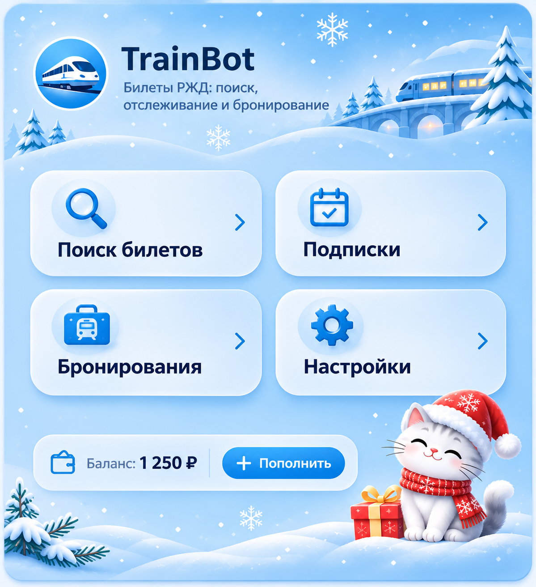

# TrainBot — визуальный стиль Telegram Widgets

**Статус:** утверждённый визуальный ориентир (13 ноября 2026).  
**Область:** главное меню и связанные с ним формы/виджеты TrainBot.  
**Основание:** выбранный пользователем последний, упрощённый макет главной формы — светло-голубой зимний интерфейс с четырьмя крупными кнопками и белым котиком в новогодней шапке.  
**Важно:** это UX/UI-спецификация, **не** утверждение архитектуры или готовности HTML Widget для Telegram.

## Утверждённый графический макет



[Открыть изображение в полном размере](./trainbot-main-menu-winter.png)

Этот PNG — **выбранный пользователем эталон главного меню** (четыре основные карточки, компактный баланс и кнопка пополнения, снежный пейзаж и белый котик в красной новогодней шапке). Он служит визуальным референсом, а не готовым HTML Widget. Изображение хранится рядом с данным документом без изменения исходных пикселей (1199 × 1312).

## 1. Принципы

1. **Минимализм:** показывать только важные действия; не перегружать меню пояснениями, ссылками и техническими данными.
2. **Светло-голубая зимняя гамма:** мягкие голубые градиенты, белые карточки, насыщенные синие акценты и тёмно-синие читаемые заголовки.
3. **Наглядность:** большие скруглённые интерактивные зоны, простые иконки, короткие подписи; декоративные элементы не конкурируют с содержимым.
4. **Уютный зимний характер:** снег, заснеженные ели, небольшой поезд и белый котик **в красной новогодней шапке и шарфе**.
5. **Одинаковый язык оформления:** главное меню, формы даты, станций, поезда и параметров используют согласованные карточки, типографику и кнопки.
6. **Удобство важнее декора:** на узком экране котик и пейзаж могут уменьшаться или скрываться, но не перекрывать управление.

## 2. Главная форма — утверждённая композиция

- Верхняя компактная шапка: иконка поезда, название **TrainBot**, короткий подзаголовок о поиске/отслеживании/бронировании билетов РЖД.
- Под шапкой — **четыре** крупные основные карточки, в две колонки при достаточной ширине:
  - 🔎 **Поиск билетов**
  - 📅 **Подписки**
  - 🧳 **Бронирования**
  - ⚙️ **Настройки**
- Под карточками — лаконичная строка **«Баланс: … ₽»** и отдельная заметная кнопка **«Пополнить»**.
- Фон — мягкая зимняя иллюстрация с небольшим поездом, заснеженными елями и редкими снежинками.
- **Белый котик с красной новогодней шапкой и шарфом** — декоративный персонаж внизу справа; возможен маленький подарок рядом.
- Без отдельной строки с ID пользователя, без длинных описаний под карточками, без кнопок «Сайт», «YouTube», «Документация» и отдельного блока «Информация» на главном экране. Доступ к второстепенным функциям остаётся через соответствующие разделы, но это не решение об удалении функций из бота.
- Содержимое карточек при узкой ширине адаптируется: при необходимости — одна колонка или компактный двухколоночный режим с коротким текстом.

### Схематичная компоновка (не графический макет)

```text
┌──────────────────────────────────┐
│ 🚆 TrainBot                      │
│ Билеты РЖД                       │
│            ❄  🚆  🌲            │
│                                  │
│  ┌────────────┐ ┌────────────┐   │
│  │ 🔎 Поиск   │ │ 📅 Подписки│   │
│  │ билетов    │ │            │   │
│  └────────────┘ └────────────┘   │
│  ┌────────────┐ ┌────────────┐   │
│  │ 🧳 Брони-  │ │ ⚙️ Настройки│   │
│  │ рования    │ │            │   │
│  └────────────┘ └────────────┘   │
│                                  │
│ Баланс: … ₽     [Пополнить]  🐱  │
└──────────────────────────────────┘
```

## 3. Цвета — ориентировочные дизайн-токены

Значения ниже предложены для последующей HTML/CSS-реализации; **это не извлечённые с пиксельной точностью цвета картинки**.

| Назначение | HEX |
|---|---|
| Основной фон (ледяной голубой) | `#EAF6FF` |
| Второй оттенок фона | `#B9DFFF` |
| Карточки | `#F4FAFF` / `#FFFFFF` |
| Основной текст | `#102F61` |
| Вторичный текст | `#476C9B` |
| Акцент и основная кнопка | `#168BE2` |
| Тёмный акцент | `#0969BE` |
| Светлая окантовка | `#C8E3F8` |
| Сезонный акцент (шапка котика) | `#D83B45` |

Градиенты — спокойные; без агрессивного неона и избыточного объёма. Радиусы — крупные, тени — мягкие. Цвета текста/кнопок должны сохранять читаемость при светлой и тёмной теме Telegram (если они поддерживаются соответствующим клиентом).

## 4. Стиль элементов

**Карточки:** большие, светлые, с мягкой голубой границей/тенью; одна крупная иконка, одно короткое название, индикатор перехода только если помогает навигации.  
**Кнопка «Пополнить»:** ярко-синяя, контрастная, но меньше основных пунктов меню по визуальному весу.  
**Шрифт:** простой системный, без декоративных гарнитур; заголовки полужирные; обычный текст хорошо читается с телефона.  
**Зима:** немного снега в свободных областях, поезд и ели преимущественно в верхней части, котик — справа снизу.  
**Унификация:** календарь, выбор станции и поезда должны ощущаться частью TrainBot, но их содержание всегда важнее украшений.

## 5. Движение и сезонность

- Допустимые **визуальные идеи**, если поддерживаются Telegram Widget-клиентом и проходят тесты: редкое медленное падение снежинок, моргание котика, лёгкое движение хвоста, ненавязчивая реакция кнопок.
- Анимация не должна мешать нажатию, вводить пользователя в заблуждение относительно состояния операции или требовать частых серверных запросов.
- Уважать настройку уменьшения движения при технической возможности; предусмотреть статичный вариант.
- Зимний декор — **сезонный слой**, а не обязательная часть бизнес-логики. В дальнейшем его можно сменить, сохранив базовый светло-голубой дизайн.

## 6. Что явно НЕ нужно повторять

Предыдущий, перегруженный вариант главного меню с шестью подробными карточками, ID пользователя и отдельными ссылками на сайт, YouTube и документацию **не выбран**. Не использовать его как UI-эталон.

Не включать в виджет крупные справочные тексты, многоуровневые меню без необходимости, полноэкранную иллюстрацию в ущерб управлению и декоративные элементы поверх интерактивных зон.

## 7. Границы и реализация

- Это **единый визуальный ориентир**, а не указание незамедлительно менять Python-код.
- Для разных действий выбирать подходящую технологию: inline-кнопки для простых пунктов, HTML Widget для интерактивных карточек и выбора параметров, Mini App только при необходимости полноценного ввода/сложных интерфейсов.
- На главной форме переходы к выбору даты, станции и поезда могут инициировать отдельный Widget; конкретный контракт переходов, FSM и обновления данных нужно согласовать **в отдельной архитектурной спецификации**.
- Ограничения Telegram HTML Widgets, безопасность и совместимость проверять по [Telegram Widgets](https://core.telegram.org/bots/widgets), [Telegram Bot API](https://core.telegram.org/bots/api) и [специализированному Skill](../../.agents/skills/telegram-aiogram-widgets/SKILL.md). **Ссылка на Skill в данном относительном пути проверяется от каталога `specs/trainbot-widget/`; при переходе в GitHub используйте корневой путь `.agents/skills/telegram-aiogram-widgets/SKILL.md`.**
- Обязательно предусмотреть fallback на старые inline-меню, если конкретный клиент не поддерживает Widgets. Не считать визуальный макет доказательством технической реализуемости эффектов.
- Production-исходники и существующие FSM/сервисы в рамках утверждения стиля **не изменяются**.

## 8. Критерии для следующих макетов

- [ ] Узнаваемый светло-голубой визуальный язык TrainBot.
- [ ] На главной форме ровно четыре основных раздела и компактная область баланса.
- [ ] Котик в новогодней шапке присутствует как декоративный, не мешающий элемент.
- [ ] Снежный фон аккуратен, текст и кнопки остаются контрастными.
- [ ] На узких экранах форма читается без горизонтальной прокрутки.
- [ ] Элементы выбора даты, станции и поезда визуально согласованы с главной формой.
- [ ] Анимации и платформенные ограничения тестируются отдельно до внедрения.
